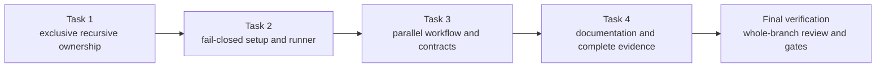

# Parallel Repository Validation Implementation Plan

| Field | Value |
|---|---|
| **Version** | 1.0 |
| **Date** | 2026-10-22 |
| **Author** | docs-agent (Voice of Knowledge) |
| **Status** | Draft |
| **Scope** | Repository CI validation helpers, ownership, workflow topology, contracts, documentation, and pull-request evidence |
| **References** | [Approved Parallel Repository Validation Design](../specs/2026-10-22-parallel-repository-validation-design.md), [Implementation Plan Catalogue](README.md), [Workflow Guide](../../.github/workflows/README.md), [Documentation Policy](../README.md) |

> **For agentic workers:** REQUIRED SUB-SKILL: Use superpowers:executing-plans to implement this plan task-by-task. Steps use checkbox (`- [ ]`) syntax for tracking. Do not dispatch subagents unless the user separately authorizes them.

**Goal:** Replace the current sequential repository-validation monolith with four fail-closed, exclusively owned domain jobs and one pure stable result gate without changing deployment, provider, tenant, application, or runbook behavior.

**Architecture:** Three focused PowerShell helpers own recursive test selection, bounded dependency setup, and fail-closed Pester execution. Four explicit `windows-2025` jobs consume those helpers in parallel, upload raw domain NUnit evidence, and feed one stable `validate` aggregator that evaluates only dependency results.

**Tech Stack:** Windows PowerShell 5.1 (authoritative workflow host), installed PowerShell 7 compatibility where a helper is shared, Pester 5.7.1, Python and `jsonschema[format]==4.26.0`, GitHub Actions, NUnit XML, Git, Pester contracts, and local Bicep compilation.

**Spec:** [`docs/specs/2026-10-22-parallel-repository-validation-design.md`](../specs/2026-10-22-parallel-repository-validation-design.md)

## Authority and Current Branch State

The governing specification is Approved. This plan is Draft and does not prove implementation, workflow execution, a live required-check context, branch-protection configuration, provider behavior, merge readiness, or runtime state.

At plan creation:

- `.github/workflows/validate-repository.yml` has one 60-minute `validate` monolith, an isolated lifecycle dispatch smoke invocation, and a later complete maintained Pester invocation that repeats that smoke case.
- `.github/cli/tests/DocumentationNavigation.Tests.ps1` has a reviewed exact changed-line guard for that timeout and smoke amendment. Task 3 replaces only that brittle line guard with the approved structural workflow-file boundary.
- PR [#34](https://github.com/urruegg/caldova-hr-frontier/pull/34) has successful monolithic run `39753309395` at remote head `94bbaf2`: total job `39m18s`, Pester step `35m23s`, and setup approximately `2m36s`.
- That run is a pre-refactor comparison baseline only. It is not evidence for the proposed topology or a speed target.
- Local design commits, including the Approved specification and this plan, have not been pushed to PR #34.

Do not overwrite remote evidence, infer a required branch-protection context, or claim a duration improvement. The first new green run is recorded as implementation evidence; a measured target requires three non-cancelled green runs.

## Global Constraints

- Keep one workflow named exactly `Validate repository`; add no workflow, path filter, matrix, cache, shard, test publisher, deployment stage, or provider operation.
- Keep exact job IDs, display names, and timeouts: `repository` / `Repository/documentation validation` / 30; `infrastructure` / `Infrastructure validation` / 30; `hr` / `HR solution validation` / 30; `lifecycle` / `Lifecycle/runbook validation` / 45; `validate` / `Repository setup validation` / 15.
- Keep global permissions exactly `contents: read`. Add no secret, environment, `checks: write`, `id-token: write`, deployment, Azure authentication, or tenant authority.
- Every job uses `windows-2025`. Every `run:` step declares `shell: powershell`, preserving Windows PowerShell 5.1.
- Every domain checks out with `actions/checkout@3d3c42e5aac5ba805825da76410c181273ba90b1` and `fetch-depth: 0`.
- Add `actions/upload-artifact` to `infra/src/config/github/action-pins.json` before workflow use with `sourceRef` `v4.6.2` and SHA `ea165f8d65b6e75b540449e92b4886f43607fa02`.
- The reviewed GitHub API result for that external pin is: tag `v4.6.2` resolves to the verified commit `ea165f8d65b6e75b540449e92b4886f43607fa02`, dated 2025-03-19.
- Use Pester exactly `5.7.1`; use `jsonschema[format]==4.26.0` independently from `hr/tests/requirements.txt` for HR and `infra/tests/requirements.txt` for Lifecycle.
- Retry dependency acquisition only, at most three total attempts. Never retry verification, test discovery, tests, safety, Bicep, whitespace, artifact publication, or aggregation.
- Test ownership is recursive, nonempty, ordinal, exact-case, duplicate-free, pairwise disjoint, and complete. Lifecycle owns exactly five allowlisted files.
- Execute tagged lifecycle smoke cases first and the excluded remainder second. Both partitions are nonempty, disjoint, and together equal all discovered lifecycle cases.
- The final `validate` job is a pure dependency-result gate. It performs no checkout, setup, validation, artifact, safety, Bicep, whitespace, provider, or deployment work.
- Preserve all current lifecycle and runbook behavior. Tag existing tests only; do not change their assertions or implementation behavior.
- Perform no live/provider operation, Azure login, WhatIf, deployment, tenant mutation, application mutation, or runbook invocation against a live environment.
- Do not merge without explicit user approval. Do not unblock lifecycle Plans 2-6 until this implementation is merged and then-current `main` is green.
- Every implementation task follows RED/GREEN, receives an independent diff-and-evidence review, and commits only its accepted scope with the exact message and Copilot trailer stated below.

## File Responsibility Map

| File | Change | Single responsibility |
|---|---|---|
| `.github/cli/Get-MaintainedTestGroups.ps1` | Create | Validate complete recursive maintained-test ownership and return one group as normalized ordinal paths. |
| `.github/cli/tests/MaintainedTestGroups.Tests.ps1` | Create | Prove selection, canonical case, nesting, exclusivity, completeness, and culture independence. |
| `infra/tests/requirements.txt` | Create | Pin Lifecycle's independent JSON Schema dependency. |
| `.github/cli/Install-CiTestDependencies.ps1` | Create | Acquire exact domain dependencies with bounded retry and one fail-closed verification pass. |
| `.github/cli/Invoke-MaintainedTestGroup.ps1` | Create | Build exact Pester configuration, emit NUnit XML, log diagnostics, and fail closed on every result dimension. |
| `.github/cli/tests/CiTestExecution.Tests.ps1` | Create | Prove setup retry boundaries and runner configuration/result behavior deterministically. |
| `.github/workflows/validate-repository.yml` | Modify | Define the four domain jobs and pure stable aggregator. |
| `.github/cli/tests/WorkflowContract.Tests.ps1` | Modify | Semantically enforce the complete approved workflow topology and exclusions. |
| `.github/cli/tests/DocumentationNavigation.Tests.ps1` | Modify | Retain only the structural workflow inventory and changed-file boundary. |
| `.github/cli/tests/RepositorySafety.Tests.ps1` | Modify | Exercise both exact external action pins and all unknown/mutable/mismatch/unused failures. |
| `infra/src/config/github/action-pins.json` | Modify | Record the exact reviewed upload-artifact source tag and commit. |
| `infra/tests/pester/TenantLifecycleOrchestration.Tests.ps1` | Modify | Tag the three existing high-risk compatibility cases without changing behavior. |
| `.github/workflows/README.md` | Modify | Document the delivered topology, ownership, dependencies, artifacts, cancellation, authority, and stable check. |

## Dependency Flow



Task 2 consumes Task 1's selected path arrays. Task 3 consumes both helper boundaries and cannot start until their reviews pass. Task 4 documents and validates the delivered Task 3 topology. Final verification creates no implementation and no empty commit.

---

### Task 1: Recursive Exclusive Ownership and Lifecycle Python Requirement

**Files:**
- Create: `.github/cli/Get-MaintainedTestGroups.ps1`
- Create: `.github/cli/tests/MaintainedTestGroups.Tests.ps1`
- Create: `infra/tests/requirements.txt`

**Interfaces:**
- Public selector:

```powershell
Get-MaintainedTestGroups.ps1 `
    -Group Repository|Infrastructure|Hr|Lifecycle `
    [-RepositoryRoot [string]]
```

- The selector emits only `[string]` values. Every value is repository-relative, uses `/`, and is sorted by `StringComparer.Ordinal`.
- `RepositoryRoot` defaults to the repository root resolved from `$PSScriptRoot`; a supplied value must be absolute.
- The only hidden test seam is:

```powershell
[Parameter(DontShow)]
[scriptblock]$TrackedPathProvider
```

The selector invokes it with exactly one positional argument:

```powershell
& $TrackedPathProvider ([string]$resolvedRepositoryRoot)
```

It returns `[string[]]`: every canonical Git-tracked repository-relative `*.Tests.ps1` path, with Git's exact spelling and `/` separators. The production provider resolves one scalar `git.exe`, runs `git -C $resolvedRepositoryRoot -c core.quotepath=false ls-files`, checks the exit code, filters returned tracked leaves whose suffix equals `.Tests.ps1` under `StringComparison.OrdinalIgnoreCase`, and emits no diagnostics to the success stream. The selector then requires the canonical suffix and complete path spelling to match ordinally.

- Synthetic tests do not initialize or stage a Git repository. They create real nested files under `$TestDrive` and inject this filesystem-preserving provider:

```powershell
$trackedPathProvider = {
    param([string]$ProviderRoot)

    @(
        Get-ChildItem -LiteralPath $ProviderRoot -Filter '*.Tests.ps1' -File -Recurse |
            ForEach-Object {
                $_.FullName.Substring($ProviderRoot.TrimEnd('\').Length + 1).
                    Replace('\', '/')
            }
    )
}.GetNewClosure()
```

Case-drift and duplicate-provider tests inject deliberately changed canonical rows. This makes the contracts deterministic without Git index, untracked-file, `core.ignorecase`, or staging ambiguity.

**Ownership constants:**

```powershell
$maintainedRoots = [ordered]@{
    Repository = '.github/cli/tests'
    Infrastructure = 'infra/tests/pester'
    Hr = 'hr/tests/pester'
}
$lifecycleAllowlist = [string[]]@(
    'infra/tests/pester/TenantLifecycleContracts.Tests.ps1'
    'infra/tests/pester/TenantLifecycleOrchestration.Tests.ps1'
    'infra/tests/pester/RunbookContracts.Tests.ps1'
    'infra/tests/pester/RunbookStaticSafety.Tests.ps1'
    'infra/tests/pester/RunbookDocumentation.Tests.ps1'
)
```

Infrastructure owns every recursive infrastructure test leaf not in the exact lifecycle allowlist. Lifecycle equals the allowlist. Repository and HR own every recursive leaf below their roots.

- [ ] **Step 1: Write the selector and requirement RED contracts**

Create `MaintainedTestGroups.Tests.ps1` with exact `Describe`/`It` cases:

```text
Describe: Maintained recursive test ownership
It: discovers nested Repository Infrastructure and Hr test leaves
It: returns the exact five-file Lifecycle allowlist
It: returns every group nonempty as normalized ordinal strings
It: rejects a missing lifecycle allowlist leaf
It: rejects a directory at an allowlisted lifecycle path
It: rejects canonical case drift from the tracked-path provider
It: rejects duplicate canonical tracked rows
It: rejects an untracked maintained-root test leaf
It: rejects a tracked test outside the three maintained roots
It: keeps every pair of groups disjoint and their union complete
It: returns the same exact order under en-US and tr-TR
It: keeps infra/tests/requirements.txt at one exact UTF-8 line
```

For each synthetic case, create all five lifecycle files so a test fails only for its intended reason. Use case-sensitive `-CContains`, `StringComparer.Ordinal`, and exact array comparison. The requirements assertion is:

```powershell
$requirementsBytes = [IO.File]::ReadAllBytes($requirementsPath)
$requirementsBytes[0] | Should -Not -Be 0xEF
[Text.UTF8Encoding]::new($false, $true).GetString($requirementsBytes).
    Replace("`r`n", "`n") |
    Should -BeExactly "jsonschema[format]==4.26.0`n"
```

- [ ] **Step 2: Run RED**

Run:

```powershell
powershell.exe -NoProfile -Command "Import-Module Pester -RequiredVersion 5.7.1 -Force; Invoke-Pester -Path '.github/cli/tests/MaintainedTestGroups.Tests.ps1' -Output Detailed"
```

Expected RED: the selector and infrastructure requirements file do not exist. A Pester parse, fixture-construction, or zero-discovery error is not acceptable RED.

- [ ] **Step 3: Implement fail-closed ownership validation**

Use the following implementation sequence before selecting `-Group`:

1. Resolve and validate the absolute root.
2. Recursively enumerate real leaf files below the three exact roots.
3. Normalize each full path by subtracting the exact root prefix and replacing `\` with `/`.
4. Invoke the canonical tracked-path provider once.
5. Reject provider duplicates with an ordinal generic string set.
6. Reject every discovered maintained leaf with no exact canonical provider match; if an ordinal-ignore-case match exists, report case drift without returning paths.
7. Reject every tracked `*.Tests.ps1` path outside the three roots.
8. Build all four groups, validate every path is a real leaf, and prove all groups nonempty.
9. Prove each group has no ordinal duplicate, every pair is disjoint, Lifecycle equals the exact allowlist, and the four-group union equals the recursive maintained inventory.
10. Copy the selected strings to a string array, apply the ordinal array-sort overload shown in the code block below, and emit that array only.

The critical public boundary begins:

```powershell
[CmdletBinding()]
param(
    [Parameter(Mandatory)]
    [ValidateSet('Repository', 'Infrastructure', 'Hr', 'Lifecycle')]
    [string]$Group,

    [ValidateScript({ [IO.Path]::IsPathRooted($_) })]
    [string]$RepositoryRoot = [IO.Path]::GetFullPath((
        Join-Path $PSScriptRoot '..\..'
    )),

    [Parameter(DontShow)]
    [scriptblock]$TrackedPathProvider
)

$ErrorActionPreference = 'Stop'
Set-StrictMode -Version Latest
```

Use exception messages with stable prefixes `MaintainedTests.Root`, `MaintainedTests.TrackedInventory`, `MaintainedTests.Case`, `MaintainedTests.Leaf`, `MaintainedTests.Empty`, `MaintainedTests.Duplicate`, `MaintainedTests.Overlap`, `MaintainedTests.Unowned`, and `MaintainedTests.Lifecycle`. Do not write progress, objects, counts, or warnings to the success stream.

Create `infra/tests/requirements.txt` as UTF-8 without BOM with exactly:

```text
jsonschema[format]==4.26.0
```

- [ ] **Step 4: Run GREEN and culture contracts**

Run:

```powershell
powershell.exe -NoProfile -Command "Import-Module Pester -RequiredVersion 5.7.1 -Force; Invoke-Pester -Path '.github/cli/tests/MaintainedTestGroups.Tests.ps1' -Output Detailed -PassThru"
```

Expected GREEN: all named ownership, failure, exact-line, `en-US`, and `tr-TR` cases pass.

- [ ] **Step 5: Prove the real repository inventory**

Stage the three reviewed Task 1 files so the production Git-backed canonical provider sees the new test candidate without relying on an untracked worktree inference, then run:

```powershell
git add .github/cli/Get-MaintainedTestGroups.ps1
git add .github/cli/tests/MaintainedTestGroups.Tests.ps1
git add infra/tests/requirements.txt

$selector = '.github/cli/Get-MaintainedTestGroups.ps1'
$groups = [ordered]@{}
foreach ($group in @('Repository', 'Infrastructure', 'Hr', 'Lifecycle')) {
    $groups[$group] = @(& $selector -Group $group)
    if ($groups[$group].Count -eq 0) {
        throw "$group selector returned no paths."
    }
}
$allSelected = @($groups.Values | ForEach-Object { $_ })
$duplicates = @(
    $allSelected |
        Group-Object -CaseSensitive |
        Where-Object Count -gt 1
)
if ($duplicates.Count -ne 0) {
    throw "Duplicate ownership: $($duplicates.Name -join ', ')"
}
$inventory = @(
    Get-ChildItem '.github/cli/tests','infra/tests/pester','hr/tests/pester' `
        -Filter '*.Tests.ps1' -File -Recurse |
        ForEach-Object {
            $_.FullName.Substring($PWD.Path.TrimEnd('\').Length + 1).
                Replace('\', '/')
        }
)
[Array]::Sort($inventory, [StringComparer]::Ordinal)
$union = [string[]]@($allSelected)
[Array]::Sort($union, [StringComparer]::Ordinal)
if (($union -join "`n") -cne ($inventory -join "`n")) {
    throw 'Maintained selector union does not equal the recursive inventory.'
}
$expectedLifecycle = @(
    'infra/tests/pester/RunbookContracts.Tests.ps1'
    'infra/tests/pester/RunbookDocumentation.Tests.ps1'
    'infra/tests/pester/RunbookStaticSafety.Tests.ps1'
    'infra/tests/pester/TenantLifecycleContracts.Tests.ps1'
    'infra/tests/pester/TenantLifecycleOrchestration.Tests.ps1'
)
if (($groups.Lifecycle -join "`n") -cne ($expectedLifecycle -join "`n")) {
    throw 'Lifecycle selector differs from the exact ordinal allowlist.'
}
```

Expected: four nonempty groups, no duplicate owner, complete recursive union, and exact ordinal Lifecycle output.

- [ ] **Step 6: Review and commit Task 1**

Review only the three Task 1 files. Confirm synthetic tests use the injected canonical provider, production uses Git spelling, output contains only strings, nested leaves are owned, lifecycle is exact, and culture does not affect order.

```powershell
git diff --check
git diff --cached --check
git commit -m "feat(ci): define maintained test ownership" -m "Co-authored-by: Copilot <223556219+Copilot@users.noreply.github.com>"
```

**Independent review gate:** A reviewer accepts the Task 1 diff, named RED reason, GREEN output, real inventory counts, exact lifecycle list, and zero-overlap proof before Task 2 starts.

---

### Task 2: Fail-Closed Setup and Pester Runner Helpers

**Files:**
- Create: `.github/cli/Install-CiTestDependencies.ps1`
- Create: `.github/cli/Invoke-MaintainedTestGroup.ps1`
- Create: `.github/cli/tests/CiTestExecution.Tests.ps1`

**Interfaces:**

Public installer:

```powershell
Install-CiTestDependencies.ps1 `
    -Group Repository|Infrastructure|Hr|Lifecycle `
    [-MaxAttempts 3]
```

`MaxAttempts` has `[ValidateRange(1,3)]` and defaults to `3`. Pester `5.7.1` is acquired and verified for every group. HR alone acquires `hr/tests/requirements.txt`; Lifecycle alone acquires `infra/tests/requirements.txt`; Repository and Infrastructure do not invoke Python.

Hidden deterministic seams and their exact signatures are:

```powershell
# Throws on acquisition failure; emits no success output.
param([string]$Name, [string]$RequiredVersion, [int]$Attempt)
$ModuleInstaller

# Returns exactly one [version] after Import-Module -RequiredVersion.
param([string]$Name, [string]$RequiredVersion)
$ModuleVerifier

# Returns [pscustomobject]@{ ExitCode = [int]; Detail = [string] }.
param([string[]]$Arguments, [ValidateSet('Acquire','Verify')][string]$Phase, [int]$Attempt)
$PythonRunner

# Receives the retry delay and returns no output.
param([timespan]$Delay)
$Sleeper

# Returns one UTC [datetime].
param()
$Clock
```

All five parameters use `[Parameter(DontShow)]`. Production retry delays are 2 seconds after attempt 1 and 4 seconds after attempt 2. Diagnostic detail is trimmed to 512 characters and has CR/LF collapsed; it never includes environment variables or command-line secrets. Verification runs exactly once after acquisition and is never inside the retry loop.

Public runner:

```powershell
Invoke-MaintainedTestGroup.ps1 `
    -Path [string[]] `
    -OutputPath [string] `
    [-Tag CICompatibilitySmoke] `
    [-ExcludeTag CICompatibilitySmoke]
```

`Tag` and `ExcludeTag` are mutually exclusive parameter sets. `Path` is nonempty. Every selected path resolves beneath the repository and exists as a leaf test file. `OutputPath` is absolute, remains beneath the repository, and ends in `.xml`.

Hidden runner seams are:

```powershell
# Receives the completed PesterConfiguration and returns a Pester result object.
param([PesterConfiguration]$Configuration)
$PesterInvoker

# Returns all matching application Source strings in command-resolution order.
param([ValidateSet('git.exe','pwsh.exe')][string]$Name)
$ApplicationResolver

# Returns one UTC [datetime].
param()
$Clock
```

The runner returns one closed summary only:

```powershell
[pscustomobject][ordered]@{
    TotalCount = [int]$result.TotalCount
    FailedCount = [int]$result.FailedCount
    FailedContainersCount = [int]$result.FailedContainersCount
    Result = [string]$result.Result
    OutputPath = [string]$resolvedOutputPath
    StartedAtUtc = $startedAtUtc.ToString('o')
    FinishedAtUtc = $finishedAtUtc.ToString('o')
}
```

It returns no Pester test objects, provider output, environment values, credentials, or native command output.

- [ ] **Step 1: Write installer RED contracts**

Create `CiTestExecution.Tests.ps1` and use injected scriptblocks and call lists; never install a module or Python package from these unit tests. Add exact cases:

```text
Describe: CI dependency installation
It: acquires and verifies exact Pester 5.7.1 for every group
It: installs only hr/tests/requirements.txt and verifies jsonschema for Hr
It: installs only infra/tests/requirements.txt and verifies jsonschema for Lifecycle
It: invokes no Python operation for Repository or Infrastructure
It: retries module acquisition twice and succeeds on attempt three
It: fails after the third module acquisition failure
It: retries pip acquisition twice and succeeds on attempt three
It: fails after the third pip acquisition failure
It: never retries a wrong loaded Pester version
It: never retries a failed required Python import
It: verifies Pester once and Python imports once
It: uses retry delays of two and four seconds only
```

Assert call sequences exactly: HR uses `python -m pip install --disable-pip-version-check --requirement hr/tests/requirements.txt`; Lifecycle uses `python -m pip install --disable-pip-version-check --requirement infra/tests/requirements.txt`; both use `python -c "import jsonschema"` verification. Assert that no injected test runner exists or is called by the installer.

- [ ] **Step 2: Write runner RED contracts**

Add exact cases:

```text
Describe: Fail-closed maintained Pester execution
It: builds exact Throw non-exiting PassThru Detailed NUnit configuration
It: applies only the CICompatibilitySmoke include tag
It: applies only the CICompatibilitySmoke exclude tag
It: rejects simultaneous include and exclude tags
It: creates the repository-contained NUnit parent directory
It: rejects a relative output path and a path outside the repository
It: fails when TotalCount is zero
It: fails when FailedCount is positive
It: fails when FailedContainersCount is positive
It: fails when final Result is not Passed
It: fails when a successful invocation does not create the requested NUnit file
It: invokes Pester exactly once for a test failure
It: logs selected paths host Pester applications start and finish
It: chooses one deterministic native application scalar
It: returns only the seven closed summary fields
It: runs under Windows PowerShell 5.1 and installed PowerShell 7
```

The injected result factory must vary only `TotalCount`, `FailedCount`, `FailedContainersCount`, and `Result`. Capture information output separately from the success stream. The compatibility test parses both scripts under `powershell.exe` and `pwsh.exe`, then runs a no-network injected success probe on each host.

- [ ] **Step 3: Run RED**

Run:

```powershell
powershell.exe -NoProfile -Command "Import-Module Pester -RequiredVersion 5.7.1 -Force; Invoke-Pester -Path '.github/cli/tests/CiTestExecution.Tests.ps1' -Output Detailed"
```

Expected RED: both helper scripts are absent. Wrong injected call counts, a parser failure, or zero discovered test cases is not acceptable RED.

- [ ] **Step 4: Implement bounded acquisition and one-time verification**

Use one acquisition helper with exact loop semantics:

```powershell
for ($attempt = 1; $attempt -le $MaxAttempts; $attempt++) {
    $attemptStarted = & $Clock
    $attemptDetail = 'success'
    try {
        & $Acquire $attempt
        $acquired = $true
        break
    }
    catch {
        $detail = ($_.Exception.Message -replace '[\r\n]+', ' ')
        if ($detail.Length -gt 512) { $detail = $detail.Substring(0, 512) }
        $attemptDetail = $detail
        if ($attempt -eq $MaxAttempts) { throw }
        & $Sleeper ([timespan]::FromSeconds([math]::Pow(2, $attempt)))
    }
    finally {
        $attemptFinished = & $Clock
        Write-Host (
            'CI dependency acquisition attempt {0}/{1}; start={2:o}; finish={3:o}; elapsedMs={4}; detail={5}' -f
            $attempt, $MaxAttempts, $attemptStarted, $attemptFinished,
            [math]::Max(0, ($attemptFinished - $attemptStarted).TotalMilliseconds),
            $attemptDetail
        )
    }
}
```

After Pester acquisition, call `ModuleVerifier` once and require `[version]'5.7.1'`. For HR or Lifecycle, acquire its one requirements file, then call `PythonRunner` once with phase `Verify`, attempt `1`, and arguments `@('-c', 'import jsonschema')`. A nonzero exit code is final. Do not catch verification to retry it.

- [ ] **Step 5: Implement exact Pester configuration and result guards**

The critical runner configuration is:

```powershell
$configuration = New-PesterConfiguration
$configuration.Run.Path = [string[]]$resolvedPaths
$configuration.Run.Throw = $true
$configuration.Run.Exit = $false
$configuration.Run.PassThru = $true
$configuration.Output.Verbosity = 'Detailed'
$configuration.TestResult.Enabled = $true
$configuration.TestResult.OutputFormat = 'NUnitXml'
$configuration.TestResult.OutputPath = $resolvedOutputPath
if ($PSCmdlet.ParameterSetName -ceq 'IncludeTag') {
    $configuration.Filter.Tag = [string[]]@($Tag)
}
elseif ($PSCmdlet.ParameterSetName -ceq 'ExcludeTag') {
    $configuration.Filter.ExcludeTag = [string[]]@($ExcludeTag)
}
```

Import Pester with `Import-Module Pester -RequiredVersion 5.7.1 -Force` before `New-PesterConfiguration`, and verify the selected loaded module version exactly. Resolve all `git.exe` and `pwsh.exe` applications, log the arrays and the first scalar from each, and never pass an array where a scalar executable is required.

Invoke exactly once:

```powershell
try {
    $result = & $PesterInvoker $configuration
    if ([int]$result.TotalCount -eq 0) {
        throw 'CiPester.ZeroTests'
    }
    if ([int]$result.FailedCount -gt 0) {
        throw 'CiPester.FailedTests'
    }
    if ([int]$result.FailedContainersCount -gt 0) {
        throw 'CiPester.FailedContainers'
    }
    if ([string]$result.Result -cne 'Passed') {
        throw 'CiPester.ResultNotPassed'
    }
}
finally {
    $finishedAtUtc = & $Clock
    Write-Host ("CI Pester finish={0:o}" -f $finishedAtUtc)
}
```

Create the result parent before invocation. After a successful invocation, require the requested XML leaf to exist; otherwise throw `CiPester.ResultFileMissing`.

- [ ] **Step 6: Run GREEN and focused dual-host compatibility**

Run:

```powershell
$testPath = '.github/cli/tests/CiTestExecution.Tests.ps1'
powershell.exe -NoProfile -Command "Import-Module Pester -RequiredVersion 5.7.1 -Force; Invoke-Pester -Path '$testPath' -Output Detailed"
if ($LASTEXITCODE -ne 0) { throw 'Windows PowerShell helper contracts failed.' }
pwsh.exe -NoProfile -Command "Import-Module Pester -RequiredVersion 5.7.1 -Force; Invoke-Pester -Path '$testPath' -FullNameFilter '*runs under Windows PowerShell 5.1 and installed PowerShell 7*' -Output Detailed"
if ($LASTEXITCODE -ne 0) { throw 'PowerShell 7 helper compatibility failed.' }
```

Expected GREEN: retries occur only around acquisition, exact versions/imports are verified once, result dimensions fail independently, tag configuration is exact, output containment is enforced, and Pester is never retried.

- [ ] **Step 7: Integrate with Task 1 selectors without running the long suites**

Stage the three reviewed Task 2 files so the real Git-backed Repository selector includes the new contract file, then run a leaf-only probe for each group:

```powershell
git add .github/cli/Install-CiTestDependencies.ps1
git add .github/cli/Invoke-MaintainedTestGroup.ps1
git add .github/cli/tests/CiTestExecution.Tests.ps1

foreach ($group in @('Repository', 'Infrastructure', 'Hr', 'Lifecycle')) {
    $paths = @(& .github/cli/Get-MaintainedTestGroups.ps1 -Group $group)
    if ($paths.Count -eq 0) { throw "$group has no selected paths." }
    foreach ($path in $paths) {
        if (-not (Test-Path -LiteralPath $path -PathType Leaf)) {
            throw "$group selected a non-leaf path: $path"
        }
    }
}
```

Expected: each group supplies existing leaves acceptable to the runner boundary.

- [ ] **Step 8: Review and commit Task 2**

Review no-network test determinism, exact call signatures, retry scope, one-time verification, output containment, final-result guards, log boundaries, closed return type, and dual-host syntax.

```powershell
git diff --check
git diff --cached --check
git commit -m "feat(ci): add fail-closed test execution helpers" -m "Co-authored-by: Copilot <223556219+Copilot@users.noreply.github.com>"
```

**Independent review gate:** A reviewer accepts Task 2's RED/GREEN output and proves from injected call logs that only acquisition retries, tests invoke once, and every failed result dimension closes the runner before Task 3 starts.

---

### Task 3: Parallel Workflow Topology, Smoke Tagging, Artifacts, and Contracts

**Files:**
- Modify: `.github/workflows/validate-repository.yml`
- Modify: `.github/cli/tests/WorkflowContract.Tests.ps1`
- Modify: `.github/cli/tests/DocumentationNavigation.Tests.ps1`
- Modify: `.github/cli/tests/RepositorySafety.Tests.ps1`
- Modify: `infra/src/config/github/action-pins.json`
- Modify: `infra/tests/pester/TenantLifecycleOrchestration.Tests.ps1`

**Interfaces:**
- Consumes Task 1 selector and Task 2 setup/runner interfaces without reimplementing ownership, retries, or result checks.
- Produces exactly five jobs and four domain-owned raw result directories.
- Adds no source, application, infrastructure, lifecycle, or runbook behavior.

**Exact smoke tags:**

Add `-Tag 'CICompatibilitySmoke'` to these existing `It` blocks in `TenantLifecycleOrchestration.Tests.ps1`, without changing body text or assertions:

1. `uses the first deterministic Git application when PATH exposes aliases`
2. `passes exact named arguments and a fresh nine-field control record`
3. `transports the control envelope independently of console input encoding`

All three tests are in the exact lifecycle allowlist already. Do not tag a file, `Describe`, or `Context`, because that could pull unrelated cases into smoke.

- [ ] **Step 1: Replace old workflow expectations with RED semantic contracts**

Rewrite `WorkflowContract.Tests.ps1` around exact semantic sections rather than an exact full-file line diff:

```text
Describe: Parallel repository validation workflow
It: keeps one Validate repository workflow with global contents read
It: defines exactly repository infrastructure hr lifecycle and validate jobs
It: uses exact display names windows-2025 runners and 30 30 30 45 15 timeouts
It: declares powershell on every run step
It: uses pinned checkout and fetch-depth zero on every domain only
It: uses the selector installer and runner for every owning domain
It: keeps Repository safety and merge-base whitespace in repository
It: keeps recursive local Bicep compilation in infrastructure
It: keeps Hr and Lifecycle Python requirements independent
It: partitions lifecycle smoke and remainder without duplicate cases
It: uploads four unique always-run raw NUnit artifacts for fourteen days
It: uses the exact reviewed upload-artifact SHA
It: keeps validate a pure result gate over all four dependencies
It: fails validate for failure cancelled or skipped dependencies
It: uses exact PR-number-or-ref concurrency with cancellation
It: excludes path filters caches publishers provider operations and deployment authority
```

Parse job boundaries, step arrays, `uses`, `with`, `needs`, `if`, and `run` blocks into small test-owned objects. Do not assert only one regex over the whole file. If `ConvertFrom-Yaml` is available locally, parse once and assert the top-level object also contains exactly the expected job keys; absence of that optional command is recorded with `Write-Verbose` because no YAML parser dependency is approved.

In `DocumentationNavigation.Tests.ps1`, replace `keeps workflow changes limited to the reviewed validation budget and smoke gate` with:

```text
It: keeps workflow changes limited to the reviewed validation workflow
```

Retain the exact workflow inventory `README.md`, `validate-repository.yml`; retain merge-base changed-file inspection; permit only no workflow change or `validate-repository.yml`; delete the exact changed-line array and no other documentation-navigation behavior.

- [ ] **Step 2: Add RED pin, artifact, and smoke-partition contracts**

Update `RepositorySafety.Tests.ps1` fixtures to model two reviewed actions. Add exact manifest assertions for:

```json
"actions/upload-artifact": {
  "sourceRef": "v4.6.2",
  "sha": "ea165f8d65b6e75b540449e92b4886f43607fa02"
}
```

Keep explicit failures for unknown, mutable, mismatched, and unused entries. The default valid fixture uses both exact actions. The `accepts exact external pins and ignores repository-local actions` case includes both exact action uses.

Add a Pester discovery helper in `WorkflowContract.Tests.ps1`:

```powershell
function Get-DiscoveredLifecycleCaseId {
    param(
        [Parameter(Mandatory)][string[]]$Path,
        [ValidateSet('All','Include','Exclude')][string]$Mode
    )

    $configuration = New-PesterConfiguration
    $configuration.Run.Path = $Path
    $configuration.Run.SkipRun = $true
    $configuration.Run.PassThru = $true
    $configuration.Output.Verbosity = 'None'
    if ($Mode -ceq 'Include') {
        $configuration.Filter.Tag = @('CICompatibilitySmoke')
    }
    elseif ($Mode -ceq 'Exclude') {
        $configuration.Filter.ExcludeTag = @('CICompatibilitySmoke')
    }
    $result = Invoke-Pester -Configuration $configuration
    @(
        $result.Tests |
            ForEach-Object {
                '{0}::{1}' -f $_.Path, $_.ExpandedName
            } |
            Sort-Object -Unique
    )
}
```

Assert all, smoke, and remainder are nonempty; `smoke ∩ remainder` is empty; and ordinal-sorted `smoke ∪ remainder` equals all discovered lifecycle cases.

- [ ] **Step 3: Run RED**

Run:

```powershell
powershell.exe -NoProfile -Command "Import-Module Pester -RequiredVersion 5.7.1 -Force; Invoke-Pester -Path @('.github/cli/tests/WorkflowContract.Tests.ps1','.github/cli/tests/DocumentationNavigation.Tests.ps1','.github/cli/tests/RepositorySafety.Tests.ps1') -Output Detailed"
```

Expected RED: the workflow has one monolithic job, no concurrency or artifacts, the action manifest lacks upload-artifact, old smoke is untagged and duplicated by the full suite, and the exact-diff navigation guard rejects the approved topology.

- [ ] **Step 4: Add the reviewed action pin before workflow use**

Update `action-pins.json` first:

```json
{
  "schemaVersion": "1.0",
  "actions": {
    "actions/checkout": {
      "sourceRef": "v7.0.1",
      "sha": "3d3c42e5aac5ba805825da76410c181273ba90b1"
    },
    "actions/upload-artifact": {
      "sourceRef": "v4.6.2",
      "sha": "ea165f8d65b6e75b540449e92b4886f43607fa02"
    }
  }
}
```

Run the focused safety contract before editing the workflow:

```powershell
powershell.exe -NoProfile -Command "Import-Module Pester -RequiredVersion 5.7.1 -Force; Invoke-Pester -Path '.github/cli/tests/RepositorySafety.Tests.ps1' -FullNameFilter '*unused manifest entry*' -Output Detailed"
```

Expected RED: `actions/upload-artifact` is rejected as unused. This proves the repository refuses a reviewed manifest entry until the workflow consumes it.

- [ ] **Step 5: Implement the exact workflow topology**

Replace the monolith with this topology. Keep commands equivalent to the complete snippet; line wrapping may change, semantics may not:

```yaml
name: Validate repository

on:
  pull_request:
  push:
    branches: [main]
  workflow_dispatch:

permissions:
  contents: read

concurrency:
  group: ${{ github.workflow }}-${{ github.event.pull_request.number || github.ref }}
  cancel-in-progress: true

jobs:
  repository:
    name: Repository/documentation validation
    runs-on: windows-2025
    timeout-minutes: 30
    steps:
      - name: Check out repository
        uses: actions/checkout@3d3c42e5aac5ba805825da76410c181273ba90b1
        with:
          fetch-depth: 0
      - name: Run repository tests
        shell: powershell
        run: |
          $ErrorActionPreference = 'Stop'
          & .github/cli/Install-CiTestDependencies.ps1 -Group Repository -MaxAttempts 3
          $paths = @(& .github/cli/Get-MaintainedTestGroups.ps1 -Group Repository)
          & .github/cli/Invoke-MaintainedTestGroup.ps1 `
            -Path $paths `
            -OutputPath ([IO.Path]::GetFullPath('test-results/repository/pester.xml'))
      - name: Run repository safety validation
        shell: powershell
        run: |
          powershell.exe -NoProfile -ExecutionPolicy Bypass -File .github/cli/verify-repository-safety.ps1
          if ($LASTEXITCODE -ne 0) { throw 'Repository safety validation failed.' }
      - name: Check branch whitespace
        shell: powershell
        run: |
          $ErrorActionPreference = 'Stop'
          $baseRef = if ([string]::IsNullOrWhiteSpace($env:GITHUB_BASE_REF)) { 'origin/main' } else { "origin/$env:GITHUB_BASE_REF" }
          $mergeBase = git merge-base $baseRef HEAD
          if ($LASTEXITCODE -ne 0 -or [string]::IsNullOrWhiteSpace($mergeBase)) { throw 'Cannot resolve whitespace merge base.' }
          git diff --check "$mergeBase...HEAD"
          if ($LASTEXITCODE -ne 0) { throw 'Whitespace validation failed.' }
      - name: Upload repository test results
        if: always()
        uses: actions/upload-artifact@ea165f8d65b6e75b540449e92b4886f43607fa02
        with:
          name: repository-validation-test-results
          path: test-results/repository
          if-no-files-found: warn
          retention-days: 14

  infrastructure:
    name: Infrastructure validation
    runs-on: windows-2025
    timeout-minutes: 30
    steps:
      - name: Check out repository
        uses: actions/checkout@3d3c42e5aac5ba805825da76410c181273ba90b1
        with:
          fetch-depth: 0
      - name: Run infrastructure tests
        shell: powershell
        run: |
          $ErrorActionPreference = 'Stop'
          & .github/cli/Install-CiTestDependencies.ps1 -Group Infrastructure -MaxAttempts 3
          $paths = @(& .github/cli/Get-MaintainedTestGroups.ps1 -Group Infrastructure)
          & .github/cli/Invoke-MaintainedTestGroup.ps1 `
            -Path $paths `
            -OutputPath ([IO.Path]::GetFullPath('test-results/infrastructure/pester.xml'))
      - name: Build every maintained Bicep entry point
        shell: powershell
        run: |
          $ErrorActionPreference = 'Stop'
          $entryPoints = @(Get-ChildItem -LiteralPath 'infra/src/bicep' -Filter '*.bicep' -File -Recurse | Sort-Object FullName)
          if ($entryPoints.Count -eq 0) { throw 'No maintained Bicep entry point was found.' }
          foreach ($entryPoint in $entryPoints) {
            az bicep build --file $entryPoint.FullName --stdout | Out-Null
            if ($LASTEXITCODE -ne 0) { throw "Bicep build failed: $($entryPoint.FullName)" }
          }
      - name: Upload infrastructure test results
        if: always()
        uses: actions/upload-artifact@ea165f8d65b6e75b540449e92b4886f43607fa02
        with:
          name: infrastructure-validation-test-results
          path: test-results/infrastructure
          if-no-files-found: warn
          retention-days: 14

  hr:
    name: HR solution validation
    runs-on: windows-2025
    timeout-minutes: 30
    steps:
      - name: Check out repository
        uses: actions/checkout@3d3c42e5aac5ba805825da76410c181273ba90b1
        with:
          fetch-depth: 0
      - name: Run HR tests
        shell: powershell
        run: |
          $ErrorActionPreference = 'Stop'
          & .github/cli/Install-CiTestDependencies.ps1 -Group Hr -MaxAttempts 3
          $paths = @(& .github/cli/Get-MaintainedTestGroups.ps1 -Group Hr)
          & .github/cli/Invoke-MaintainedTestGroup.ps1 `
            -Path $paths `
            -OutputPath ([IO.Path]::GetFullPath('test-results/hr/pester.xml'))
      - name: Upload HR test results
        if: always()
        uses: actions/upload-artifact@ea165f8d65b6e75b540449e92b4886f43607fa02
        with:
          name: hr-validation-test-results
          path: test-results/hr
          if-no-files-found: warn
          retention-days: 14

  lifecycle:
    name: Lifecycle/runbook validation
    runs-on: windows-2025
    timeout-minutes: 45
    steps:
      - name: Check out repository
        uses: actions/checkout@3d3c42e5aac5ba805825da76410c181273ba90b1
        with:
          fetch-depth: 0
      - name: Run lifecycle tests
        shell: powershell
        run: |
          $ErrorActionPreference = 'Stop'
          & .github/cli/Install-CiTestDependencies.ps1 -Group Lifecycle -MaxAttempts 3
          $paths = @(& .github/cli/Get-MaintainedTestGroups.ps1 -Group Lifecycle)
          & .github/cli/Invoke-MaintainedTestGroup.ps1 `
            -Path $paths `
            -OutputPath ([IO.Path]::GetFullPath('test-results/lifecycle/smoke.xml')) `
            -Tag CICompatibilitySmoke
          & .github/cli/Invoke-MaintainedTestGroup.ps1 `
            -Path $paths `
            -OutputPath ([IO.Path]::GetFullPath('test-results/lifecycle/remainder.xml')) `
            -ExcludeTag CICompatibilitySmoke
      - name: Upload lifecycle test results
        if: always()
        uses: actions/upload-artifact@ea165f8d65b6e75b540449e92b4886f43607fa02
        with:
          name: lifecycle-validation-test-results
          path: test-results/lifecycle
          if-no-files-found: warn
          retention-days: 14

  validate:
    name: Repository setup validation
    needs: [repository, infrastructure, hr, lifecycle]
    if: always()
    runs-on: windows-2025
    timeout-minutes: 15
    steps:
      - name: Require every validation domain
        shell: powershell
        run: |
          $results = [ordered]@{
            repository = '${{ needs.repository.result }}'
            infrastructure = '${{ needs.infrastructure.result }}'
            hr = '${{ needs.hr.result }}'
            lifecycle = '${{ needs.lifecycle.result }}'
          }
          $unsuccessful = @($results.GetEnumerator() | Where-Object Value -cne 'success')
          if ($unsuccessful.Count -ne 0) {
            throw "Validation domain did not succeed: $(($unsuccessful | ForEach-Object { "$($_.Key)=$($_.Value)" }) -join ', ')"
          }
```

The checkout action is not a `run:` step and has no shell field. Every actual `run:` step has explicit `powershell`.

- [ ] **Step 6: Tag the exact existing smoke cases**

Change only the three `It` declarations:

```powershell
It 'uses the first deterministic Git application when PATH exposes aliases' `
    -Tag 'CICompatibilitySmoke' {

It 'passes exact named arguments and a fresh nine-field control record' `
    -Tag 'CICompatibilitySmoke' {

It 'transports the control envelope independently of console input encoding' `
    -Tag 'CICompatibilitySmoke' {
```

Do not alter their bodies. Do not retain the old `FullNameFilter` workflow smoke step.

- [ ] **Step 7: Run GREEN contracts, safety, and optional YAML parse**

Run:

```powershell
$contractPaths = @(
    '.github/cli/tests/WorkflowContract.Tests.ps1'
    '.github/cli/tests/DocumentationNavigation.Tests.ps1'
    '.github/cli/tests/RepositorySafety.Tests.ps1'
)
powershell.exe -NoProfile -Command "Import-Module Pester -RequiredVersion 5.7.1 -Force; Invoke-Pester -Path @('$($contractPaths -join "','")') -Output Detailed"
if ($LASTEXITCODE -ne 0) { throw 'Workflow, navigation, or safety contract failed.' }

$yamlParser = Get-Command ConvertFrom-Yaml -ErrorAction SilentlyContinue
if ($null -ne $yamlParser) {
    $parsed = Get-Content -Raw .github/workflows/validate-repository.yml | ConvertFrom-Yaml
    if ($null -eq $parsed.jobs) { throw 'YAML parser did not find jobs.' }
}
```

Expected GREEN: exactly five jobs, exact topology and pins, a pure aggregator, four unique always-run artifact uploads, complete smoke partition, only one workflow YAML, and all safety pin cases pass.

- [ ] **Step 8: Run relevant maintained Pester**

Run:

```powershell
Import-Module Pester -RequiredVersion 5.7.1 -Force
$paths = @(
    '.github/cli/tests/MaintainedTestGroups.Tests.ps1'
    '.github/cli/tests/CiTestExecution.Tests.ps1'
    '.github/cli/tests/WorkflowContract.Tests.ps1'
    '.github/cli/tests/DocumentationNavigation.Tests.ps1'
    '.github/cli/tests/RepositorySafety.Tests.ps1'
    'infra/tests/pester/TenantLifecycleOrchestration.Tests.ps1'
)
$result = Invoke-Pester -Path $paths -Output Detailed -PassThru
if ($result.TotalCount -eq 0 -or
    $result.FailedCount -gt 0 -or
    $result.FailedContainersCount -gt 0 -or
    [string]$result.Result -cne 'Passed') {
    throw 'Task 3 relevant Pester failed closed.'
}
powershell.exe -NoProfile -ExecutionPolicy Bypass -File .github/cli/verify-repository-safety.ps1
if ($LASTEXITCODE -ne 0) { throw 'Repository safety validation failed.' }
```

Expected: every relevant test passes once; repository safety accepts both exact used pins; no lifecycle implementation assertion changes.

- [ ] **Step 9: Review and commit Task 3**

Review exact job identities, timeout values, shell declarations, action pins, setup/group boundaries, lifecycle partition, artifact paths, gate purity, concurrency, absence of duplicate monolith, and unchanged test bodies.

```powershell
git diff --check
git add .github/workflows/validate-repository.yml
git add .github/cli/tests/WorkflowContract.Tests.ps1
git add .github/cli/tests/DocumentationNavigation.Tests.ps1
git add .github/cli/tests/RepositorySafety.Tests.ps1
git add infra/src/config/github/action-pins.json
git add infra/tests/pester/TenantLifecycleOrchestration.Tests.ps1
git commit -m "feat(ci): parallelize repository validation" -m "Co-authored-by: Copilot <223556219+Copilot@users.noreply.github.com>"
```

**Independent review gate:** A reviewer accepts the six-file Task 3 diff, including the pin manifest, RED/GREEN evidence, semantic workflow report, smoke discovery set equality, and repository safety result before Task 4 starts.

---

### Task 4: Documentation, Complete Local Validation, PR Evidence, and Review

**Files:**
- Modify: `.github/workflows/README.md`
- Verification only: the planning review found no current runbook document that asserts the monolithic CI topology, so no runbook document is scheduled for modification.
- Do not modify application, workflow YAML, helper, infrastructure, or runbook source in this task.

**Required documented behavior:**

- Four explicit domain jobs and their exact ownership.
- A pure `validate` aggregator with stable display name `Repository setup validation`.
- Recursive exclusive test ownership and the exact lifecycle five-file boundary.
- Pester 5.7.1 for all domains; HR and Lifecycle requirement-file separation.
- Smoke include first and remainder exclude second, with zero duplicate cases.
- Four raw NUnit artifact directories, exact unique names, always-run upload, warning on absent files, and 14-day retention.
- PR-number-or-ref concurrency cancellation.
- Global `contents: read`, no check publishing, no deployment/provider/tenant authority.
- The branch-protection check name is preserved by the final job identity; external configuration must be observed rather than inferred.

- [ ] **Step 1: Prove the current guide is stale**

Run before editing:

```powershell
Import-Module Pester -RequiredVersion 5.7.1 -Force
$guide = Get-Content -Raw .github/workflows/README.md
if ($guide -match 'four validation domains' -and
    $guide -match 'repository-validation-test-results' -and
    $guide -match 'pure result gate') {
    throw 'Workflow guide already claims the new topology; review branch state.'
}
```

Expected RED: the current guide still describes one job and an ordered monolith.

- [ ] **Step 2: Scan for topology assertions and update only current owners**

Run:

```powershell
$topologyClaims = @(
    git grep -n -I -E (
        'Repository setup validation|validate-repository[.]yml|' +
        'Run all maintained tests|60-minute|timeout-minutes: 60'
    ) -- '*.md' '.github/cli/tests/*.Tests.ps1' 'infra/tests/pester/*Documentation.Tests.ps1'
)
if ($LASTEXITCODE -gt 1) { throw 'Topology documentation scan failed.' }
$topologyClaims
```

Classify each match:

- update `.github/workflows/README.md`;
- retain this Approved specification and Draft plan as design and planning authority;
- retain historical evidence that explicitly names the old monolith as a baseline;
- update a runbook/documentation contract only if it asserts the old CI topology as current;
- do not rewrite lifecycle operational behavior or historical records.

- [ ] **Step 3: Rewrite the workflow guide**

Set metadata to a new minor version, Date `2026-10-22`, and references to the Approved specification, this Draft plan, and `action-pins.json`. Replace the one-job narrative with a concise table containing the exact five IDs, display names, responsibilities, and timeouts. Add sections for:

1. recursive ownership and independent requirements;
2. smoke/remainder ordering with no duplicate execution;
3. raw NUnit artifact names and retention;
4. concurrency cancellation;
5. pure stable aggregator and branch-protection identity;
6. validation-only authority and no deployment/provider behavior.

Do not claim the workflow is live until the implementation is merged and then-current `main` is green. On the feature branch, phrase it as the behavior delivered by the implementation branch and subject to PR evidence.

- [ ] **Step 4: Run documentation GREEN**

Run:

```powershell
$guide = Get-Content -Raw .github/workflows/README.md
foreach ($required in @(
    'Repository/documentation validation'
    'Infrastructure validation'
    'HR solution validation'
    'Lifecycle/runbook validation'
    'Repository setup validation'
    'pure result gate'
    'repository-validation-test-results'
    'infrastructure-validation-test-results'
    'hr-validation-test-results'
    'lifecycle-validation-test-results'
    '14 days'
    'contents: read'
    'no deployment'
)) {
    if ($guide.IndexOf($required, [StringComparison]::OrdinalIgnoreCase) -lt 0) {
        throw "Workflow guide is missing: $required"
    }
}

$docs = Invoke-Pester -Path @(
    '.github/cli/tests/DocumentationMetadata.Tests.ps1'
    '.github/cli/tests/DocumentationLinks.Tests.ps1'
    '.github/cli/tests/DocumentationNavigation.Tests.ps1'
    'infra/tests/pester/RunbookDocumentation.Tests.ps1'
) -Output Detailed -PassThru
if ($docs.TotalCount -eq 0 -or
    $docs.FailedCount -gt 0 -or
    $docs.FailedContainersCount -gt 0 -or
    [string]$docs.Result -cne 'Passed') {
    throw 'Documentation contracts failed closed.'
}
```

Expected GREEN: metadata, links, complete direct-child catalogues, structural workflow navigation, and runbook documentation contracts pass.

- [ ] **Step 5: Run all maintained Pester through the new ownership paths exactly once**

Use the implementation helpers and distinct local NUnit paths:

```powershell
$localResults = [IO.Path]::GetFullPath('test-results/local-final')
foreach ($group in @('Repository', 'Infrastructure', 'Hr')) {
    & .github/cli/Install-CiTestDependencies.ps1 -Group $group -MaxAttempts 3
    $paths = @(& .github/cli/Get-MaintainedTestGroups.ps1 -Group $group)
    & .github/cli/Invoke-MaintainedTestGroup.ps1 `
        -Path $paths `
        -OutputPath (Join-Path $localResults "$($group.ToLowerInvariant())/pester.xml")
}

& .github/cli/Install-CiTestDependencies.ps1 -Group Lifecycle -MaxAttempts 3
$lifecyclePaths = @(
    & .github/cli/Get-MaintainedTestGroups.ps1 -Group Lifecycle
)
& .github/cli/Invoke-MaintainedTestGroup.ps1 `
    -Path $lifecyclePaths `
    -OutputPath (Join-Path $localResults 'lifecycle/smoke.xml') `
    -Tag CICompatibilitySmoke
& .github/cli/Invoke-MaintainedTestGroup.ps1 `
    -Path $lifecyclePaths `
    -OutputPath (Join-Path $localResults 'lifecycle/remainder.xml') `
    -ExcludeTag CICompatibilitySmoke
```

Expected: Repository, Infrastructure, and HR each execute once; Lifecycle executes one nonempty smoke partition and one nonempty disjoint remainder; all result guards pass.

- [ ] **Step 6: Prove selected-file union and discovered lifecycle-case union**

Run:

```powershell
$selected = @(
    foreach ($group in @('Repository', 'Infrastructure', 'Hr', 'Lifecycle')) {
        & .github/cli/Get-MaintainedTestGroups.ps1 -Group $group
    }
)
$inventory = @(
    Get-ChildItem '.github/cli/tests','infra/tests/pester','hr/tests/pester' `
        -Filter '*.Tests.ps1' -File -Recurse |
        ForEach-Object {
            $_.FullName.Substring($PWD.Path.TrimEnd('\').Length + 1).
                Replace('\', '/')
        }
)
[Array]::Sort($selected, [StringComparer]::Ordinal)
[Array]::Sort($inventory, [StringComparer]::Ordinal)
if (($selected -join "`n") -cne ($inventory -join "`n")) {
    throw 'Final selected-file union differs from current inventory.'
}
if (@($selected | Group-Object -CaseSensitive | Where-Object Count -gt 1).Count -ne 0) {
    throw 'A maintained file has duplicate execution ownership.'
}

$partitionResult = Invoke-Pester `
    -Path '.github/cli/tests/WorkflowContract.Tests.ps1' `
    -FullNameFilter '*partitions lifecycle smoke and remainder without duplicate cases*' `
    -Output Detailed `
    -PassThru
if ($partitionResult.FailedCount -gt 0) {
    throw 'Lifecycle discovered-case partition proof failed.'
}
```

Record the four file counts, total inventory count, smoke case count, remainder case count, and full discovered lifecycle count in the PR evidence. Do not estimate them in advance.

- [ ] **Step 7: Run safety, setup, contracts, Bicep, and branch checks**

Run:

```powershell
powershell.exe -NoProfile -ExecutionPolicy Bypass -File .github/cli/verify-repository-safety.ps1
if ($LASTEXITCODE -ne 0) { throw 'Repository safety failed.' }
powershell.exe -NoProfile -ExecutionPolicy Bypass -File .github/cli/verify-repository-setup.ps1
if ($LASTEXITCODE -ne 0) { throw 'Repository setup failed.' }

$contracts = Invoke-Pester -Path @(
    '.github/cli/tests/WorkflowContract.Tests.ps1'
    '.github/cli/tests/RepositorySafety.Tests.ps1'
    '.github/cli/tests/MaintainedTestGroups.Tests.ps1'
    '.github/cli/tests/CiTestExecution.Tests.ps1'
) -Output Detailed -PassThru
if ($contracts.TotalCount -eq 0 -or
    $contracts.FailedCount -gt 0 -or
    $contracts.FailedContainersCount -gt 0 -or
    [string]$contracts.Result -cne 'Passed') {
    throw 'Focused CI contracts failed closed.'
}

$entryPoints = @(
    Get-ChildItem -LiteralPath infra/src/bicep -Filter '*.bicep' -File -Recurse |
        Sort-Object FullName
)
if ($entryPoints.Count -eq 0) { throw 'No Bicep entry point found.' }
foreach ($entryPoint in $entryPoints) {
    az bicep build --file $entryPoint.FullName --stdout | Out-Null
    if ($LASTEXITCODE -ne 0) {
        throw "Bicep build failed: $($entryPoint.FullName)"
    }
}

Remove-Item -LiteralPath test-results/local-final -Recurse -Force
git diff --check
if ($LASTEXITCODE -ne 0) { throw 'Whitespace validation failed.' }
git status --short
git diff --stat
git diff -- . ':(exclude)test-results'
```

Expected: safety/setup/docs/workflow/action-pin contracts pass, every Bicep entry point compiles locally, whitespace is clean, and the diff contains no provider, deployment, live, application, or runbook behavior change.

- [ ] **Step 8: Commit documentation only when documentation changed**

If Task 4 changed tracked documentation:

```powershell
git add .github/workflows/README.md
git diff --cached --quiet
if ($LASTEXITCODE -eq 0) {
    throw 'Task 4 expected a documentation diff but none is staged.'
}
git commit -m "docs(ci): document parallel repository validation" -m "Co-authored-by: Copilot <223556219+Copilot@users.noreply.github.com>"
```

If all required documentation was already committed by an accepted earlier task, prove `git diff --quiet -- '*.md'` and do not create an empty commit.

- [ ] **Step 9: Verify PR #34 identity, then push the reviewed branch**

Do this only after Tasks 1-4 have accepted reviews and the worktree is clean:

```powershell
$pr = gh pr view 34 --repo urruegg/caldova-hr-frontier `
    --json number,url,headRefName,headRefOid,headRepositoryOwner,isCrossRepository |
    ConvertFrom-Json
if ($pr.number -ne 34) { throw 'Unexpected pull request identity.' }
if (-not ([string]$pr.headRefOid).StartsWith('94bbaf2', [StringComparison]::Ordinal)) {
    throw "PR #34 remote head moved from reviewed baseline 94bbaf2: $($pr.headRefOid)"
}
if (@(git status --short).Count -ne 0) {
    throw 'Worktree must be clean before push.'
}
git push origin "HEAD:$($pr.headRefName)"
if ($LASTEXITCODE -ne 0) { throw 'Push to existing PR #34 failed.' }
```

Do not open another PR. If the remote head moved, stop for review rather than force-pushing or rebasing.

- [ ] **Step 10: Capture the first new run and external branch-protection state**

Read the run created for the pushed head:

```powershell
$head = (git rev-parse HEAD).Trim()
$runs = gh run list --repo urruegg/caldova-hr-frontier `
    --workflow validate-repository.yml --branch $pr.headRefName `
    --limit 20 --json databaseId,headSha,status,conclusion,url,createdAt,updatedAt |
    ConvertFrom-Json
$run = @($runs | Where-Object headSha -CEQ $head | Select-Object -First 1)
if ($run.Count -ne 1) { throw 'Cannot identify the new validation run.' }
gh run watch $run.databaseId --repo urruegg/caldova-hr-frontier --exit-status
if ($LASTEXITCODE -ne 0) { throw 'The first new validation run is not green.' }
$runDetail = gh run view $run.databaseId --repo urruegg/caldova-hr-frontier `
    --json databaseId,headSha,status,conclusion,url,createdAt,updatedAt,jobs |
    ConvertFrom-Json
```

Capture exact results and UTC start/finish/duration for `repository`, `infrastructure`, `hr`, `lifecycle`, and `validate`, plus each setup/test/artifact step where GitHub returns timestamps. Confirm the visible final check is `Repository setup validation` and reflects all four successful dependencies.

Attempt a read-only branch-protection query:

```powershell
$protection = gh api `
    repos/urruegg/caldova-hr-frontier/branches/main/protection/required_status_checks 2>&1
if ($LASTEXITCODE -ne 0) {
    $branchProtectionRecord = 'Unverified external branch-protection state'
}
else {
    $branchProtectionRecord = $protection
}
```

If access is unavailable, record exactly `Unverified external branch-protection state`; do not infer a context from workflow names or the successful run. If the observed required context differs from the visible stable final check, stop for review and do not reconfigure branch protection.

Build exact timing, step, and artifact evidence and post it to PR #34 without adding generated evidence to the repository:

```powershell
$expectedJobNames = @(
    'Repository/documentation validation'
    'Infrastructure validation'
    'HR solution validation'
    'Lifecycle/runbook validation'
    'Repository setup validation'
)
[Array]::Sort($expectedJobNames, [StringComparer]::Ordinal)
$actualJobNames = [string[]]@($runDetail.jobs | ForEach-Object name)
[Array]::Sort($actualJobNames, [StringComparer]::Ordinal)
if (($actualJobNames -join "`n") -cne ($expectedJobNames -join "`n")) {
    throw "Unexpected check topology: $($actualJobNames -join ', ')"
}

$jobRows = @(
    foreach ($job in $runDetail.jobs) {
        $started = [datetimeoffset]$job.startedAt
        $completed = [datetimeoffset]$job.completedAt
        '| {0} | {1} | {2:o} | {3:o} | {4} |' -f
            $job.name, $job.conclusion, $started, $completed,
            ($completed - $started).ToString('c')
    }
)
$stepRows = @(
    foreach ($job in $runDetail.jobs) {
        foreach ($step in $job.steps) {
            if ($null -eq $step.startedAt -or $null -eq $step.completedAt) {
                continue
            }
            $started = [datetimeoffset]$step.startedAt
            $completed = [datetimeoffset]$step.completedAt
            '| {0} | {1} | {2} | {3} |' -f
                $job.name, $step.name, $step.conclusion,
                ($completed - $started).ToString('c')
        }
    }
)
$domainJobs = @(
    $runDetail.jobs |
        Where-Object name -CNE 'Repository setup validation'
)
$firstDomainStart = @(
    $domainJobs | ForEach-Object { [datetimeoffset]$_.startedAt } |
        Sort-Object | Select-Object -First 1
)
$lastDomainFinish = @(
    $domainJobs | ForEach-Object { [datetimeoffset]$_.completedAt } |
        Sort-Object | Select-Object -Last 1
)
$validateJob = @(
    $runDetail.jobs |
        Where-Object name -CEQ 'Repository setup validation'
)
$queueDuration = (
    $firstDomainStart - [datetimeoffset]$runDetail.createdAt
).ToString('c')
$aggregatorScheduleDuration = (
    [datetimeoffset]$validateJob.startedAt - $lastDomainFinish
).ToString('c')
$totalDuration = (
    [datetimeoffset]$runDetail.updatedAt -
    [datetimeoffset]$runDetail.createdAt
).ToString('c')
$criticalDomain = @(
    $domainJobs |
        Sort-Object {
            [datetimeoffset]$_.completedAt -
            [datetimeoffset]$_.startedAt
        } -Descending |
        Select-Object -First 1
)

$artifactResponse = gh api `
    "repos/urruegg/caldova-hr-frontier/actions/runs/$($run.databaseId)/artifacts" |
    ConvertFrom-Json
$artifactNames = @($artifactResponse.artifacts | ForEach-Object name | Sort-Object)
$expectedArtifactNames = @(
    'hr-validation-test-results'
    'infrastructure-validation-test-results'
    'lifecycle-validation-test-results'
    'repository-validation-test-results'
)
if (($artifactNames -join "`n") -cne ($expectedArtifactNames -join "`n")) {
    throw "Unexpected artifact inventory: $($artifactNames -join ', ')"
}

$completedRuns = gh run list --repo urruegg/caldova-hr-frontier `
    --workflow validate-repository.yml --branch $pr.headRefName `
    --limit 20 --json headSha,conclusion |
    ConvertFrom-Json
$qualifyingGreenCount = @(
    $completedRuns |
        Where-Object {
            $_.headSha -ceq $head -and
            $_.conclusion -ceq 'success'
        }
).Count

$evidenceBody = @(
    '## Parallel repository validation evidence'
    ''
    "- Implementation head: ``$head``"
    "- New run: $($runDetail.url) (ID $($runDetail.databaseId))"
    "- Queue duration: ``$queueDuration``"
    "- Aggregator scheduling duration: ``$aggregatorScheduleDuration``"
    "- Total workflow duration: ``$totalDuration``"
    "- Longest observed domain: ``$($criticalDomain.name)``"
    "- Final stable check: ``Repository setup validation``"
    "- Branch protection: $branchProtectionRecord"
    "- Artifacts: ``$($artifactNames -join '`, `')``"
    "- Non-cancelled green runs at this head: ``$qualifyingGreenCount``"
    ''
    '| Job | Result | Started UTC | Finished UTC | Duration |'
    '|---|---|---|---|---|'
    $jobRows
    ''
    '| Job | Step | Result | Duration |'
    '|---|---|---|---|'
    $stepRows
    ''
    'Comparison baseline only: run 39753309395 at 94bbaf2; total 39m18s; Pester 35m23s; setup approximately 2m36s.'
    ''
    'This first green run does not establish or approve a speed target. Three non-cancelled green runs are required before a measured target can be reviewed.'
) -join [Environment]::NewLine
gh pr comment 34 --repo urruegg/caldova-hr-frontier --body $evidenceBody
if ($LASTEXITCODE -ne 0) { throw 'Could not record PR #34 evidence.' }
```

The evidence must include:

- old baseline run `39753309395`, head `94bbaf2`, total `39m18s`, Pester `35m23s`, setup approximately `2m36s`;
- new run ID, URL, exact head SHA, five-job topology, each exact result and duration, artifact names, and final check identity;
- the branch-protection read result or exact unverified statement;
- a statement that one green run does not establish a speed target;
- the count of non-cancelled green runs available toward the required three.

**Independent review gate:** A reviewer accepts current documentation, complete local evidence, clean branch, remote five-job topology, exact first-run timings, and branch-protection disposition. A green run does not itself authorize merge.

---

## Final Verification: Whole-Branch Review and Merge Gates

This is verification only. Create no empty commit.

- [ ] **Step 1: Re-run the final local gate from a clean worktree**

Repeat Task 4 Steps 5-7 from fresh command output. Require every helper summary and Pester result to have `Result = Passed`, zero failed tests, zero failed containers, and nonzero tests. Confirm all expected NUnit files exist.

- [ ] **Step 2: Review the whole branch against the Approved specification**

Review the complete merge-base diff and answer every item with a file, test, or run reference:

1. one workflow, exact triggers, no path filters, exact concurrency, and cancellation enabled;
2. exactly four explicit domain jobs plus `validate`, with exact IDs, names, runners, and timeouts;
3. recursive exclusive ownership, exact five lifecycle files, exact case, nested coverage, ordinal order, nonempty groups, pairwise disjointness, and complete union;
4. exact independent HR and Lifecycle Python requirements;
5. bounded three-attempt acquisition only, one exact Pester/import verification, and no test retry;
6. exact Pester configuration, NUnit outputs, and all zero/failure/container/result guards;
7. exact three tagged smoke cases, nonempty disjoint remainder, and complete discovered-case union;
8. Repository owns repository Pester, safety, and merge-base whitespace;
9. Infrastructure owns non-lifecycle Pester and recursive local Bicep compilation;
10. HR owns only HR Pester and HR requirements;
11. Lifecycle owns only the allowlist and Lifecycle requirements;
12. both external actions use exact reviewed SHAs and both manifest entries are used;
13. four distinct always-run artifact directories warn when absent and retain for 14 days;
14. `validate` has four `needs`, `if: always()`, and only one result-gate step;
15. failed, cancelled, and skipped dependency results cannot become success;
16. global permissions remain exactly `contents: read`, with no publisher, cache, secret, OIDC, environment, provider, deployment, or tenant authority;
17. Windows PowerShell 5.1 remains authoritative and shared helpers pass the stated installed PowerShell 7 compatibility probes;
18. WorkflowContract owns semantics and DocumentationNavigation owns only structure;
19. workflow documentation matches the delivered branch without making a live, merge, provider, deployment, or runtime claim;
20. no lifecycle or runbook behavior changed beyond test tags;
21. PR #34 shows the exact five-job topology and final stable check;
22. branch-protection state is observed or explicitly recorded as unverified;
23. the old run is used only as baseline and no speed target is claimed from one new run;
24. no merge occurs without explicit user approval; and
25. lifecycle Plans 2-6 remain blocked until merge and then-current `main` is green.

Any failed item returns to its owning task and invalidates its review gate.

- [ ] **Step 3: Enforce the three-run performance evidence rule**

Query PR #34 workflow runs at the implementation head and count only runs with `conclusion == success` that were not cancelled. Record queue, setup, domain, aggregator, total, and critical-path timing for each. Do not approve a measured end-to-end target until the count reaches three. The first green run is still recorded; a second run is still insufficient.

- [ ] **Step 4: Present, but do not execute, the merge gate**

Present the clean diff, local evidence, remote runs, external branch-protection disposition, and whole-branch checklist to the user. State explicitly:

- implementation remains unmerged;
- no live/provider/deployment operation occurred;
- no branch-protection setting was changed;
- no measured speed target is approved unless three qualifying greens exist; and
- explicit user approval is required before merge.

After a separately approved merge, verify then-current `main` is green before any lifecycle Plan 2-6 status or blocking language changes.

## Plan Self-Review Record

- **Spec coverage:** Task 1 implements recursive exact ownership and Lifecycle requirements; Task 2 implements bounded fail-closed setup and execution; Task 3 implements topology, pins, smoke partition, artifacts, aggregation, and semantic contracts; Task 4 implements current documentation, complete local/remote evidence, and PR handling; Final Verification covers acceptance, branch protection, measurement, merge, and downstream gates.
- **Placement and navigation:** This repository-owned plan uses the exact `docs/plans/` override, has the required six-field metadata header, links the Approved specification and owning catalogue, and is catalogued by `docs/plans/README.md`. The specification catalogue links back to this plan.
- **Exact names and pins:** Job IDs, display names, timeouts, groups, tags, NUnit paths, artifact names, action source refs, and both 40-character SHAs are consistent throughout.
- **Type and signature consistency:** Task 1 has one selector interface and one canonical-provider signature. Task 2 has one installer interface, one runner interface, exact hidden seam signatures, and one closed seven-field summary. Tasks 3-4 consume those names without aliases.
- **Dependency integrity:** Each task produces the reviewed boundary consumed by the next. No workflow task begins before selector/setup/runner reviews; no remote evidence begins before all four task reviews.
- **Ownership and aggregator purity:** Lifecycle never enters Infrastructure, smoke never enters remainder, every maintained file has one owner, and `validate` contains only dependency-result evaluation.
- **Artifact behavior:** Each domain owns one directory and unique artifact; Lifecycle owns two XML leaves in its one directory; uploads always run, warn on absence, retain 14 days, and publish no checks.
- **Status and authority:** The specification is Approved; this plan is Draft. Neither status claims implementation, live/provider behavior, merge, branch protection, runtime state, or a measured performance target.
- **Current-state reconciliation:** The plan explicitly removes the 60-minute monolith, isolated duplicate smoke, and exact changed-line navigation guard, while preserving run `39753309395` at `94bbaf2` as baseline evidence only.
- **Placeholder scan:** Every task names exact files, interfaces, tests, commands, expected RED/GREEN outcomes, review gates, commit messages, and authority boundaries. No implementation step depends on an unnamed helper or invented Board ID.
