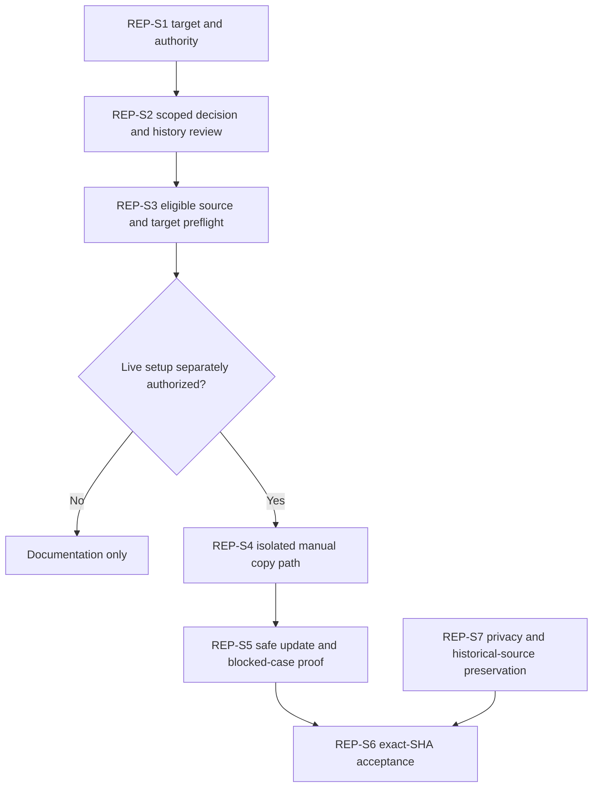

# Caldova GitHub Authority and Azure Repos Secondary Copy - Draft Sprint

| Field | Value |
|---|---|
| **Version** | 0.6 |
| **Date** | 2026-10-30 |
| **Author** | Copilot |
| **Status** | Draft |
| **Scope** | Caldova Tenant 1 project/demo: gated main-history secondary replication design and acceptance |
| **References** | [Idea](../ideas/caldova-azure-devops-repository-idea.md), [Specification](../specs/2026-10-28-caldova-azure-devops-repository-design.md), [CI/CD sprint](2026-10-28-caldova-azure-devops-solution-cicd-sprint.md), [Proposed ADR-0015](../adr/0015-caldova-github-authority-and-azure-repos-secondary.md), [Package map](../README.md#caldova-draft-packages) |

## 1. Goal and authority

Specify and later prove reviewed main-history replication to a verified Caldova Azure Repo while GitHub remains source/PR authority and Azure Pipelines consumes GitHub directly.

This is not the original GF customer cutover; that historical source is fixed at `a4e4fbc`. GF source/customer facts remain labelled. Existing `IDEA-GF-REPOSITORY`/`REP-S*` IDs retain traceability, not old deployment authority.

Dates, capacity, named owners, estimates and operational acceptance are
unconfirmed. The initial documentation refinement is followed by the read-only
execution assessment in section 5. No remote, connection, Git ref or pipeline
has been changed.

## 2. Candidate backlog and gates

| Item | Work | Required evidence/dependency |
|---|---|---|
| REP-S1 | Confirm GitHub authority and intended target identity/privacy/ownership | User direction plus live read-only target verification before writes |
| REP-S2 | Ratify scoped ADR and approved-main history/disclosure contract | Preserve original Approved decisions; no all-ref/force/reverse path; depends on REP-S1 |
| REP-S3 | Verify source eligibility, required exact-SHA validation and destination refs/content | No local-confidential upload; detect empty/equal/ancestor/divergent states; depends on REP-S2 |
| REP-S4 | Establish separate trusted manual pipeline, isolated secondary-write identity and protected approval | Not shared PR credentials or approval only in editable YAML; depends on REP-S3 |
| REP-S5 | Exercise NoChange, initial/fast-forward and blocked/error/concurrency cases | Synthetic tests first, then separately authorized ref/read-back proof; depends on REP-S4 |
| REP-S6 | Accept copy/operational ownership independently of CI/CD delivery | Exact source/destination SHA and retained validation/approval evidence; depends on REP-S5 |
| REP-S7 | Preserve private config, GF-source notices and fixed handover; document optional local remote | No dual-push origin or source/identity mutation; prerequisite to transfer acceptance |

Known mandatory-validation failures, absent approval/permissions, target ambiguity or divergence block the affected copy. Do not manufacture a green result by using only focused tests.

## 3. Dependency view

The source-copy track is separate from direct-source CI/CD.

## 4. Acceptance and exclusions

Demonstrate exact eligible source/target identities, approval, main-only non-force operation and read-back. Equal refs are NoChange; unknown/divergent/unrelated/failed-validation states produce no mutation.

Exclude Azure-only development, reverse sync, all-ref mirror, force/deletion, public disclosure of local confidential material, private-config replication and production deployment. A local `azdo` remote alone is not replication or authentication proof.

The detailed specification and later owner/implementation authorization govern execution. No new live setup is accepted by this Draft.

## 5. Execution record - 2026-10-29

**Execution state: Blocked, not complete.** The request to finish the sprint was
assessed against this Caldova model, not the original GF-independent cutover.
Read-only Azure DevOps/GitHub inspection succeeded; no source was copied and no
live configuration, credential, policy or pipeline was changed.

The intended Azure repository was returned as enabled in a private, well-formed
project, with reported size zero and no default branch or returned refs/policies.
The project pipeline listing returned no pipelines. These observations do not
establish accountable ownership, effective write permissions, credential
isolation or approved initial-copy authority. Actual identifiers/endpoints and
the raw read-back remain in session/private evidence, not tracked configuration.

Published GitHub `main` resolved to
`a4e4fbcf2cbf84162c1b2e7d6663fe26ad162cd3`. Its completed
`Repository setup validation` check failed. The
[exact source validation run](https://github.com/urruegg/caldova-hr-frontier/actions/runs/40831896096)
reported 1,620 tests passed, three failed and four skipped. The failed cases are:

1. prohibited tracked path/scannable text branding validation;
2. curated identity assets/bindings/provenance validation;
3. runbook Markdown destination resolution.

The latter reports the percent-encoded blueprint filename, not evidence that
the preserved HTML should be renamed or removed. The identity wrapper reports a
`RemoteException` while receiving Python test output; it does not establish an
asset defect or a passing full identity run. Diagnose these failures without
disabling guards, changing immutable source bytes or inventing exceptions.

| Item | Observed disposition | Remaining acceptance gate |
|---|---|---|
| REP-S1 | Partial: selected authority and intended target read-back available | Named accountable ownership and effective permissions/security baseline |
| REP-S2 | Blocked: ADR-0015 remains Proposed Baseline | Formal ratification and content/reachable-history disclosure approval |
| REP-S3 | Blocked: exact published-main check failed | Remediate and validate an approved exact source SHA; public availability is not disclosure approval |
| REP-S4 | Blocked; no project pipelines returned | Separately authorized trusted manual pipeline, isolated identity and external protected approval controls |
| REP-S5 | Not run | Synthetic safe-update/blocked-case tests, then authorized live proof after prerequisite gates |
| REP-S6 | Not accepted; no copy performed | Exact source/destination SHA/read-back and named operational acceptance |
| REP-S7 | Existing source/brand/history protections retained | Carry those controls through any later authorized copy; no dual-push origin or public publication of local changes |

The local 27-document Caldova migration remains uncommitted in its isolated
worktree; it is not an eligible published release/copy revision. Passing focused
documentation tests cannot replace the failed mandatory check above.

Resume only after the missing ownership/authorization gates and source-validation
failures are resolved. Re-read target/source state immediately before any write.
Do not mark this sprint Done, ratify the ADR implicitly or copy an unvalidated
revision merely to make the destination nonempty.

## 6. Local CI remediation - 2026-10-30

Three implementation defects are repaired locally without changing supplied
assets, exception records or operational permissions:

| Area | Root cause and repair | Verification |
|---|---|---|
| Identity test wrapper | Windows PowerShell 5.1 treats redirected Python stderr progress as a terminating error. Capture both streams asynchronously and assert the actual process exit code. | Actual identity validation and all runbook contracts: 23 passed on each host; an isolated failing Python validation is still rejected with its original diagnostic. |
| Runbook links | The local-link parser tested percent-encoded filenames without decoding them. Decode only after separating the fragment. | Three new regressions observed failing before the repair; spaces, literal plus signs, encoded fragment markers and missing destinations are checked. |
| Branding exception parser | JSON integer one is Int64 under PowerShell 7, while the parser accepted only Int32. Admit either integer representation, still exactly one. | 35 strict units passed on each host, covering all seven classes and invalid/coercible counts. |
| Complete maintained suite | Ran all 53 maintained test files with the workflow's Windows PowerShell host and discovery, without selective exclusions. | 1,645 tests: 1,641 passed, one failed, three skipped. The sole failure is the actual branding policy gate. |
| Build and static safety | No infrastructure implementation change or deployment. | All five maintained Bicep entry points compile; repository safety and whitespace checks pass. |

The full-run branding scan recorded 1,210 blocking path/class pairs across 524
paths and recognized seven existing approved evidence records. The Approved
anonymization policy still prohibits intentional retained customer-source names
and paths. This is not permission to change source bytes, suppress findings or
fabricate evidence exceptions.

The subsequent explicit user approval on 2026-10-30 authorizes the scoped source
classification described in the
[identity specification](../specs/2026-10-29-caldova-agent-identity-kit-design.md)
and [Approved branding design](../specs/2026-10-01-caldova-branding-migration-design.md).
The scanner now validates a policy-pinned exact source inventory while leaving
the seven evidence exceptions unchanged. Unknown or altered inputs still block.
The prior unavailable-user state was not treated as approval; this later explicit
approval supersedes it. Disclosure and copying permission remain separate gates.

The amended local tree now passes complete maintained validation: 53 files,
1,670 tests, 1,667 passed, zero failed and three existing blueprint-evidence
skips. The actual source gate reports zero unapproved findings, 524 exact source
records and seven unchanged evidence approvals. Sixty strict units pass on both
PowerShell hosts. The local branding/validation blocker is cleared.

REP-S3 still requires eligible published exact-SHA evidence. These uncommitted
local repairs do not change
the published source's failed check, ratify ADR-0015 or close the named-owner,
protected-credential and live-acceptance gates. No commit, push, source copy,
remote change or live pipeline configuration was performed.

## Board synchronization

Deferred - not synchronized.
