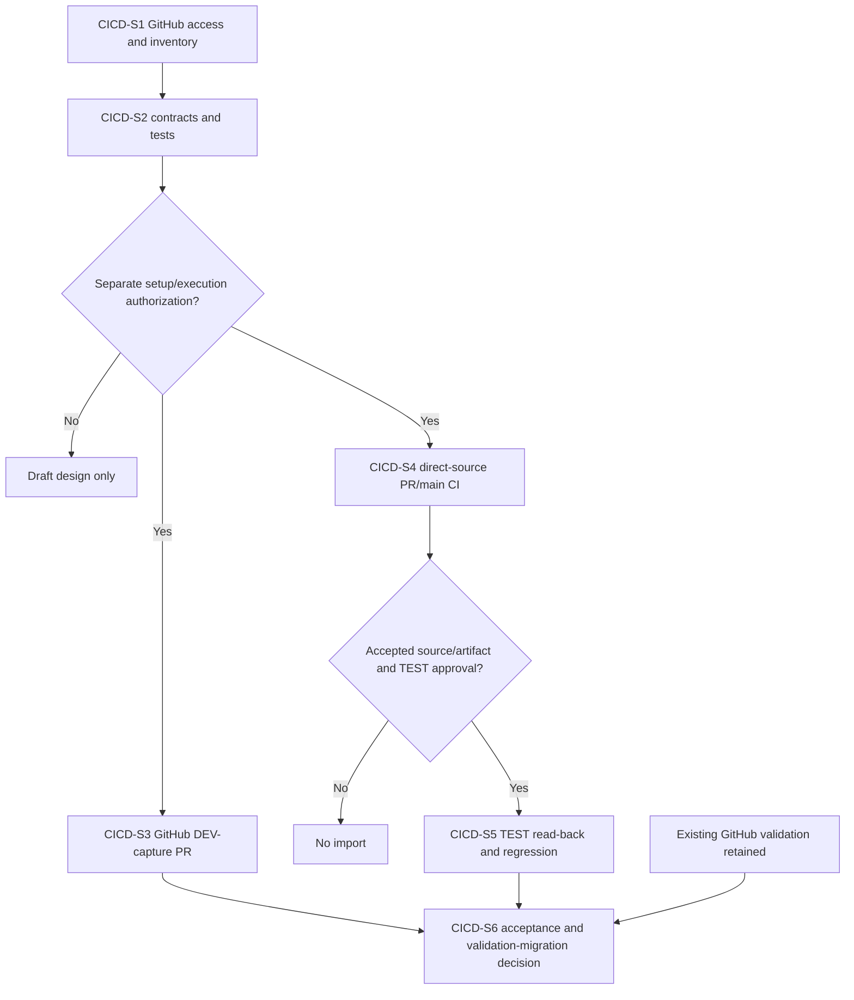

# Caldova GitHub-Source Azure Pipelines CI/CD and DEV Capture - Draft Sprint

| Field | Value |
|---|---|
| **Version** | 0.3 |
| **Date** | 2026-10-29 |
| **Author** | Copilot |
| **Status** | Draft |
| **Scope** | Caldova project/demo: direct-source CI, GitHub DEV-capture PRs, TEST artifacts and independent replication |
| **References** | [Idea](../ideas/caldova-azure-devops-solution-cicd-idea.md), [Specification](../specs/2026-10-28-caldova-azure-devops-solution-cicd-design.md), [Repository sprint](2026-10-28-caldova-azure-devops-repository-sprint.md), [Proposed ADR-0015](../adr/0015-caldova-github-authority-and-azure-repos-secondary.md), [Package map](../README.md#caldova-draft-packages) |

## 1. Goal and current scope

Define Azure Pipelines execution with GitHub source/YAML/PR authority, controlled explicit DEV capture back to GitHub PR, identified reviewed-source artifacts and authorized TEST delivery. Azure Repos is only an independently approved main-history secondary copy.

The package is Caldova project/demo work using GF source/customer context, not a transfer of GF approval or native runtime readiness. Existing stable `CICD-S*` IDs remain traceable. Production, dates/capacity/estimates and named acceptance owners are not committed.

Current implementation scope is documentation only. No YAML pipeline, service connection, tool/runtime setting, remote copy or import is created.

## 2. Candidate backlog

| Item | Work | Evidence/dependency |
|---|---|---|
| CICD-S1 | Verify GitHub service/App access and exact source/harness/component inventory | Actual read-back; no assumed Azure secondary source or generic export completeness |
| CICD-S2 | Define test/artifact/private-configuration and separate identity contracts | Untrusted PR cannot access deploy/replicate credentials; depends on CICD-S1 |
| CICD-S3 | Implement explicit DEV capture into a GitHub branch/PR after separate approval | NoChange/concurrency/denied/partial-export evidence; depends on CICD-S2 |
| CICD-S4 | Prove direct GitHub PR/main Azure CI and required GitHub blocking | Equivalent checks/results/logs, no source-SHA confusion; depends on CICD-S2 |
| CICD-S5 | Build accepted exact-source candidate and verify TEST deployment | Identified artifact, private settings, import/component/access regression; depends on CICD-S4 and deployment authorization |
| CICD-S6 | Evaluate end-to-end/failure behavior and check-migration disposition | Actual evidence from CICD-S3/CICD-S5; keep GitHub validation until explicit equivalence/retirement approval |

The separate repository sprint owns manual main-history replication. Its approval, credential and failure paths must not be inherited by ordinary PR/main CI or become CD source authority.

## 3. Dependency and migration flow

The flow does not retire existing validation based on a planned pipeline.

## 4. Definition of ready and done

Ready requires supported source round-trip, approved DEV/TEST and identity/resource boundaries, versioned mandatory tests and current source/brand/customer scope. Known legacy branding failures prevent claiming green mandatory validation.

Done requires actual GitHub PR/main check/blocking proof, capture reviewed through GitHub, exact accepted commit/artifact identity, TEST component/config/access results and reproducible failed/uncertain handling. PR synthetic merge SHA cannot be mistaken for final main source.

Resolve identity stamping's differing TEST/PROD bytes against the release policy; do not silently rebuild under the same artifact identity. Production and automatic validation retirement remain excluded.

## Board synchronization

Deferred - not synchronized.
