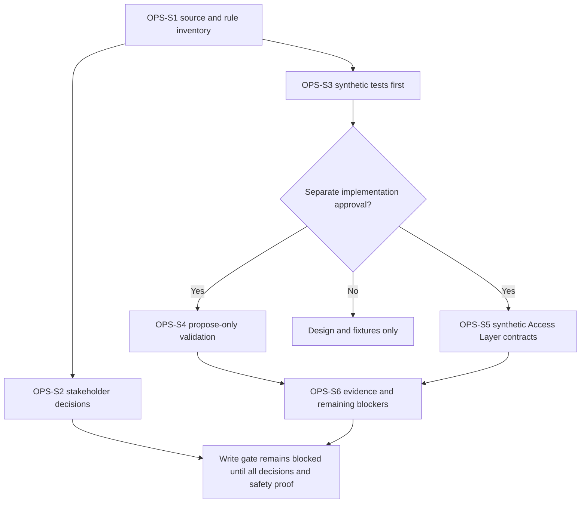

# Caldova HR Operations Agent - Draft Sprint

| Field | Value |
|---|---|
| **Version** | 0.3 |
| **Date** | 2026-10-29 |
| **Author** | Copilot |
| **Status** | Draft |
| **Scope** | Caldova project/demo; GF source/customer context: functional package: synthetic, propose-only HR Operations validation |
| **References** | [Idea](../ideas/caldova-hr-operations-agent-idea.md), [Specification](../specs/2026-10-28-caldova-hr-operations-agent-design.md), [Package index](../README.md#caldova-draft-packages) |

## Caldova project and GF source boundary

This is a Caldova project/demo document using the explicitly identified GF source/customer scenario. GF facts, approvals, requirements and trademarks remain GF-scoped; project renaming does not establish Caldova corporate policy or runtime acceptance. See the [source and authority boundary](../README.md#caldova-project-and-gf-source-boundary). Existing stable IDs are retained for traceability, not reassigned.

## 1. Sprint goal and planning status

Detail the Swiss PeopleDoc-to-Workday proposal process and validate it with synthetic data, keeping writes blocked until stakeholder decisions and safety evidence are complete. Copilot Studio's GitHub Copilot runtime harness is selected; ESS is excluded.

The build brief v1.0 section 5 now supplies the process outline; its primary PRD/BOM/SOP, field workbook and sample files remain pending. Dates, duration, capacity, estimates, named owner and any implementation commitment remain TBD. Prototype-day dates in the brief are context, not a sprint commitment.

## 2. Entry gates

Obtain original evidence, approved rules and accountable owners. Close the matching, approval, field/document, interface/identity and privacy gates before operational processing or writes. Neither a reported own-profile REST read nor a filename proves the needed match/write capability.

Discovery must use approved, minimized material; real employee data must not be added to this repository.

## 3. Candidate backlog

| Item | Proposed work | Evidence and dependency |
|---|---|---|
| OPS-S1 | Verify E14/E15/E16, mapping workbook and non-identity source inventory | Field/type/TBC and identity-exclusion register; no real records in Git |
| OPS-S2 | Review GF-OPS-D01 through D07 with HR/HRIS/Privacy | Matching, approval, API/object, confidence, transient-processing and disposition decisions; requires OPS-S1 |
| OPS-S3 | Create synthetic golden/negative fixtures before implementation | Match 0/1/many, blank/existing/missing/conflicting fields, no-approval/replay/failure tests; requires OPS-S1 |
| OPS-S4 | After separate approval, validate propose-only workflow responsibilities | Extraction/source/confidence, comparison, statuses and blocked-write behavior; requires OPS-S3 and permission/privacy gates for any non-synthetic read |
| OPS-S5 | Validate Access Layer enforcement with synthetic contract tests | Allow-list, fresh blank check, idempotency, stop switch and uncertain-outcome handling; no live writes; requires OPS-S3 |
| OPS-S6 | Record evaluation, unresolved gates, audit/movement rules and handover | 100% signed-off mandatory cases, zero unsafe actions and explicit owner disposition; requires OPS-S4/OPS-S5 |

This backlog covers GF-OPS-01 through GF-OPS-11 without authorizing live development or writes. A later designated-profile test write requires separate Workday-owner consent and complete gates; it is not a promised sprint outcome.

The dependency chart keeps stakeholder decisions separate from synthetic safety work and retains the current write block.

## 4. Proposed acceptance and exit evidence

Source facts/proposals remain distinct. Synthetic tests exercise approved-type rejection, extraction/provenance, matching 0/1/many, Already exists/Missing/proposed statuses, concurrency/replay, injection, stop/authentication failures and uncertain outcomes. No unapproved write occurs. Pending or uncertain packages are not moved to Complete as if processed.

The brief's zero unsafe writes/overwrites/duplicates target is mandatory safety intent; extraction confidence/accuracy thresholds remain unconfirmed. Verify process/audit records contain no master-field values and treat opaque employee references as potentially personal. Actual live capability and acceptance evidence remain unavailable.

## 5. Exclusions and risks

Exclude identity documents/fields, profiles created or overwritten, guessed matches, production data in DEV/TEST/Git and unapproved personal-data processing. No general PDF-to-spreadsheet skill or catalogue HR assistant replaces the field-specific extraction contract or governed Access Layer.

## 6. Next interactive checkpoint

Start with matching and approval conflicts, then fields/document scope and transient-processing/privacy. Agent Evaluation Designer is a conditional test-design aid only; see the [CAT assessment](../README.md#cat-reuse-assessment). Pause and refine each stakeholder answer. Board synchronization is Deferred - not synchronized.
