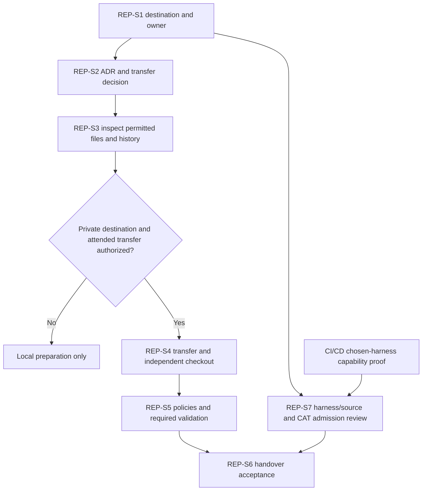

# GF Azure DevOps Repository Establishment - Draft Sprint

| Field | Value |
|---|---|
| **Version** | 0.2 |
| **Date** | 2026-10-28 |
| **Author** | Copilot |
| **Status** | Draft |
| **Scope** | GF technical package: attended repository transfer sprint proposal |
| **References** | [Idea](../ideas/gf-azure-devops-repository-idea.md), [Specification](../specs/2026-10-28-gf-azure-devops-repository-design.md), [GF source-authority refinement](../adr/0013-gf-azure-repos-source-authority.md), [CI/CD sprint](2026-10-28-gf-azure-devops-solution-cicd-sprint.md), [Package index](../README.md#gf-draft-packages) |

## 1. Sprint goal and planning status

Establish an independent GF Azure Repos repository through a one-time reviewed transfer from this repository, with verified content, ownership and change controls. GF Azure Repos becomes GF's source/PR authority; the GitHub demo remains separate without automatic synchronization.

This is a Draft proposal, not migration permission. Dates, duration, capacity, estimates, named owner and live destination are TBD.

The supplied brief adds source-layout and SharePoint boundaries; underlying exports/tenant state are not independently verified. All three agents use the GitHub Copilot runtime harness in Copilot Studio; this does not change GF Azure Repos ownership. ESS is excluded. Confidential local drafts must not be committed/pushed to the public demo origin.

## 2. Entry gates

Ratify the GF-scoped ADR refinement and confirm destination authorization, accountable owner and security baseline before live work. Decide history treatment and the inclusion/exclusion inventory. Approval to draft does not permit unfiltered cloning or publication.

## 3. Candidate backlog

| Item | Proposed work | Evidence and dependency |
|---|---|---|
| REP-S1 | Confirm GF destination, ownership, permissions and source snapshot | Approved destination/control inventory; no live creation implied |
| REP-S2 | Review the GF ADR refinement, transfer method and history decision | Explicit GF applicability and reviewed transfer contract; depends on REP-S1 |
| REP-S3 | Prepare and independently inspect the permitted transfer content/history | Sanitized inventory, exclusions, licensing and information-protection evidence; depends on REP-S2 |
| REP-S4 | After attended execution approval, create/import and verify the GF destination | Destination read-back and independent checkout; depends on REP-S3 |
| REP-S5 | Establish and verify GF PR policies and required validation | Controls tested against GF-REP-01 through GF-REP-06; depends on REP-S4 and linked validation capability |
| REP-S6 | Record cutover/handover acceptance and remaining restrictions | Source authority, no-sync evidence and accountable sign-off; depends on REP-S5 |
| REP-S7 | Review harness source mapping and any proposed reusable-skill admission | One canonical source per component; exact revisions/checksums, asset licenses, dependencies and data/permission boundaries; requires REP-S1 and CI/CD capability proof |

The CI/CD sprint may start destination-side setup after REP-S4 and its own authorization gates. Final repository acceptance waits for required validation to be operational; this does not require the TEST application deployment to precede repository creation.

The chart separates local preparation from authorized transfer and ties final acceptance to working controls.

## 4. Proposed acceptance and exit evidence

The intended destination contains the reviewed inventory, with explained differences from the selected source snapshot. Excluded material is absent from both files and any transferred history. An independent checkout succeeds, mandatory checks and approved review controls are enforced, and no automatic synchronization exists.

Document GF ownership and read back effective access and branch-policy behavior. A successful import alone does not satisfy handover acceptance.

Verify confidential attachments, tenant-specific values and real personal data are absent from transferred Git content/history. If a CAT component is later admitted, record the exact bundle source, review/notices and validation evidence; this sprint does not install any candidate. No assessed CAT plugin substitutes for native repository controls.

## 5. Exclusions and risks

Exclude demo-tenant changes, automatic backporting and production delivery. Current risks are copying tenant/private evidence or history, inheriting inappropriate solo-owner controls and treating GitHub-native files as functioning Azure DevOps controls.

## 6. Next interactive checkpoint

Confirm destination ownership, private handover boundary and history treatment before constructing transfer commands. Review the [CAT assessment](../README.md#cat-reuse-assessment) before any vendoring. No live commands are prescribed by this starting draft. Board synchronization is Deferred - not synchronized.
