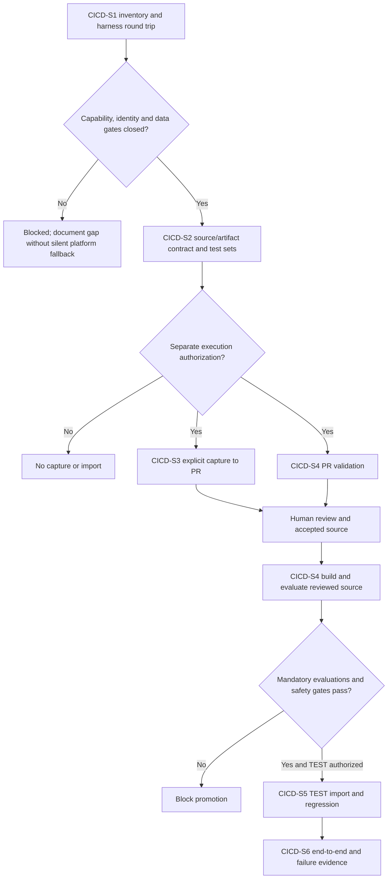

# GF Azure DevOps Solution CI/CD and DEV Capture - Draft Sprint

| Field | Value |
|---|---|
| **Version** | 0.2 |
| **Date** | 2026-10-28 |
| **Author** | Copilot |
| **Status** | Draft |
| **Scope** | GF technical package: reusable DEV capture and TEST-only delivery proposal |
| **References** | [Idea](../ideas/gf-azure-devops-solution-cicd-idea.md), [Specification](../specs/2026-10-28-gf-azure-devops-solution-cicd-design.md), [Repository sprint](2026-10-28-gf-azure-devops-repository-sprint.md), [Package index](../README.md#gf-draft-packages) |

## 1. Sprint goal and planning status

Establish controlled, reusable DEV solution export/unpack into a branch and PR, reviewed-source build, and verified TEST deployment through Azure DevOps. Production delivery is explicitly later scope.

Selected platform: Copilot Studio's GitHub Copilot runtime harness for all MVP agents. ESS is excluded. The brief's reported export/environment state is input to inventory, not proof of portable harness-specific source.

This is a starting backlog, not permission to queue pipelines or access environments. Dates, duration, capacity, estimates, named owner and the solution list are TBD.

## 2. Entry gates

The GF destination must be available under the repository package's transfer/control gates. Confirm approved DEV/TEST targets, solution inventory, dependencies, accountable owners, authentication and least-privilege access before live capture or import.

Validate the supported source-to-artifact packaging route and environment-specific configuration. Do not infer GF readiness from existing demo designs.

Prove actual agent/workflow/skill/knowledge/configuration round-trip coverage before claiming deployability. Current generic solution import/export documentation is standard-harness scoped, so the chosen-harness route remains an explicit capability gate.

## 3. Candidate backlog

| Item | Proposed work | Evidence and dependency |
|---|---|---|
| CICD-S1 | Inventory solutions, types, dependencies, selected-harness assets and DEV/TEST prerequisites | Reviewed capture/deployment contract and round-trip feasibility evidence; requires approved environment access |
| CICD-S2 | Agree identities, source paths, artifact/configuration rules and required checks | Approved technical/security contract; depends on CICD-S1 and available GF repository |
| CICD-S3 | Implement and authorize reusable explicit DEV capture into branch/PR | Export, inspection, unpack, no-difference and concurrent-change evidence; depends on CICD-S2 |
| CICD-S4 | Implement PR validation, harness-compatible evaluations and reviewed-source artifact creation | Destination policy, signed-off tests, any admitted skill assets and commit/artifact traceability; depends on CICD-S2 |
| CICD-S5 | Implement authorized TEST deployment and post-import verification | Intended artifact/target read-back, configuration and smoke checks; depends on CICD-S4 |
| CICD-S6 | Exercise end-to-end and failure cases | GF-CICD-01 through GF-CICD-08 evidence; depends on CICD-S3 and CICD-S5 |

Implementation and every environment operation require separate approval after entry gates close. Backlog ordering is not execution authorization.

The chart places harness proof and tests before release execution. Repository-source review remains mandatory after DEV capture.

## 4. Proposed acceptance and exit evidence

An explicit capture produces reviewed solution-source changes without a direct protected-branch write. Repeated/no-difference capture and concurrent changes are handled explicitly. Mandatory checks protect PR completion, and the deployable artifact identifies its reviewed commit/build.

The approved artifact reaches only the approved TEST environment and passes agreed import/configuration/component checks. Denied capture, invalid source, dependency/import failure and uncertain outcomes produce visible failures and controlled recovery. No production permissions or deployment are used.

Exact solution-specific test cases and thresholds remain TBD after inventory. No GF pipeline, capture or deployment has been executed by drafting these documents.

The brief proposes 100% signed-off mandatory golden/refusal cases before promotion, with environment/access tests rerun after TEST import. Retain the disabled Recruiting write/publishing boundary and HR Operations write gate. CAT evaluation guidance is not an executable CI runner; prove the actual evaluation/export mechanism and capacity. No CAT bundle is installed by this sprint draft.

## 5. Exclusions and risks

Exclude PROD deployment/access, automatic capture on maker edits, direct-to-main export synchronization, unreviewed deployment and application-feature development. Unsupported packaging assumptions, missing dependencies and hidden configuration values are current delivery risks.

## 6. Next interactive checkpoint

Review selected-harness round-trip and solution inventory before task versions, authentication and commands. Then review [CAT admission/evaluation dependencies](../README.md#cat-reuse-assessment). Pause on unresolved decisions; no silent ESS/standard-harness substitution. Board synchronization is Deferred - not synchronized.
