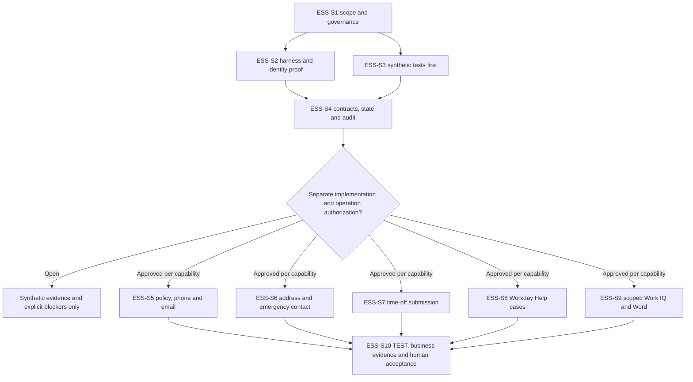

# GF ESS-Equivalent GitHub Harness and Work IQ Rebuild - Draft Sprint

| Field | Value |
|---|---|
| **Version** | 0.2 |
| **Date** | 2026-10-28 |
| **Author** | Copilot |
| **Status** | Draft |
| **Scope** | GF employee self-service: capability proof, six bounded Workday operations and per-use-case M365 support |
| **References** | [Idea](../ideas/gf-ess-github-harness-workiq-idea.md), [Specification](../specs/2026-10-28-gf-ess-github-harness-workiq-design.md), [Draft implementation plan](2026-10-28-gf-ess-github-harness-workiq-implementation.md), [Proposed scoped ADR](../adr/0014-gf-ess-workiq-and-self-service-write-envelope.md), [GF CI/CD sprint](2026-10-28-gf-azure-devops-solution-cicd-sprint.md), [Package index](../README.md#gf-draft-packages) |

## GF handover summary

This is the primary sprint document for the sixth GF handover package; it is reused rather than duplicated. Read the [idea](../ideas/gf-ess-github-harness-workiq-idea.md) for the outcome and canvas, this sprint for candidate work and acceptance, and the [specification](../specs/2026-10-28-gf-ess-github-harness-workiq-design.md) for detailed capability/contracts and Mermaid interactions. The implementation plan and proposed ADR support those three primary documents.

| Handover question | Current answer |
|---|---|
| What is proposed? | A new employee-self-service agent for Switzerland, with policy guidance, six self-only Workday operations and per-use-case M365 support |
| What is prepared? | Cross-linked Draft idea, sprint, specification and implementation plan, plus Proposed Baseline ADR-0014 |
| What is not established? | Working GF runtime integrations, complete operation/API permissions, verified formal approval scope, committed capacity/dates or actual benefit measurements |
| Who needs to review? | GF business/HR process owner, Workday/HRIS, Privacy/Security, platform/IT and operational acceptance roles; named individuals remain to be assigned |
| What happens first? | Confirm owners, pilot priorities and approval scope, then prove identity, operation contracts and enforceable tool restrictions before activating any capability |

This is a handover starting point, not confirmation that the package has been transferred or that GF has accepted delivery. No live execution, publication or repository push is authorized by the document.

## 1. Sprint goal and commitment boundary

Establish a new Copilot Studio GitHub-harness ESS-equivalent with source-grounded policy guidance and reviewable self-only Workday transactions, supported by Work IQ only where it serves a defined use case. Prove backend completion, safety and measurable business value rather than a convincing conversational demonstration.

The user selected six transaction scenarios: personal phone, personal email, home address, emergency contact, time-off submission through Workday approval, and employee-confirmed Workday Help case creation. Use employee-delegated OAuth and separate governed Workday/M365 paths.

Dates, duration, capacity, named owners, estimates and relative scenario priority are not supplied. This is a candidate sprint, **not a promise to complete six production integrations inside an invented time box**. Retain all six in scope tracking; acceptance is per scenario. Blocked scenarios are not counted as completed.

There is no deployed agent/source baseline to refactor. Build new from evaluated Microsoft references, in DEV with TEST acceptance. Production and automatic activation are excluded. Existing five GF draft packages remain unchanged.

## 2. Entry gates

The specification's ESS-D01 through ESS-D08 govern execution:

- Record the user-reported Privacy/Security decision reference/scope and obtain the proposed ADR/HRIS write-envelope ratification.
- Prove employee self-identity, per-user delegated connector behavior and exact operation permissions.
- Prove Work IQ tool/resource restrictions outside prompts; whole-workload selection and tenant defaults alone are not sufficient.
- Establish confirmation/state/retention, named support/acceptance ownership, capacity and platform/ALM readiness.

Synthetic design and test development may proceed only after its own implementation approval. No real employee data, connector sign-in, permission grant or live mutation is authorized by this sprint.

## 3. Candidate backlog and dependencies

| Item | Work and source basis | Evidence required | Dependencies |
|---|---|---|---|
| ESS-S1 | Approve capability matrix, source provenance and scoped decision [specification 1-3, 10, 12] | Accountable scope/gate register; approval claimed versus verified separated | None |
| ESS-S2 | Prove selected-harness workflows, delegated identity, confirmation and source round trip | Two-user self-isolation, trusted confirmations, real-time action/status split, inspected export/import coverage | ESS-S1 |
| ESS-S3 | Write synthetic golden/refusal/contract tests before agent or mutation implementation | Every selected operation has positive, cross-user, no-confirmation, stale-state, injection and timeout/replay tests | ESS-S1 |
| ESS-S4 | Establish workflow-owned state/audit and bounded Workday/M365 contracts | No raw pass-through; disabled capabilities default-deny; minimized audit and stop/reconcile tests | ESS-S2, ESS-S3 |
| ESS-S5 | Build policy and personal phone/email slice after separate authorization | Approved sources, exact personal-field mappings, user review and verified outcome | ESS-S4; source/operation gates closed |
| ESS-S6 | Build home-address/emergency-contact slice | HRIS-proven write APIs, field/reference/effective-date rules, related-person privacy and preservation of other entries | ESS-S4; ESS-D03/ESS-D06 closed |
| ESS-S7 | Build time-off request slice | Tenant leave-type/units validation, confirmed submission, request status, no agent entitlement/approval | ESS-S4; time-off API/approval evidence |
| ESS-S8 | Build Workday Help case slice | Proven create/status/routing API, minimal case review, trusted confirmation, replay protection and verified case reference | ESS-S4; case-specific capability/privacy gates |
| ESS-S9 | Apply the per-use-case Work IQ read/draft/action matrix and optional Word output | Tested resource/destination limits, draft-versus-send separation, safe document handling and recorded value hypothesis | ESS-S4; ESS-D04/ESS-D06 closed |
| ESS-S10 | Capture reviewed source, build and verify in TEST; evaluate value and release readiness | Versioned artifacts, full mandatory safety evidence, per-scenario disposition, baseline/pilot effort/cost data and human acceptance | ESS-S5 through ESS-S9 as applicable; linked GF delivery readiness |

ESS-S5 through ESS-S9 can be separate reviewable tracks after the common contracts. Their deployment/acceptance is independent; a phone/email demonstration does not prove address, emergency contact, leave or Help case support.

Developer Kit reuse belongs in ESS-S1/S2/S3, not an automatic installation task. Assess pinned main/declarative versus main-ca/Custom Engine components and their license/dependencies/telemetry before selecting files. Its ISU/Basic developer Workday MCP is not the delegated runtime.

## 4. Dependency and activation model

The diagram distinguishes shared proof from use-case tracks and activation. No path skips operation-specific gates.

## 5. Definition of ready per scenario

Before an operation is implemented with operational data, require an accountable owner, complete seven declarations, exact supported API and permission contract, actor/target binding, field/data classification, confirmation UX, short-lived state and failure/reconciliation design, plus signed-off synthetic tests.

For M365, state the purpose and exact permitted reads, selected resources, draft behavior, side-effect destinations and retention. "Use Work IQ" is not a complete envelope. Where effective enforcement cannot be proven, keep that action disabled or separately design mediation.

For Workday Help, opening a link or sending an email is not API proof. Do not introduce a guessed endpoint, transcript attachment or automatic case creation on every fallback.

## 6. Proposed definition of done

For each enabled capability:

1. Reviewed source and approved field/action contract correspond to the tested runtime.
2. Self-only delegated identity and server-side confirmation/allow-list controls pass both positive and negative tests.
3. Every mandatory safety/golden case passes; zero cross-user/unauthorized writes, duplicate submissions or false success claims.
4. Workday read-back/status proves the actual outcome. Time-off Pending remains Pending; Help returns a verified case reference/status.
5. Denied policies, stale state, throttles, uncertain outcomes and stop/recovery behavior are explicit and reproducible.
6. Privacy-approved audit/transcript/document handling contains no unnecessary master values; approved connection/configuration settings survive TEST promotion.
7. Baseline/pilot effort, correct completion, exceptions, employee feedback, latency and consumption are recorded for human value assessment.

Run evaluations in DEV and rerun configuration/access/component tests in TEST. No tests have yet been executed against GF by this document. Numeric business improvement thresholds remain to be agreed; documentation tests cannot substitute for runtime proof.

## 7. Business value and review checkpoints

Measure quality by scenario, not by whether the conversation sounds helpful. Compare manual effort/steps with a safely completed request, record failed/uncertain/assisted outcomes, and include cost per safe completion. Maintain source/evaluation/configuration versions so the business assessment is traceable.

Checkpoint A reviews source/approval/capability gaps before implementation planning. Checkpoint B reviews identity and confirmation proof before the first live test. Checkpoint C reviews each operation's result and privacy envelope. Checkpoint D reviews TEST and measured value before any later production proposal.

## 8. Risks, exclusions and next step

The critical current gaps are formal approval scope, delegated runtime propagation, exact address/contact/Help APIs, enforceable M365 restrictions, confirmation/state/retention and chosen-harness ALM. The Work IQ documentation's agent/tenant write defaults must be read back and tested, not assumed.

Exclude identity documents, payroll/bank, manager/other-employee changes, employment decisions, automatic approval/case creation, broad inbox/chat grounding, unrestricted connector tools, enabled memory/connected agents, production deployment and a supposed existing source migration.

The user reviewed the written specification as the planning basis. The [Draft implementation plan](2026-10-28-gf-ess-github-harness-workiq-implementation.md) now identifies slices, intended files/test surfaces, validation commands and stop/recovery gates without inventing missing product APIs. Execution and live permissions still require separate approval.

Board synchronization is Deferred - not synchronized.
