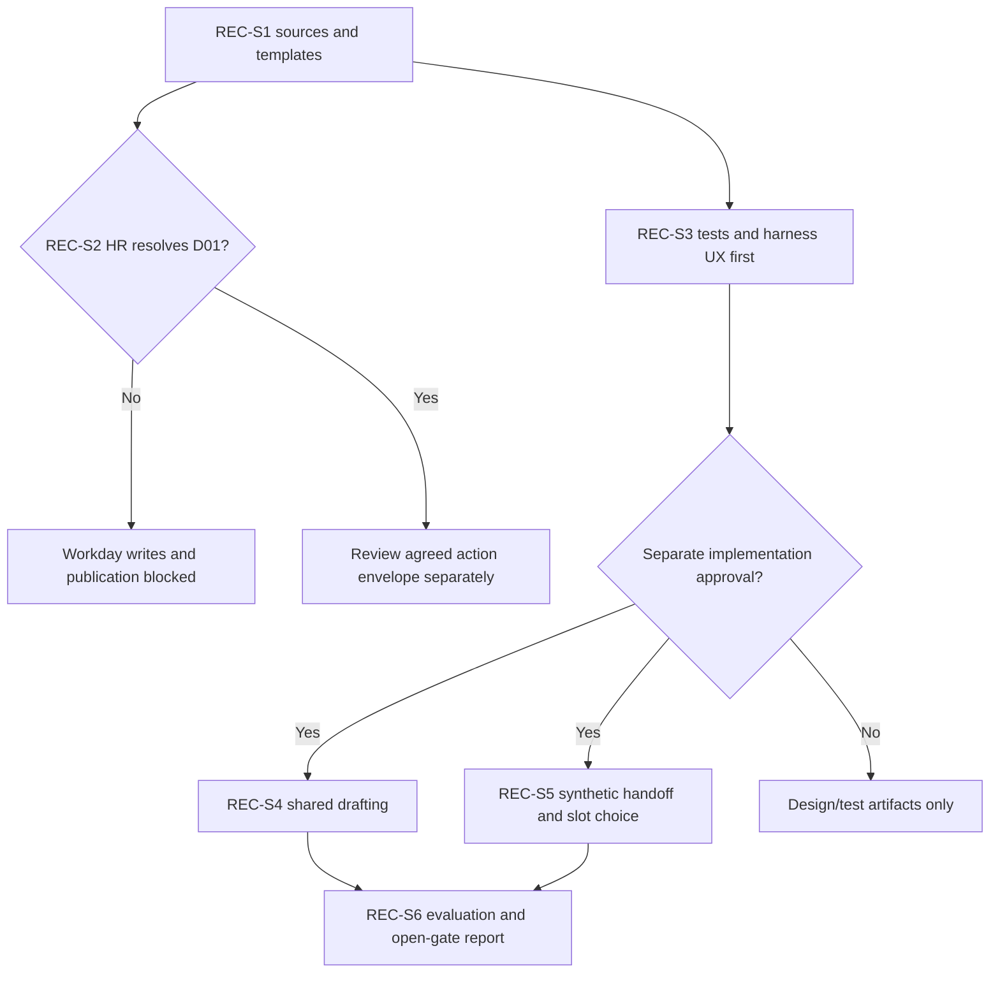

# GF Recruiting: Job Requisition and Job Posting Agent - Draft Sprint

| Field | Value |
|---|---|
| **Version** | 0.2 |
| **Date** | 2026-10-28 |
| **Author** | Copilot |
| **Status** | Draft |
| **Scope** | GF functional package: source-gated recruiting workflow sprint proposal |
| **References** | [Idea](../ideas/gf-recruiting-requisition-posting-agent-idea.md), [Specification](../specs/2026-10-28-gf-recruiting-requisition-posting-agent-design.md), [Package index](../README.md#gf-draft-packages) |

## 1. Sprint goal and planning status

Refine and, only after separate approval, validate the shared interview/review/generation process and synthetic approved-requisition handoff. **Requisition creation/submission and publication remain GF-REC-D01 stakeholder decisions**, not committed automation. Copilot Studio's GitHub Copilot runtime harness is selected; ESS is excluded.

Dates, duration, capacity, estimates, accountable owner and delivery commitment are TBD. This Draft neither authorizes writes nor claims a deployable integration.

## 2. Entry gates

The supplied brief v1.0 section 4 has been reviewed; original PRD/SOP/templates and their approvals remain pending here. The brief proposes human Workday entry/publication, conflicting with the earlier request for approved agent actions. The user explicitly keeps that conflict open for HR stakeholders.

Confirm the named process owner, approver authority, permitted fields/actions/destinations, system access, audit and failure-handling contract before enabling any write.

## 3. Candidate backlog

| Item | Proposed work | Evidence and dependency |
|---|---|---|
| REC-S1 | Verify Templates A-C, clean Job Description layout, follow-ups, global items and linked guidance | Approved/missing inventory; no invented global items or copied screening guidance |
| REC-S2 | Resolve GF-REC-D01 and action ownership with HR stakeholders | Recorded decision and separate write-envelope review if automation is chosen; requires REC-S1 |
| REC-S3 | Design golden/refusal/action tests and validate harness-specific confirmation UX before implementation | Test contracts, synthetic requisition fixtures and seven declarations; requires REC-S1; D01-dependent cases stay blocked |
| REC-S4 | After separate approval, build shared review/edit/generate behavior | No generation before confirmation; optional CAT Word candidate only after admission/storage approval; requires REC-S3 |
| REC-S5 | Validate synthetic handoff and selected-slot scheduling workflow | One-email/idempotency and no automatic publication; no assumed live Recruiting event/read capability; requires REC-S3 |
| REC-S6 | Evaluate shared behavior, negative cases and any subsequently authorized actions | 100% signed-off mandatory cases and explicit unresolved D01 blocker; requires REC-S4/REC-S5 |

REC-S4/REC-S5 are conditional, not execution authority. No Workday-write/publishing implementation can bypass REC-S2. The CAT standard-harness card builder and Cowork-only test plugin are not runtime dependencies.

The chart separates the shared preparation track from the disputed action track.

## 4. Proposed acceptance and exit evidence

The shared flow clarifies missing input, follows approved structure, supports review/edit, and generates only on explicit request. Synthetic approval fixtures are clearly labelled; duplicate events do not produce duplicate emails. Slot choice and current availability precede any meeting. No Workday submission or publication is enabled while D01 remains open.

Instantiation uses reviewed originals and permitted synthetic/test context. Agent Evaluation Designer can shape semantic/tool-use grading, but cannot provide GF approval or an executable runner. Actual fixtures, acceptance owner and runtime results remain pending.

## 5. Exclusions and risks

CV screening, candidate data/assessment/ranking and employment decisions are excluded. Unconfirmed event/read/API scopes, ambiguous action ownership, unsupported confirmation UI, optional Word persistence and uncertain email/calendar outcomes are explicit risks. No standard-harness substitution or final publishing route is assumed.

## 6. Next interactive checkpoint

Raise GF-REC-D01 with HR stakeholders first, with both conflicting positions visible. Then refine global-item ownership, actual roles, event/read integration and mailbox/slot controls. See the [CAT assessment](../README.md#cat-reuse-assessment). Board synchronization is Deferred - not synchronized.
