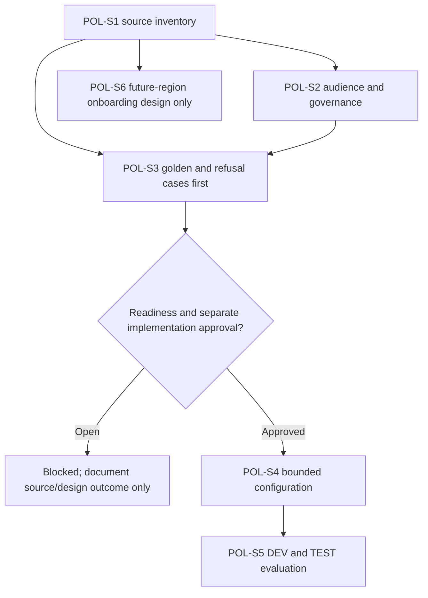

# GF SSE HR Policy Assistant - Draft Sprint

| Field | Value |
|---|---|
| **Version** | 0.2 |
| **Date** | 2026-10-28 |
| **Author** | Copilot |
| **Status** | Draft |
| **Scope** | GF functional package: source-gated policy-assistant sprint proposal |
| **References** | [Idea](../ideas/gf-sse-hr-policy-assistant-idea.md), [Specification](../specs/2026-10-28-gf-sse-hr-policy-assistant-design.md), [Package index](../README.md#gf-draft-packages) |

## 1. Sprint goal and planning status

Propose a bounded Swiss policy Q&A pilot: read-only cited answers and HR support handoff for eligible Switzerland employees/HR. Design reusable onboarding gates for later regions without enabling other-country retrieval in this MVP. Copilot Studio's GitHub Copilot runtime harness is selected; ESS is excluded.

This is a sprint starting point, not an approved execution plan. Dates, duration, capacity, estimates, named owner and committed scope are TBD. No working pilot or accepted performance level is claimed.

## 2. Entry gates

The supplied build brief v1.0 section 3 has been reviewed. Its E41/E42 primary SOP/FAQ and policy files remain pending here. The reported 13-policy inventory and 66-question FAQ do not prove source availability, owner approval, indexing or employee visibility. Classification remains explicitly open.

Confirm the accountable HR owner, source maintenance responsibility, channel, escalation route and evaluation criteria before committing delivery work.

## 3. Candidate backlog

| Item | Proposed work | Evidence and dependency |
|---|---|---|
| POL-S1 | Verify K1.01-K1.14 inventory, primary SOP/FAQ, tracker and current/archive/work separation | Source register with actual files, owner approval and access; CAT Knowledge Readiness is an optional maker aid, not ACL proof |
| POL-S2 | Confirm Swiss audience, source classification, language, HR/IT/incident routes and privacy boundary | Recorded stakeholder decisions; source-dependent parts require POL-S1 |
| POL-S3 | Build owner-reviewed golden/refusal cases before agent implementation | All 66 FAQ cases once obtained, semantic expectations and denied-access/country/conflict/refusal cases; depends on POL-S1/POL-S2 |
| POL-S4 | After separate approval, configure harness-supported instructions/skills, permitted retrieval and support behavior | Tenant capability and source/index/access evidence; depends on POL-S3 and CI/CD harness gate |
| POL-S5 | Run GF-POL-01 through GF-POL-08 evaluation and TEST regression | 100% signed-off mandatory cases, no disclosure violations and human acceptance; depends on POL-S4 |
| POL-S6 | Define future-region onboarding contract and permission-isolation tests | Region-owned sources, policy hierarchy, language, escalation and deployment-topology decision; no extra region activated |

POL-S4 and POL-S5 are conditional candidate work, not permission to build/release. CAT Source Router adaptation is deferred until its tools, permissions and region behavior are proven. Agent Evaluation Designer may inform POL-S3 without replacing owner approval.

The dependency chart makes evaluation-first sequencing and the unresolved readiness gate visible.

## 4. Proposed acceptance and exit evidence

The source register identifies permitted audiences and accountable maintenance. The assistant demonstrates supported answers with accessible citations, does not expose restricted content, refuses transactions and reaches the agreed HR escalation path when evidence is inadequate.

The proposed promotion bar is 100% of the signed-off mandatory golden/refusal set, plus no access-boundary violations. The brief's FAQ contents/expected answers, named acceptance owner and actual results are not available here. Record configuration/source/evaluation versions and actual pass/fail evidence; draft completion does not satisfy runtime acceptance.

## 5. Exclusions and risks

Exclude employee-record access, HR transactions and employment decisions. The principal current risks are unclassified SOP content, incomplete sources, missing policy applicability and an unnamed escalation owner. None is solved by making the audience all employees.

## 6. Next interactive checkpoint

Review source classification and Swiss access with HR/IT first, then the named support route and policy-conflict rules. Pause and refine each answer; future-region deployment topology remains open. See the [CAT assessment](../README.md#cat-reuse-assessment). Board synchronization is Deferred - not synchronized.
