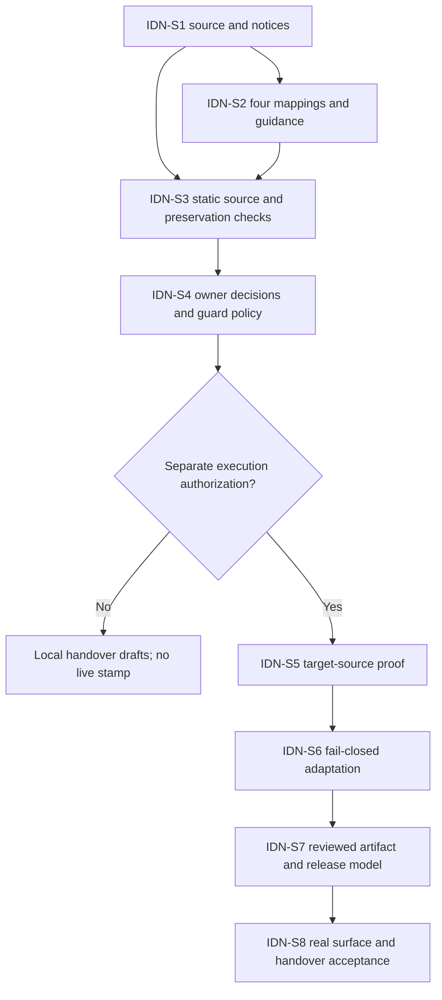

# GF Grounded Agent Identity Kit - Draft Sprint

| Field | Value |
|---|---|
| **Version** | 0.1 |
| **Date** | 2026-10-29 |
| **Author** | Copilot |
| **Status** | Draft |
| **Scope** | GF identity-kit intake, four-agent adoption and gated source/deployment readiness |
| **References** | [Idea](../ideas/gf-agent-identity-kit-idea.md), [Specification](../specs/2026-10-29-gf-agent-identity-kit-design.md), [Provisional implementation plan](2026-10-29-gf-agent-identity-kit-implementation.md), [Kit guide](../brand/gf-agent-identity/README.md), [GF delivery sprint](2026-10-28-gf-azure-devops-solution-cicd-sprint.md), [Package index](../README.md#gf-draft-packages) |

## 1. Goal and handover boundary

Provide a grounded, versioned identity kit for every GF Copilot Studio agent design/build and prevent names, colours/icons and environment markers drifting across planning and later deployment.

The eighth handover package covers adoption, not a new HR runtime use case. It retains all 37 source catalogue identities without promoting hypotheses into approved delivery scope. Current bindings are Policy D3-A01, Recruiting D1-A01, HR Operations D2-A01 and ESS-equivalent D3-A02.

GF written adaptation approval is user-reported; its reference and unresolved technical decisions remain open. Dates, duration, capacity, named acceptance owners and estimates are not supplied. No implementation/deployment commitment is inferred from this Draft.

## 2. Current slice and candidate backlog

| Item | Work | Evidence / dependency |
|---|---|---|
| IDN-S1 | Curate original assets/config and inactive source references with notices/hashes | Current authorized intake; exact source preservation and recorded original status |
| IDN-S2 | Bind four runtime specifications and scope repository guidance | Current authorized integration; no technical-name mutation or repository-agent rename; depends on IDN-S1 |
| IDN-S3 | Run static identity tests and preserve demo/blueprint behavior | Current authorized checks; fixture failures before intake, then actual imported-data validation; depends on IDN-S1/IDN-S2 |
| IDN-S4 | Resolve approval-reference, PO/prefix/solution/description and legacy customer-scope guard decisions | Owner dispositions, no invented evidence exceptions; needed before merge/activation |
| IDN-S5 | Prove actual GitHub-harness export and publication fields | Authorized DEV source/manifest read-back, exact schema matches and target field inventory; depends on IDN-S4 |
| IDN-S6 | Adapt a fail-closed identity normalizer/stamper with synthetic tests first | Dry-run/no-op, missing/unknown/ambiguous rejection, atomic writes and unrelated-content preservation; depends on IDN-S5 |
| IDN-S7 | Reconcile TEST/PROD artifact identity and integrate existing validation/release | Reviewed artifact model, source/hash mapping, no new autonomous workflow; depends on IDN-S6 and GF CI/CD readiness |
| IDN-S8 | Verify actual non-production surfaces and prepare approved handover | Copilot Studio/Teams/M365 names/icons, notice/inventory/validation evidence and human acceptance; depends on IDN-S7 |

IDN-S1 through IDN-S3 are local intake/design evidence only. IDN-S4 through IDN-S8 remain execution/owner-gated work. Static configuration checks do not prove a rendered or deployed brand identity.

## 3. Dependency flow

The chart separates the current grounded source intake from future source/pipeline activation.

## 4. Definition of ready and done

Before live adaptation, identify accountable GF process/platform/brand owners, the permitted identity/version, exact target schema/manifest, required notices, technical-name decisions and an authorized non-production environment. Missing target-format or owner evidence blocks mutation.

Intake acceptance requires source hashes, actual schema/naming/assets/contrast validation, four correct mappings, unchanged demo theme/blueprint and explicit inactive automation. Deployment acceptance separately requires no unknown-component success, no partial write, exact selected assets and verified displayed names/icons after publishing/import.

Resolve the already-failing blanket anonymization guard through a reviewed customer-scope decision before claiming repository-wide merge readiness. Never bypass it by altering historical evidence exceptions.

## 5. Next review and exclusions

Review the written specification and implementation plan before executing rollout work. Confirm the formal approval scope/reference and technical decisions first. Retain the current GitHub-harness platform, functional/write/approval gates and manual/automated case boundaries.

Exclude global Caldova retheming, new logo creation, repository-agent renaming, runtime portfolio expansion, blueprint rewriting, new GitHub Actions, production release and unapproved source stamping.

Board synchronization is Deferred - not synchronized.
