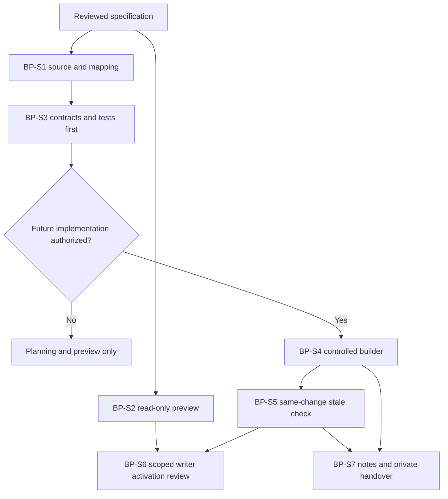

# GF Blueprint Progress Overview and Maintainer - Draft Sprint

| Field | Value |
|---|---|
| **Version** | 0.1 |
| **Date** | 2026-10-29 |
| **Author** | Copilot |
| **Status** | Draft |
| **Scope** | GF handover: evidence-backed blueprint projection, scoped maintainer and same-change freshness |
| **References** | [Idea](../ideas/gf-blueprint-progress-overview-idea.md), [Specification](../specs/2026-10-29-gf-blueprint-progress-overview-design.md), [Provisional implementation plan](2026-10-29-gf-blueprint-progress-overview-implementation.md), [Repository-agent governance](../specs/2026-10-02-hr-frontier-copilot-agent-portfolio-governance-design.md), [GF package map](../README.md#gf-draft-packages) |

## 1. Goal and current scope

Establish a reliable project overview derived from repository sprint/progress evidence, with reviewed narrative changes, deterministic controlled HTML updates and a same-change stale-output check. Hand over a reproducible snapshot and maintenance process, not a promise that an agent runs continuously.

The supplied [blueprint HTML](../Georg%20Fischer%20Frontier%20Company%20Blueprint.html) remains unchanged during planning. The current approved deliverables are the four Draft documents and a gated read/search-only repository-agent preview. Renderer/synchronization/write activation is later implementation.

This is the seventh handover package. It tracks the existing six work packages and its own delivery-enablement work without reclassifying the original three customer workshop MVPs.

Dates, duration, capacity, named owners and estimates are not supplied. No implementation or customer acceptance is claimed from document completion.

## 2. Readiness gates

Confirm the source/evidence and package-ID mapping, allowed narrative updates and reviewer authority. Resolve the scoped repository-agent portfolio amendment and documentation-cleanup prerequisites before enabling write/execute capabilities.

Review the local HTML/customer source inventory and handover permissions. Keep stable IDs, embedded assets, original renderer attribution and browser notes intact. Missing generator source does not authorize rebuilding arbitrary content.

## 3. Candidate backlog

| Item | Work | Evidence and dependency |
|---|---|---|
| BP-S1 | Register the imported baseline, seven-package mapping and source/authority rules | Source hashes/schema, status vocabulary, actual mappings and unresolved claims; no invented delivery state |
| BP-S2 | Create/verify the manually invoked read-only maintainer preview | Explicit read/search/task tools, Proposed Baseline status, no file/command/remote capability and not-run reporting; uses the previously approved narrow preview scope, not full-role activation |
| BP-S3 | Define strict progress/narrative/source contracts and synthetic fixtures | Document/delivery/verification/acceptance separation; rejected unsupported claims and paths; depends on BP-S1 |
| BP-S4 | Implement controlled builder and managed data/rendering regions | Same-input reproducibility, preserved unapproved data/assets and atomic/conflict-safe writes; depends on BP-S3 |
| BP-S5 | Add read-only freshness checking to existing validation | Exact-input fingerprints, stale/missing/unknown failures and no new autonomous publisher; depends on BP-S4 |
| BP-S6 | Review full maintainer role and only then authorize narrowly enforced update capability | Portfolio amendment, exact path/command enforcement, negative tests and human acceptance; depends on BP-S2 through BP-S5 |
| BP-S7 | Prove note/version handling and clean-folder customer handover | Explicit feedback review/migration, approved inventory/manifest, offline checks and recipient acceptance; depends on BP-S4/BP-S5 |

BP-S2 is the only agent implementation authorized by this planning request. BP-S3 through BP-S7 require a separate execution decision and their own gates. A profile file alone does not deliver automatic blueprint updates.

## 4. Dependency and review flow

The chart separates the preview profile from the future update/validation path.

## 5. Proposed definition of done

For the implemented overview, repository sources and evidence determine explicit progress scope; draft documents, checkboxes and browser validation cannot create completion or approval. Every material narrative change has a reviewed authority/source reference.

The deterministic builder preserves unapproved content, assets, attribution and note namespaces. Check never writes; changed input fails freshness until a reviewed rebuild produces matching output. Repeated builds with identical inputs are byte-identical.

A full maintainer cannot bypass its path/command envelope, create evidence, approve itself, access tenants or publish/merge. Preview acceptance verifies only its actual read-only capabilities, not the planned writer.

Customer handover requires an approved inventory, manifest, clean-folder offline/link/keyboard checks, current snapshot label and named acceptance. No raw browser notes, private configuration, unreviewed sources or Git history travel by default.

## 6. Current blockers and next checkpoint

The source HTML and record shapes are inspected, but generator implementation, structured progress inputs, exact narrative allow-list, freshness integration and full-role controls do not yet exist. Source mappings, named owners and handover inventory need review. Azure Boards is later scope; no item ID or synchronization is implied.

The [implementation plan](2026-10-29-gf-blueprint-progress-overview-implementation.md) remains provisional because written-specification review is pending. Only the previously approved tested read-only preview is created now; full execution and activation require that review and the plan's gates. Keep the imported HTML unchanged and do not commit, push or transfer without a separate request and disclosure authorization.

Board synchronization is Deferred - not synchronized.
