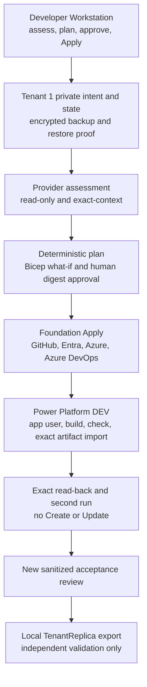

# Tenant 1 Runbook End-to-End Design

| Field | Value |
|---|---|
| **Version** | 1.0 |
| **Date** | 2026-10-02 |
| **Author** | docs-agent (Voice of Knowledge) |
| **Status** | Proposed Baseline |
| **Scope** | Tenant 1 infrastructure runbooks and Power Platform DEV delivery |
| **References** | [Specification Catalogue](README.md), [Operational Runbooks Design](2026-09-26-operational-runbooks-design.md), [Tenant 1 Lean Engineering Platform Design](2026-09-28-tenant-1-lean-engineering-platform-design.md), [Active Configuration Review](../reviews/2026-09-28-tenant-1-engineering-platform-configuration-review.md), [Infrastructure Domain](../../infra/README.md) |

## 1. Status and Approval Gate

This specification proposes the architecture and acceptance authority for the next Tenant 1 runbook sprint. It is not approved implementation authority. User approval is still required before:

- writing implementation plans from this design;
- changing the status of an older specification or plan;
- reactivating any cloud-foundation Apply path;
- running a live provider assessment, pipeline, deployment, import, or tenant mutation; or
- archiving or moving an existing document.

The sprint outcome below is the recommended default selected during brainstorming because the user was unavailable at that decision point. Recording it as a Proposed Baseline does not convert that recommendation into approval.

The core responsibility split in ADR-0001, ADR-0002, and ADR-0012 remains: GitHub owns product source, Azure Boards owns the backlog, Azure Pipelines owns HR solution delivery, and each tenant has an isolated repository and project. This proposal advances the previously future Azure Pipeline into the next sprint; it does not restore the rejected private Azure Repo or GitHub OIDC bootstrap. Approval requires a targeted authority review of those ADRs' time-bound “current sprint” wording, without silently changing their architectural decisions.

The three companion specifications make each subsystem independently plannable:

- [Developer Workstation Runbook Refactor Design](2026-10-02-developer-workstation-runbook-refactor-design.md)
- [Cloud Service Foundation Runbook Design](2026-10-02-cloud-service-foundation-runbook-design.md)
- [Tenant Replica and Customer Handover Runbook Design](2026-10-02-tenant-replica-and-customer-handover-runbook-design.md)

## 2. Problem and Proposed Outcome

The repository has substantial workstation and local-export engines, but it does not have one supported, evidence-bound sequence that proves Tenant 1 from a current Windows 11 workstation through provider foundation and an exact Power Platform DEV deployment. The cloud public entry points are deliberate stop stubs, the Tenant 1 private configuration is absent, no Azure Pipeline YAML exists, and the current HR PAC tooling exports and unpacks only.

The proposed sprint proves one composable lifecycle:

1. assess, plan, approve, and Apply the developer workstation;
2. restore or re-enter `infra/src/config/tenants/tenant1.local.psd1`, create local state, and prove encrypted backup and restore;
3. perform read-only provider assessment;
4. produce a deterministic plan and Azure subscription `what-if`;
5. obtain human approval of the exact digest;
6. Apply only supported foundation actions;
7. create or reconcile an Azure Pipeline that uses Power Platform Build Tools 2.0 and workload identity federation;
8. build the committed HR solution and import that exact artifact to Power Platform DEV;
9. read back the exact supported stable properties;
10. reassess and rerun Apply to prove there are no `Create` or `Update` actions;
11. produce a new sanitized acceptance review; and
12. create and independently validate a local `TenantReplica` export only.

Power Platform TEST and PROD are discovered and validated as lifecycle targets but are never mutated. This sprint neither publishes the replica nor operates Tenant 2.

## 3. Evidence Basis

### 3.1 Known

The design baseline was reported as a clean `main` at merge commit `3334ff311884e6be166bb174ba3c6409bce8baa2`. This design branch started at that commit. The commit identifies the source baseline; it does not prove future execution state.

Repository inspection and the supplied design findings establish:

- Three infrastructure runbooks exist. The [workstation runbook](../../infra/docs/runbooks/01-developer-workstation.md) is an active Proposed Baseline; the [cloud foundation runbook](../../infra/docs/runbooks/02-cloud-service-foundation.md) is a Superseded stop notice whose two public scripts throw immediately; the [customer handover runbook](../../infra/docs/runbooks/03-customer-handover.md) is a local-only Proposed Baseline.
- The workstation assessment, execution-manifest, `ShouldProcess`, Apply, read-back, and test foundations are substantial.
- The customer export and independent-validation foundations are substantial and tested, but they do not publish a repository or provision a tenant.
- Dormant cloud modules can assess, plan, or mutate portions of GitHub rulesets and metadata, credential-free Entra application and service-principal state, Azure subscription Bicep resources, and Azure DevOps project creation. They are not a supported operating path until revalidated and connected to new public contracts.
- Power Platform environments, SharePoint sites, Azure DevOps approvals and checks, connections, and federation surfaces are currently `Manual` or `Blocked`.
- Subscription-scope Bicep currently declares the platform resource group, Log Analytics workspace, Activity Log diagnostic setting, and policy assignments. Bicep remains the owner of Azure resources; PowerShell only validates, sequences, invokes, and reads back.
- The ignored Tenant 1 file `infra/src/config/tenants/tenant1.local.psd1` is absent. Only the tracked Tenant 2 transition manifest and discovery evidence remain. Live Tenant 1 work is blocked until the private intent is restored or re-entered and an encrypted backup and independent restore are proven.
- An Azure extension authentication context observed during design was not proven to be Tenant 1 and is isolated from Azure CLI, PAC CLI, Azure DevOps, and GitHub CLI contexts. It is not live evidence and grants no execution confidence.
- The [2026-09-28 configuration review](../reviews/2026-09-28-tenant-1-engineering-platform-configuration-review.md) is historical point-in-time evidence: 12 `PASS`, 24 `GAP`, and 14 `NOT EVIDENCED`. The [older acceptance review](../reviews/2026-09-28-tenant-1-lean-engineering-platform-acceptance-review.md) remains `Draft`, with controls `Not Run`, and cannot satisfy this sprint.
- No Azure Pipeline YAML exists. [HR solution tooling](../../hr/src/scripts/README.md) is export-only; no pack/import path, pipeline, application-user reconciliation, or service-connection implementation exists.
- Microsoft documents service-principal authentication through workload identity federation as the recommended connection model for Power Platform Build Tools 2.0. Tenant-specific availability and permissions remain unproven.

### 3.2 Inferred

The following are design inferences, not implemented-state claims:

- A composable orchestrator can reuse the strongest existing engines without coupling all behavior into one privileged script.
- Focused reuse of dormant provider modules is lower risk than a wholesale rewrite only where tests and current contracts prove the behavior. Some modules may be cheaper and safer to replace.
- One shared run identity and evidence root can make cross-subsystem provenance reviewable while preserving independently runnable runbooks.
- Packaging committed solution source once and importing the byte-identical pipeline artifact can provide stronger provenance than rebuilding in an environment-specific stage.
- A forward-only reconcile model is safer than automatic destructive rollback across providers that have different transaction and recovery semantics.

### 3.3 To Validate Before Live Entry

Fresh attended assessment must validate:

- the restored Tenant 1 intent and generated state schemas, encrypted backup, and restore procedure;
- exact GitHub, Azure CLI, PAC CLI, Azure DevOps, and Entra contexts and their Tenant 1 stable identifiers;
- current provider inventory, effective least-privilege permissions, owner approvals, and ambiguous-name handling;
- Power Platform Build Tools 2.0 availability in the Tenant 1 Azure DevOps organization and its current workload-identity-federation contract;
- the exact DEV application-user role needed for import and read-back;
- current TEST and PROD identities without changing them;
- the committed HR solution's packability, solution type, version, publisher, and known PAC CLI limitations;
- all dormant-module assumptions against current APIs and repository contracts; and
- current-main repository validation and all focused tests before any Apply.

An unvalidated item is `Blocked` or `Manual`; it is never inferred from an older review.

## 4. Chosen Architecture

### 4.1 Composable Lifecycle Orchestrator

Add a proposed `Invoke-TenantLifecycle.ps1` umbrella entry point for sequencing and evidence correlation only. It does not contain provider mutation logic and is not the only usable entry point.

Three runbooks remain independently runnable:

1. **Developer Workstation** owns local prerequisite assessment and initialization.
2. **Cloud Service Foundation** owns Tenant 1 provider assessment, planning, supported reconciliation, Azure Pipeline configuration, and DEV deployment.
3. **Repository Handover** owns local profile-based export and independent validation.

The orchestrator passes only shared, non-secret control data:

- run ID and evidence root;
- explicit private tenant selector and intent path;
- source commit;
- machine and operator identity labels;
- exact native-tool identities;
- approved execution-manifest digest; and
- prerequisite outcomes.

It never supplies a token, secret, tenant fallback, approval substitute, or provider-specific write payload.

### 4.2 Lifecycle and Dependency Order

The diagram shows control flow, not current implementation.



Each node consumes successful prerequisite evidence from the same run. A later node cannot reinterpret a prior `Manual`, `Blocked`, `Refused`, failed, or stale result as success.

### 4.3 Rejected Alternatives

| Alternative | Decision | Reason |
|---|---|---|
| One monolithic provisioning script | Rejected | It concentrates privilege, prevents subsystem use in isolation, obscures evidence ownership, and makes partial recovery unsafe. |
| Wholesale reactivation of legacy cloud code | Rejected | The public surface is deliberately stopped, contracts have changed, and retained compatibility behavior is not current authority. |
| Delete only the stop-stub `throw` statements | Rejected | Removing a safety guard does not add current context validation, planning, approval, read-back, tests, or supported provider contracts. |
| Manual-only foundation with no deterministic plan | Rejected | It cannot prove digest-bound intent, idempotency, or exact replay on a fresh workstation. |
| Terraform or PowerShell ownership of Azure resources | Rejected | Bicep remains the declarative owner of Azure resources; PowerShell orchestrates only. |
| Complete-mode deployment or implicit deletion | Rejected | This sprint has no reviewed deletion lifecycle. Azure deployment remains incremental. |
| Deployment stacks now | Deferred | Stacks may support a future reviewed deletion lifecycle, but introducing them here changes ownership and deletion semantics. |
| Rebuild the solution in each deployment stage | Rejected | The pipeline must import the same published artifact that was built and checked from the exact GitHub SHA. |
| GitHub Actions expansion for tenant CI/CD | Rejected | Azure Pipelines owns HR solution CI/CD; GitHub Actions remains repository validation only. |
| Automatic destructive rollback | Rejected | Cross-provider rollback is not atomic and can erase adopted or human-approved state. Recovery reassesses and reconciles forward. |

## 5. Desired State and Shared Evidence Contract

### 5.1 Private Desired State

Two ignored local artifacts separate human intent from observed stable state:

| Artifact | Owner | Content | Constraint |
|---|---|---|---|
| `infra/src/config/tenants/tenant1.local.psd1` | Human-reviewed intent | Non-secret tenant selectors, target names, desired properties, stages, and explicit component intent | Never generated from discovery, committed, or inferred; encrypted backup and restore proof required. |
| `infra/src/config/tenants/tenant1.state.local.json` | Tool-generated state | Stable object IDs and last-verified properties needed to re-adopt exact resources | Never an authority for desired values or credentials; fresh read-back must confirm it; encrypted backup required. |

State drift does not silently rewrite intent. Intent drift, state drift, or an unreviewed backup invalidates the run.

### 5.2 Run Evidence Layout

All raw operational evidence stays outside Git under one selected root:

```text
<evidence-root>/<run-id>/
├── assessment.json
├── execution-manifest.json
├── approvals.json
├── actions/
│   └── <ordered-action-id>.json
├── read-back.json
├── pipeline.json
├── power-platform.json
└── summary.json
```

The execution manifest binds the run ID, source commit, machine, private tenant selector, intent digest, state digest, tool identities, provider contexts, ordered actions, prerequisite outcomes, expiry, and evidence root. `approvals.json` records the approved digest, approver role, timestamp, and scope without credentials or approval-session payloads.

Raw responses, private identifiers beyond the reviewed allowlist, command transcripts, generated parameters, pipeline tokens, and authentication material remain outside Git. A separately reviewed sanitized acceptance record is the only committed run output.

### 5.3 Classifications and Idempotency

Every assessed component has exactly one classification:

- `NoChange`
- `Create`
- `Update`
- `Manual`
- `Blocked`
- `Refused`

`Manual` is not success until the human action and independent read-back both pass. `Blocked` and `Refused` stop dependent actions. A second unchanged execution must contain no `Create` or `Update`.

## 6. Provider Order and Boundaries

Every mutation rereads the exact target immediately before action and performs stable-ID and exact-property read-back afterward. Missing, unauthorized, unavailable, stale, or ambiguous state blocks. There is no first-match behavior.

1. **GitHub:** verify or reconcile only the existing repository's approved metadata and ruleset. Do not create a repository, publish an export, add a tenant workflow, or broaden Actions into delivery.
2. **Microsoft Entra:** verify or reconcile a credential-free delivery application and service principal plus one reviewed federated credential. The attended operator remains the local execution identity.
3. **Azure:** repeat subscription `what-if`, then invoke one incremental Bicep deployment for the exact approved bytes. Bicep owns the platform resource group, Log Analytics workspace, Activity Log diagnostic setting, and policy assignments. No complete mode, implicit deletion, authorization-resource improvisation, or deployment stack is allowed.
4. **Azure DevOps:** verify the exact Tenant 1 project, or create a per-tenant project only when reviewed intent says `Create` and fresh evidence proves no conflict. Then reconcile the pipeline, DEV environment, workload-identity-federated service connection, and required checks through supported and permission-gated surfaces.
5. **Power Platform administration:** verify DEV, TEST, and PROD. Reconcile only the DEV application user and minimum reviewed role through attended administrative authority. TEST and PROD remain read-only.
6. **Azure Pipeline delivery:** pack the committed HR solution, run the required check, publish one artifact bound to the exact GitHub SHA and approved digest, import that same artifact to DEV without rebuilding, and read back the supported solution properties.

Human-only identity, role, consent, secret-dependent, external-publication, and production decisions remain `Manual`. Scripts may reconcile only the identity metadata and minimum role already approved in reviewed intent. This sprint introduces no secret path. No script self-elevates, and every completed human action is independently read back before it can pass.

## 7. Failure and Recovery

- Source commit, machine, tenant, tool identity, approved digest, intent, or context drift invalidates approval.
- An action failure stops later actions, preserves evidence, and requires fresh assessment before retry.
- Partial resources may be adopted only by exact stable ID after current property read-back proves that they match reviewed intent.
- Recovery reconciles forward. It does not automatically delete, downgrade, detach, or roll back a resource.
- A `404`, empty response, malformed response, multiple match, permission failure, timeout, unsupported capability, or uncertain ownership is blocking unless the contract explicitly defines that response as the expected postcondition.
- A required manual step must be completed and read back before acceptance. Deferral is not a pass.
- Unsupported legacy actions remain blocked even when adjacent modules are reused.

## 8. Current Live-Entry Blockers

| Blocker | Required clearance |
|---|---|
| Tenant 1 private intent is absent | Restore from an encrypted backup or re-enter through reviewed intent; prove schema, backup, separate restore, and equality. |
| Tenant 1 tool contexts are unproven | Authenticate interactively and read back the exact GitHub, Azure, Azure DevOps, PAC, and tenant contexts. |
| Provider inventory is stale or incomplete | Perform a new read-only assessment; do not rely on the 2026-09-28 counts. |
| Owner and least-privilege approvals are absent | Obtain attended approval through the owning administrative processes; no self-elevation. |
| Azure DevOps WIF availability is unproven | Verify Build Tools 2.0, organization support, service-connection scheme, and required permissions. |
| HR import path does not exist | Implement and test pack, check, immutable artifact, import, and read-back before live use. |
| Cloud public scripts are stop stubs | Replace the stopped surface through focused test-driven implementation; never remove only the guard. |
| Acceptance record is historical or Draft | Create a new sprint-specific review; do not overwrite either 2026-09-28 review. |

## 9. Proposed Acceptance Authority

A new sprint-specific acceptance review is the proposed authority for claims that this lifecycle ran. It must live under `docs/reviews/`, reference this specification and the approved implementation plans, and contain only sanitized evidence. It does not overwrite the historical configuration review or Draft lean acceptance review.

All mandatory controls must pass in one traceable lifecycle. `Manual`, `Blocked`, `Refused`, `Not Run`, stale, or ambiguous outcomes cannot be accepted.

| ID | Control | Required proof |
|---|---|---|
| `T1-E2E-01` | Source and tests | Focused and full repository tests pass on the execution source commit; current-main repository CI is green at final acceptance. |
| `T1-E2E-02` | Workstation first Apply | Current Windows 11 assessment, plan, digest approval, Apply, exact read-back, and restart-safe evidence pass. |
| `T1-E2E-03` | Private intent and state recovery | Tenant 1 intent and state remain ignored and outside Git; encrypted backup and separate restore prove schema and equality without exposing values. |
| `T1-E2E-04` | Provider assessment | Fresh exact-context inventory covers GitHub, Entra, Azure, Azure DevOps, and Power Platform; ambiguity and missing permission are blocking. |
| `T1-E2E-05` | Plan and approval | The deterministic action set and subscription `what-if` are bound to one execution-manifest digest approved by a human. |
| `T1-E2E-06` | Azure deployment | Incremental Bicep Apply uses the exact approved template and parameters; resulting creates/updates match the sanitized `what-if`; no implicit deletion occurs. |
| `T1-E2E-07` | Pipeline provenance | The pipeline run identifies the exact GitHub SHA and approved digest and publishes one immutable HR solution artifact with a recorded digest. |
| `T1-E2E-08` | DEV deployment | The same published artifact is imported to the exact DEV environment; supported stable solution properties, import result, application user, and minimum role read back exactly. |
| `T1-E2E-09` | Pipeline rerun | Rerunning with unchanged source and intent is idempotent and does not rebuild a different deployment artifact or create duplicate resources. |
| `T1-E2E-10` | Foundation second run | Fresh assessment and Apply against unchanged intent produce no `Create` or `Update`. |
| `T1-E2E-11` | TEST and PROD safety | TEST and PROD stable IDs and lifecycle roles are read back; no mutation or promotion occurs. |
| `T1-E2E-12` | Fresh laptop | A fresh Windows 11 laptop clones then-current `main`, performs workstation assess/Apply, restores Tenant 1 intent/state, authenticates interactively, gets foundation `NoChange`, and proves the pipeline/read-back path. |
| `T1-E2E-13` | TenantReplica | A local profile export from the exact source commit passes independent byte-level and policy validation with no Tenant 1 private state, identifiers, or evidence. |
| `T1-E2E-14` | Sanitized review | A new acceptance review maps every control to sanitized evidence and explicitly records non-claims. |

## 10. Documentation Disposition After Approval and Replacement

This change moves or archives nothing. The following matrix is a proposal for later implementation. An archive action occurs only after replacement runbooks are accepted and the documentation policy determines the canonical archive route.

| Current document or group | Proposed disposition | Gate |
|---|---|---|
| [`infra/docs/17-bootstrap-and-provisioning.md`](../../infra/docs/17-bootstrap-and-provisioning.md) | Archive | Accepted replacement runbooks and repaired inbound links. |
| [`infra/docs/19-bootstrap-recovery.md`](../../infra/docs/19-bootstrap-recovery.md) | Archive | Accepted replacement recovery contract. |
| [`infra/docs/24-tenant-1-lean-platform-runbook.md`](../../infra/docs/24-tenant-1-lean-platform-runbook.md) | Archive | Cloud foundation replacement accepted and new acceptance authority active. |
| [`infra/docs/22-repository-cleanup-runbook.md`](../../infra/docs/22-repository-cleanup-runbook.md) | Archive | Profile-based handover replacement accepted. |
| [`infra/docs/23-customer-repository-export-and-handover-runbook.md`](../../infra/docs/23-customer-repository-export-and-handover-runbook.md) | Archive | Profile-based handover replacement accepted. |
| [`infra/docs/20-tenant-trust-activation-runbook.md`](../../infra/docs/20-tenant-trust-activation-runbook.md) and [`21-azure-boards-population-runbook.md`](../../infra/docs/21-azure-boards-population-runbook.md) | Retain as operational safety stop notices | Links may change; no reactivation is proposed. |
| [`infra/docs/10-tenant-setup-and-configuration.md`](../../infra/docs/10-tenant-setup-and-configuration.md), [`11-identity-and-access.md`](../../infra/docs/11-identity-and-access.md), [`12-power-platform-environments-and-alm.md`](../../infra/docs/12-power-platform-environments-and-alm.md), [`13-azure-devops-engineering-control-plane.md`](../../infra/docs/13-azure-devops-engineering-control-plane.md), [`14-github-repository-blueprint.md`](../../infra/docs/14-github-repository-blueprint.md), [`16-security-governance-and-compliance.md`](../../infra/docs/16-security-governance-and-compliance.md), and [`18-multi-tenant-provisioning.md`](../../infra/docs/18-multi-tenant-provisioning.md) | Rewrite in place | Approved implementation aligns authority and current operating boundaries. |
| [`infra/README.md`](../../infra/README.md), [`infra/docs/README.md`](../../infra/docs/README.md), and [`infra/docs/runbooks/README.md`](../../infra/docs/runbooks/README.md) | Rewrite in place | Catalogue and safety-critical entry points reflect accepted replacements. |
| [`01-developer-workstation.md`](../../infra/docs/runbooks/01-developer-workstation.md), [`02-cloud-service-foundation.md`](../../infra/docs/runbooks/02-cloud-service-foundation.md), and [`03-customer-handover.md`](../../infra/docs/runbooks/03-customer-handover.md) | Rewrite in place; runbook 02 becomes an active replacement only after acceptance | Approved implementations, tests, and live-entry gates are complete. |
| [`infra/docs/15-agent-workload-configuration.md`](../../infra/docs/15-agent-workload-configuration.md) | Keep as separate future workload guidance | Update only links and authority statements affected by accepted replacements. |

Historical specifications and plans remain in their canonical `docs/specs/` and `docs/plans/` roots. They are not moved to create the appearance of a new history.

## 11. Proposed Supersession Map

No status changes are made by this Proposed Baseline.

| Current artifact | Proposed successor | Earliest status change |
|---|---|---|
| [2026-09-26 Operational Runbooks Design](2026-09-26-operational-runbooks-design.md) | This umbrella and its three companion specifications | Only after explicit user approval of this design set. |
| [2026-09-28 Tenant 1 Lean Engineering Platform Design](2026-09-28-tenant-1-lean-engineering-platform-design.md) | This umbrella plus the cloud companion | Only after explicit user approval; its historical approval and point-in-time decisions remain traceable. |
| [2026-09-27 Customer Repository Export and Handover Design](2026-09-27-customer-repository-export-and-handover-design.md) | The handover companion | Only after explicit user approval. |
| [2026-09-26 Runbook Foundation and Windows 11 Workstation Implementation Plan](../plans/2026-09-26-runbook-foundation-workstation.md) | A future workstation implementation plan derived from the approved companion | Only after explicit user approval of this design set; retain it in `docs/plans/` with `Superseded` status. |
| [2026-09-26 Cloud Service Foundation Runbook Implementation Plan](../plans/2026-09-26-runbook-cloud-foundation.md) | A future cloud implementation plan derived from the approved companion | Only after explicit user approval of this design set; retain it in `docs/plans/` with `Superseded` status. |
| [2026-09-26 Customer Repository Export and Handover Implementation Plan](../plans/2026-09-26-runbook-customer-handover.md) and [2026-09-27 Customer Repository Export and Handover Implementation Plan](../plans/2026-09-27-customer-repository-export-and-handover-implementation.md) | A future profile-based handover implementation plan | Only after explicit user approval of this design set; retain both in `docs/plans/` with `Superseded` status. |
| [2026-09-28 Tenant 1 Lean Engineering Platform Implementation Plan](../plans/2026-09-28-tenant-1-lean-engineering-platform-implementation.md) | Future umbrella and subsystem plans | Only after explicit user approval of this design set; retain it in `docs/plans/` with `Superseded` status. |

The Draft [Power Platform Solution Foundation Design](2026-09-24-power-platform-solution-foundation-design.md) remains source-history and export-foundation context. This proposal adds a delivery path but does not silently promote or supersede that Draft.

## 12. Implementation Decomposition

After user approval, implementation planning should split work into independently reviewable increments:

1. **Shared lifecycle contract:** schemas, run identity, evidence envelopes, classifications, prerequisite graph, and orchestration-only `Invoke-TenantLifecycle.ps1`.
2. **Workstation refactor:** version policy, external worktree checks, restart-safe evidence, repository validation, and fresh-laptop tests.
3. **Private state recovery:** Tenant 1 intent re-entry/restore procedure, generated state, encrypted backup/restore proof, and safety tests.
4. **Read-only provider assessment:** exact contexts, stable IDs, ambiguity handling, and sanitized inventory.
5. **Deterministic planning:** provider action plans, subscription `what-if`, digest approval, drift invalidation, and `-WhatIf`.
6. **Supported provider reconciliation:** GitHub, Entra, Bicep incremental deployment, and Azure DevOps project/pipeline resources, each developed with focused tests and contract revalidation.
7. **Power Platform DEV delivery:** WIF service connection, attended application user and minimum role, Build Tools 2.0 pack/check/publish/import, and exact read-back.
8. **Idempotency and recovery:** partial-resource adoption, stopped-run resumption through reassessment, second-run `NoChange`, and pipeline rerun proof.
9. **Profile-based handover:** `TenantReplica` and `CustomerHandover` manifests, local export, independent validation, and no-publication tests.
10. **Documentation replacement:** rewrite runbooks and catalogues, update authority links, then apply approved supersession and archive dispositions.
11. **Acceptance:** fresh laptop, current-main CI, sanitized review, and explicit non-claims.

Each increment starts with focused failing tests for behavior that can be automated. Live provider calls occur only in separately approved attended checkpoints after the implementation is reviewed.

## 13. Risks and Tradeoffs

| Risk or tradeoff | Treatment |
|---|---|
| Reusing dormant modules carries stale-contract risk | Reuse only behind new tested adapters after current contract validation; replace unsafe or unclear code. |
| WIF and Power Platform administration cross permission domains | Keep setup attended, permission-gated, least-privilege, and independently read back. |
| Local private files increase operator dependency | Require encryption, separate-failure-domain backup, restore proof, and a fresh-laptop acceptance run. |
| A shared run ID may imply a transaction that providers cannot provide | Evidence records ordered outcomes; recovery is forward reconciliation, not distributed rollback. |
| Exact read-back differs by provider | Define provider-specific stable properties and state explicitly when a platform cannot expose artifact bytes or a requested property. |
| Importing to DEV changes a source environment | Limit the import to the exact reviewed committed solution artifact and record that maker changes after import require a new source sync and review. |
| Human gates reduce unattended repeatability | This is intentional for consent, role, approval, and production boundaries; automation may not substitute for authority. |
| Documentation replacement can erase safety context | Retain stop notices, delay archives until replacements are accepted, and keep historical specs/plans in canonical lifecycle roots. |

## 14. Non-goals

This proposal does not authorize or include:

- a Tenant 2 live operation;
- TEST or PROD mutation, import, promotion, or release;
- tenant creation;
- license purchase or assignment;
- DLP or Conditional Access changes;
- self-elevation, unreviewed consent, or broad role assignment;
- secrets in source, command parameters, plans, or evidence;
- destructive deletion, complete-mode deployment, or automatic rollback;
- external repository creation, publication, push, or ownership transfer;
- GitHub Actions CI/CD expansion beyond repository validation;
- a claim that current Tenant 1 configuration or authentication contexts are ready; or
- scripts, tests, pipelines, tenant mutations, live calls, document moves, or other implementation in this design-only change.

## 15. First-Party and Repository Sources

- [Bicep deployment what-if operation](https://learn.microsoft.com/en-us/azure/azure-resource-manager/bicep/deploy-what-if)
- [Azure Resource Manager deployment modes](https://learn.microsoft.com/en-us/azure/azure-resource-manager/templates/deployment-modes)
- [Azure deployment stacks](https://learn.microsoft.com/en-us/azure/azure-resource-manager/bicep/deployment-stacks)
- [Power Platform Build Tools for Azure DevOps](https://learn.microsoft.com/en-us/power-platform/alm/devops-build-tools)
- [Power Platform Build Tools tasks](https://learn.microsoft.com/en-us/power-platform/alm/devops-build-tool-tasks)
- [Power Platform Environments and ALM](../../infra/docs/12-power-platform-environments-and-alm.md)
- [Azure DevOps Engineering Control Plane](../../infra/docs/13-azure-devops-engineering-control-plane.md)
- [HR Solution Sources](../../hr/src/solutions/README.md)
- [ADR-0001](../adr/0001-azure-devops-as-engineering-control-plane.md), [ADR-0002](../adr/0002-github-first-bootstrap-and-the-role-of-azure-repos.md), [ADR-0003](../adr/0003-bicep-and-powershell-for-infrastructure-as-code.md), and [ADR-0012](../adr/0012-per-tenant-github-repository-and-account-topology.md)
