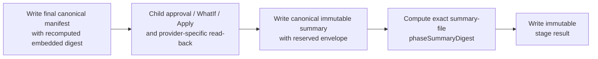

# Tenant Lifecycle Child Summary Envelope Design

| Field | Value |
|---|---|
| **Version** | 1.1 |
| **Date** | 2026-10-19 |
| **Author** | docs-agent (Voice of Knowledge) |
| **Status** | Approved |
| **Scope** | Tenant lifecycle canonical child-summary envelope, stage-result correlation, prerequisite validation, and evidence-digest authority |
| **References** | [Specification Catalogue](README.md), [Draft Child Summary Envelope Implementation Plan](../plans/2026-10-03-tenant-lifecycle-child-summary-envelope-implementation.md), [Approved Tenant Lifecycle Coordinate-Only Simplification Design](2026-10-03-tenant-lifecycle-coordinate-only-simplification-design.md), [Draft Tenant Lifecycle Coordinate-Only Correction Plan](../plans/2026-10-03-tenant-lifecycle-coordinate-only-correction-implementation.md), [Approved Tenant 1 Runbook End-to-End Design](2026-10-02-tenant-1-runbook-end-to-end-design.md) |

## 1. Review Status, Authority, and Entry Gate

The user explicitly approved all three design sections and the full design in chat. Their later unavailability applied only to a second review of this faithful written capture, so the prior explicit full-design approval is accepted and this specification is `Approved`.

This specification is the focused architectural companion to the [Tenant Lifecycle Coordinate-Only Simplification Design](2026-10-03-tenant-lifecycle-coordinate-only-simplification-design.md) and the governing summary-envelope authority for the [Tenant Lifecycle Coordinate-Only Correction Plan](../plans/2026-10-03-tenant-lifecycle-coordinate-only-correction-implementation.md). It adds exact shared `Summary` envelope, digest, write-order, and validation requirements. The Approved coordinate-only design remains authoritative for umbrella and child ownership, stage-result shape, outcome pairs, projection, and all unaffected behavior.

Approval authorizes the [Draft implementation plan](../plans/2026-10-03-tenant-lifecycle-child-summary-envelope-implementation.md) to define the corrective work; it does not prove that implementation has occurred or make the branch merge-ready. The implementation, corrective plan, and every downstream plan remain `Draft` and blocked until the plan is reviewed, its implementation is reviewed and merged, and then-current `main` is green.

No provider call, live execution, tenant mutation, or merge-readiness claim is authorized by this approval.

## 2. Problem and Root Cause

Final re-review found that child-summary validation remained digest-only and semantically opaque. The umbrella proved that a canonical summary file had the digest named by its stage result, but did not prove that the summary itself carried the expected run, stage, source, tenant, intent, output state, manifest, or outcome coordinates.

That gap permits coordinated evidence substitution: a foreign canonical summary and a correspondingly changed stage result can agree on `phaseSummaryDigest` while carrying unrelated provenance or outcomes. File integrity alone does not establish evidence identity.

The same review found a separate prerequisite-manifest gap. Validation checked the exact manifest-file SHA represented by `phaseManifestDigest`, but did not independently recompute the manifest's embedded `digest`. A changed manifest and correspondingly changed stage result could therefore pass the exact-file check while preserving an invalid embedded digest.

Section 6.3 of the Approved coordinate-only design already requires each summary's stage, provenance, status, and classification to agree with its result. The root cause is not a missing sidecar or another evidence layer; it is that the shared canonical `Summary` contract does not yet expose a reserved envelope sufficient to enforce that requirement.

## 3. Decision

Evolve the existing shared canonical `Summary` contract in place.

Every canonical `phases/<stage>/summary.json` carries one reserved root envelope alongside the existing shared summary fields. No sidecar, wrapper, nested envelope, compatibility document, or second summary type is introduced.

The reserved envelope binds the exact summary bytes to:

- the current run, stage, source, public tenant, and intent;
- the stage's output private state;
- the exact final canonical phase-manifest file;
- the terminal child outcome; and
- the terminal completion time.

Provider-specific extra root properties remain allowed and opaque. The shared validator proves the reserved envelope and existing shared structures, but does not interpret, project, redact into acceptance, or infer behavior from provider-specific content.

## 4. Canonical Summary Contract

### 4.1 Location, Bytes, and Immutability

Each completed child stage writes exactly one canonical summary at:

```text
<run-root>/phases/<stage>/summary.json
```

The file is a contained, regular, non-reparse file. It uses the repository's canonical JSON encoding: UTF-8 without BOM, deterministic property and array ordering under the shared writer, normalized canonical values, and one trailing LF. The completed file is immutable. A changed input, output, outcome, or timestamp requires a new run.

Canonicalization is part of the evidence contract, not a repair step. Validators reject noncanonical bytes rather than rewriting, normalizing, or accepting a semantically equivalent representation.

### 4.2 Reserved Root Envelope

Every canonical summary requires these reserved root fields with exactly these case-sensitive names:

| Reserved field | Exact meaning and correlation |
|---|---|
| `schemaVersion` | Exact supported version of the shared canonical `Summary` contract. It is validated against the reviewed summary contract, independently of the stage-result schema version. |
| `runId` | Exact current run identifier and exact stage-result `runId`. |
| `stage` | Exact canonical stage token from the current ordered stage set, path, and stage result. |
| `sourceCommit` | Exact current expected source commit and exact stage-result `sourceCommit`. |
| `publicTenantKey` | Exact current public tenant key and exact stage-result `publicTenantKey`; it is never a provider tenant identifier. |
| `intentDigest` | Exact canonical digest of the selected private intent at the stage boundary and exact stage-result `intentDigest`. |
| `stateDigest` | Exact canonical digest of the output private state after terminal child read-back, state adoption, or confirmed `NoChange`; it equals the stage-result `stateDigest`. |
| `phaseManifestDigest` | Lowercase SHA-256 of the exact bytes of the final canonical manifest file, after its embedded `digest` is populated; it equals the stage-result `phaseManifestDigest`. |
| `status` | Exact terminal stage-result `status`. |
| `classification` | Exact terminal stage-result `classification`. |
| `completedAtUtc` | Exact canonical UTC completion value from the stage result, with byte-equivalent string representation after canonical writing. |

The allowed `status` and `classification` values and pairs remain closed as defined by the Approved coordinate-only design. This companion does not add an outcome or reinterpret dependency success: only `Passed` satisfies a dependency or acceptance gate.

All reserved names are owned by the shared contract:

- a provider cannot replace, omit, rename, redefine, or populate one as provider data;
- duplicate JSON properties are invalid;
- a case variant does not satisfy a reserved field; and
- a root property that collides with a reserved name under ordinal case-insensitive comparison is invalid unless it has the exact reserved spelling and shared meaning.

### 4.3 Existing Shared Fields and Provider Extras

The existing shared root fields remain part of the canonical `Summary` contract and retain their current definitions and requiredness:

- `startedAtUtc`;
- `counts`;
- `prerequisites`;
- `actions`; and
- `nonClaims`.

Provider-specific extra root properties remain allowed. They are opaque to umbrella Verify and shared prerequisite validation. Their presence, absence, names, and values cannot:

- satisfy or replace a reserved or existing shared field;
- change a shared validation decision;
- appear in the umbrella projection;
- appear in a validation error payload or message; or
- become an inferred provider claim.

Existing nested shared structures remain closed. Provider properties are not permitted inside `counts`, `prerequisites`, `actions`, `nonClaims`, or another shared nested object unless that existing shared contract explicitly owns them.

Existing secret and raw-output prohibitions remain unchanged. A canonical summary cannot contain credentials, tokens, private configuration, raw provider responses, unreviewed provider output, or another prohibited value merely because provider-specific root properties are opaque to the umbrella.

### 4.4 Three Distinct Digest Checks

The evidence model has three deliberately distinct digest checks:

| Digest | Computation | Stored in | Purpose |
|---|---|---|---|
| Manifest embedded `digest` | Recomputed by the existing execution-manifest algorithm over the manifest content that algorithm defines; it is not a digest of the final file including itself. | Canonical manifest | Proves the manifest's own execution-intent contract. |
| `phaseManifestDigest` | Lowercase SHA-256 over the exact bytes of the final canonical manifest file, including its populated embedded `digest`. | Summary and stage result | Binds summary and result to one exact immutable manifest file. |
| `phaseSummaryDigest` | Lowercase SHA-256 over the exact bytes of the final canonical immutable summary file. | Stage result only | Binds the stage result to one exact summary file. |

The summary has no self-digest. Adding `phaseSummaryDigest` to the summary would create an unnecessary recursive contract. The child writes the final summary first, computes its exact byte digest, and then writes that value into the immutable stage result.

The exact-file digest checks do not replace semantic validation. Validators independently recompute the manifest's embedded `digest`, validate the summary envelope, and correlate the summary and result.

## 5. Child Write Protocol

The child owns this ordered evidence transition:



The order is mandatory:

1. Build and canonically write the final phase manifest, recomputing its embedded `digest`.
2. Complete child-owned approval, WhatIf, Apply where approved, provider-specific read-back, state adoption where required, or confirmed `NoChange`.
3. Determine the terminal status, classification, output `stateDigest`, and completion time.
4. Write the envelope-bearing canonical immutable summary.
5. Compute `phaseSummaryDigest` from the exact summary-file bytes.
6. Write the immutable stage result with matching coordinates, outcome, `phaseManifestDigest`, and `phaseSummaryDigest`.

No stage result may be written before the immutable summary exists. Neither the summary nor the stage result may be overwritten to reconcile a mismatch.

## 6. Verify and Prerequisite Enforcement

### 6.1 Common Validation

Umbrella Verify and Assess/Plan prerequisite dispatch use equivalent validation for every completed prerequisite stage. Both paths:

1. establish current run, source, public-tenant, intent, private-state, and ordered-stage coordinates;
2. validate the exact contained canonical stage result;
3. read the exact contained canonical summary bytes named by `evidenceRelativePath`;
4. reject noncanonical bytes, duplicate properties, missing fields, malformed fields, case drift, and closed-structure violations;
5. compute `phaseSummaryDigest` over the exact summary bytes and compare it with the stage result;
6. validate every reserved summary field against its contract, the stage result, and the current coordinates;
7. leave allowed provider-specific root properties opaque;
8. read the exact canonical manifest bytes and recompute `phaseManifestDigest`;
9. independently recompute and validate the manifest's embedded `digest`; and
10. accept the prerequisite only when its result status is literally `Passed` and the shared prerequisite graph is satisfied.

The shared implementation may reuse one validator, but reuse is not the acceptance criterion. Tests must prove behaviorally equivalent enforcement in Verify and prerequisite dispatch.

### 6.2 Verify Boundary

Verify remains read-only and never invokes a child, provider adapter, runner, or `SubsystemInvoker`. It validates all selected evidence before writing the umbrella projection.

Any validation failure produces no projection. Errors identify the shared artifact, field or digest rule, and failure class without echoing opaque provider property names or values, raw output, secrets, or private content.

### 6.3 Assess/Plan Prerequisite Boundary

Assess and Plan validate every completed prerequisite summary, stage result, and manifest before dispatching the next child. An invalid or non-`Passed` prerequisite prevents that child invocation.

The umbrella still invokes a child only in the selected non-mutating `Assess` or `Plan` mode. Summary-envelope validation does not grant the umbrella approval, Apply, provider, read-back, mutation, or repair authority.

## 7. Legacy Evidence and Migration

An existing summary without the reserved envelope fails closed. It cannot be accepted through:

- a compatibility parser;
- field inference from its path, result, manifest, sibling artifact, or provider data;
- in-place repair, migration, normalization, or envelope injection;
- a fallback schema or legacy mode; or
- coordinated changes to a stage-result digest.

The operator must start a new run and allow the child to produce the complete envelope-bearing evidence sequence. Existing immutable evidence remains historical; it is not rewritten.

## 8. Failure Handling and Safety

- Missing, malformed, case-drifted, mismatched, duplicate, stale, substituted, noncanonical, noncontained, or reparse evidence fails closed.
- A summary/result digest match does not waive envelope validation.
- A manifest exact-file digest match does not waive embedded `digest` recomputation.
- A provider-specific extra property never changes acceptance and never appears in projection or errors.
- Verify makes no child or provider call on success or failure.
- Assess/Plan makes no child call when prerequisite validation fails.
- No umbrella projection is created or updated on validation failure.
- No validator infers, repairs, rewrites, or falls back to nearby evidence.
- A changed or invalid immutable artifact requires a new run.

These failures are evidence failures. They do not authorize the umbrella to inspect provider-specific content or take ownership of child recovery.

## 9. Required TDD Coverage

Implementation must begin with focused failing tests and then the minimum contract change. Required cases include:

1. for each reserved field, separate missing, malformed type or format, exact-name case drift, and semantic mismatch cases;
2. duplicate reserved properties and ordinal case-insensitive reserved-name collisions;
3. closed nested shared structures and existing secret/raw-output prohibitions;
4. allowed opaque provider-specific root properties that remain absent from projection and error output;
5. rejection of every legacy summary that lacks the complete envelope;
6. coordinated summary/result substitution where `phaseSummaryDigest` is updated to match foreign canonical summary bytes but the foreign envelope does not match current coordinates;
7. embedded manifest `digest` tampering where the stage result and summary are both updated with the exact SHA-256 of the tampered manifest file;
8. equivalent Verify and Assess/Plan prerequisite enforcement for the same valid and invalid evidence;
9. exact `stateDigest`, `phaseManifestDigest`, status, classification, and `completedAtUtc` agreement with the stage result;
10. deterministic canonical summary bytes and digests across Windows PowerShell 5.1 and the reviewed PowerShell 7 host;
11. no child, provider, runner, or invoker call from Verify;
12. no next-child invocation after prerequisite failure; and
13. no umbrella projection on any validation failure.

Fixtures use only synthetic identifiers and reserved example domains. Tests perform no live or provider activity.

## 10. Final Verification Gates

The implementation cannot claim completion until fresh verification proves:

- focused lifecycle coverage passes under Windows PowerShell 5.1 and the reviewed PowerShell 7 host;
- all maintained Pester suites pass with zero failures;
- repository safety and setup verification pass;
- documentation metadata, link, and navigation checks pass;
- every maintained Bicep source builds;
- workflow-neutral checks pass;
- dormant cloud stop stubs remain byte-unchanged;
- every original lifecycle-core commit remains an ancestor with the same object ID;
- the committed worktree is clean;
- no live/provider runner, authentication, pipeline, deployment, import, tenant mutation, or other provider activity occurred; and
- broad review finds no compatibility parser, inference, repair, fallback, opaque-provider projection, digest ambiguity, or umbrella mutation authority.

The corrective plan and all downstream plans remain `Draft` and blocked until implementation is reviewed, merged, and then-current `main` is green. Passing tests on the feature branch alone does not remove that gate.

## 11. Risks and Tradeoffs

| Risk or tradeoff | Treatment |
|---|---|
| The shared root now reserves more names | Reserve only cross-stage correlation and outcome fields; leave all other provider-specific root properties opaque. |
| Two manifest digest checks can be confused | Name the embedded manifest algorithm and exact final-file SHA separately and require independent negative tests. |
| Existing evidence becomes unreadable to Verify | Fail closed and require a new run; compatibility inference would preserve the provenance gap. |
| Provider extras could leak through diagnostics | Errors report only shared paths, reserved fields, and failure classes and never echo opaque names or values. |
| Cross-host serialization could change exact digests | Require shared canonical writing and byte-identical golden coverage on both PowerShell hosts. |

## 12. Non-goals

This design does not:

- interpret provider-specific summary content;
- move provider data into the umbrella projection;
- sign evidence or introduce a signing service;
- add live execution or authorize provider activity;
- change child mutation ownership, approval, WhatIf, Apply, `ShouldProcess`, read-back, state adoption, or recovery;
- add a summary sidecar, nested envelope, wrapper, or self-digest;
- change the closed stage-result fields or allowed outcome pairs;
- repair, migrate, or accept legacy evidence;
- change production code or tests as part of this documentation change; or
- claim that the corrective implementation or any Draft plan is complete or ready to merge.
