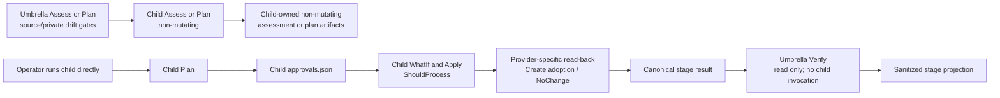

# Tenant Lifecycle Coordinate-Only Simplification Design

| Field | Value |
|---|---|
| **Version** | 1.0 |
| **Date** | 2026-10-03 |
| **Author** | docs-agent (Voice of Knowledge) |
| **Status** | Approved |
| **Scope** | Tenant 1 lifecycle umbrella authority, child-runbook ownership, stage-result evidence, and corrective migration |
| **References** | [Specification Catalogue](README.md), [Tenant 1 Runbook End-to-End Design](2026-10-02-tenant-1-runbook-end-to-end-design.md), [Tenant Lifecycle Core Plan](../plans/2026-10-02-tenant-lifecycle-core-implementation.md), [Cloud Service Foundation Design](2026-10-02-cloud-service-foundation-runbook-design.md), [Developer Workstation Design](2026-10-02-developer-workstation-runbook-refactor-design.md), [Tenant Replica and Customer Handover Design](2026-10-02-tenant-replica-and-customer-handover-runbook-design.md) |

## 1. Approval, Authority, and Entry Gate

The user explicitly approved every design section represented here on 2026-10-03. This specification is therefore the focused Approved companion to the [Tenant 1 Runbook End-to-End Design](2026-10-02-tenant-1-runbook-end-to-end-design.md).

Where the two specifications conflict, this companion supersedes only:

- the mutation-capable, approval-carrying, or provider-binding implications of section 4.1;
- the umbrella evidence and resource-correlation implications of sections 5.2 and 5.3;
- any reading of section 6 that gives the umbrella provider execution authority; and
- acceptance wording that implies one umbrella Apply or one umbrella approval envelope.

The child safety requirements in the umbrella design remain authoritative. In particular, this companion does not weaken fresh context acquisition, exact child approval, `ShouldProcess`, provider-specific pre-read and read-back, stable-ID adoption, idempotency, or fail-closed handling.

Approval of this specification authorizes the corrective documentation and future implementation-plan amendments described here. It does not authorize source changes, provider calls, pipeline execution, Tenant 1 mutation, or any live operation. The current `feat/tenant-lifecycle-core` implementation branch remains blocked and nonmergeable until the corrective implementation is reviewed and freshly verified.

## 2. Problem and Evidence Assessment

### 2.1 Known

The following are approved findings from the lifecycle-core implementation review:

- `CurrentBindingProvider` first appeared in new Plan 1 final-fix commit `cb701de`; it was not inherited from the old multi-tenant implementation.
- A PowerShell scriptblock supplied through that interface can observe or mutate orchestrator locals through dynamic scope. It is therefore unsafe as an umbrella mutation or current-binding authority.
- Generic stable-ID correlation was introduced when run-evidence `state.json` was removed during the same new lifecycle-core correction. The correlation does not carry action, provider, and result identity and skips a `Create` whose target ID is null before adoption.
- Fresh context acquisition, exact digest approval, provider-specific pre-read/read-back, one-time Create adoption, and immutable adopted IDs remain necessary controls.
- The defect is the placement of those controls in a provider-neutral umbrella, not the controls themselves.

These findings identify newly introduced defects after the lean one-tenant/one-repository decision. They must not be described as defects inherited from the older multi-tenant code.

### 2.2 Inferred

The broader historical control-plane model influenced the abstraction style: it encouraged one central lifecycle envelope to carry binding, approval, action, and correlation concerns. That influence explains the shape but does not change the provenance finding above. The two concrete defects are new.

The design inference is that removing mutation authority from the umbrella is smaller and safer than hardening a central executor. Independently runnable child runbooks already have the provider knowledge needed to validate approvals, select targets, perform actions, and read back results.

### 2.3 Validated Decision Boundary

The explicit approval validates the architecture decision recorded here: the umbrella is coordinate-only, mutation controls remain child-owned, the umbrella projection is stage-level, and the three rejected alternatives are not selected. Approval validates intended authority; it does not validate implemented behavior.

### 2.4 Still to Validate

This documentation-only decision does not claim that the corrective code exists or passes. Before implementation resumes, review must:

- inspect the complete `feat/tenant-lifecycle-core` diff and the `cb701de` ancestry without rewriting history;
- confirm the exact affected contracts, helpers, call sites, and tests;
- prove that removed umbrella parameters and dynamic binding paths have no remaining aliases or compatibility fallbacks;
- prove that child-owned approval, Create adoption, immutable state, and read-back paths still pass; and
- rerun the whole implementation branch's verification after the corrective commit.

## 3. Decision

Adopt a **coordinate-only umbrella**.

`Invoke-TenantLifecycle.ps1` is a non-mutating coordinator. It may invoke independently runnable child runbooks only in non-mutating `Assess` or `Plan` modes. In `Verify`, it reads completed child phase summaries and stage results and never invokes a child.

Every independently runnable child owns its complete mutation lifecycle:

`Assess -> Plan -> child approvals.json -> WhatIf -> Apply -> provider-specific read-back`

That ownership includes current context acquisition, exact provider actions, `ShouldProcess`, one-time adoption of IDs returned by `Create`, immutable adopted IDs afterward, and idempotent `NoChange`.

Shared canonical JSON, manifest, approval, action-evidence, state, prerequisite-graph, and atomic-write helpers remain reusable library functions. Reuse does not grant the umbrella execution authority.

## 4. Architecture and Responsibility Boundaries

| Component | Owns | Must not own |
|---|---|---|
| Coordinate-only umbrella | Run and source gates; ordered provider-neutral stages; non-mutating Assess/Plan dispatch; exact stage-result validation; dependency acceptance; consolidated stage-level projection | Apply, approval validation for provider actions, current provider binding, provider payloads, tokens, resource IDs, provider actions, provider read-back, or `ShouldProcess` |
| Child runbook | Assess, Plan, child manifest and `approvals.json`, WhatIf, Apply, exact current context, provider action, `ShouldProcess`, provider-specific read-back, state adoption, and NoChange | Another child's mutation authority or an umbrella approval substitute |
| Shared child library | Closed contracts, canonical JSON/digests, child manifest/approval/action/state helpers, prerequisite evaluation, and atomic evidence writing | Implicit orchestration authority or a generic target-only mutation dispatcher |
| Umbrella projection | Sanitized run/stage correlation and fixed nonclaims | Raw or allowlisted child provider detail |
| Child sanitized review | Provider-specific disclosure explicitly allowlisted by the child contract | Raw provider output, credentials, tokens, or unreviewed identifiers |

The flow separates coordination, mutation, and consolidated verification:



`SubsystemInvoker` is a controlled dispatch/test seam, not an untrusted-scriptblock security boundary. The umbrella passes it only an explicit provider-neutral record, supplies no provider authority, ignores provider-specific return data, reloads trusted inputs after invocation, and validates canonical artifacts from disk. This design does not claim that arbitrary PowerShell scriptblocks in one process are isolated from dynamic scope.

Non-mutating umbrella dispatch never promotes an assessment or plan artifact into a completed lifecycle stage result. The child writes that result only when its independently run lifecycle reaches a terminal child summary after read-back or confirmed `NoChange`.

## 5. Exact Umbrella Contract

The proposed public signature is:

```text
Invoke-TenantLifecycle -RunId -EvidenceRoot -RepositoryRoot -ExpectedSourceCommit -PublicTenantKey tenant1 -TenantConfigurationPath -TenantStatePath -Stages -Mode Assess|Plan|Verify -SubsystemInvoker
```

This is the complete public parameter-name set. No alias or alternate parameter set may restore mutation authority.

| Input | Contract |
|---|---|
| `RunId` | Selects one run root and must match every accepted stage result. |
| `EvidenceRoot` | Selects the external evidence root. All accepted relative paths must resolve beneath the selected run root. |
| `RepositoryRoot` and `ExpectedSourceCommit` | Establish the exact source gate. Source drift blocks dispatch and verification. |
| `PublicTenantKey` | Accepts only `tenant1`; it is not a provider tenant ID or fallback selector. |
| `TenantConfigurationPath` and `TenantStatePath` | Identify ignored private artifacts for read-only existence, containment, digest, and drift gates. The umbrella never serializes their content or writes state. |
| `Stages` | Supplies the exact ordered, nonempty, duplicate-free provider-neutral stage set. Unknown stages, case variants, or reordered results are rejected by the closed prerequisite graph. |
| `Mode` | Accepts only `Assess`, `Plan`, or `Verify`. |
| `SubsystemInvoker` | May be supplied only for `Assess` or `Plan`. `Verify` rejects it and never invokes it. |

The umbrella never accepts:

- `-Apply`, `-ApprovedDigest`, `CurrentBindingProvider`, or `-ShouldProcess`;
- a provider payload, token, credential, provider context object, provider action, provider result object, or provider resource ID; or
- an approval envelope, mutation callback, first-match selector, or compatibility fallback that has equivalent authority under another name.

For `Assess` and `Plan`, the umbrella may invoke each selected child only in the same non-mutating mode. The invoker receives the stage, mode, and a newly constructed provider-neutral control record derived from the public inputs and accepted prerequisite stage results. The umbrella does not trust mutable invoker return objects; it rereads canonical child assessment or plan artifacts from disk and never synthesizes a completed stage result.

For `Verify`, the umbrella performs no dispatch. It reads the exact expected stage-result set and completed child phase summaries, validates them, evaluates prerequisites, and writes only the sanitized umbrella projection.

## 6. Canonical Stage-Result Contract

### 6.1 Location and Immutability

Each selected stage has exactly one canonical result at:

```text
<run-root>/stage-results/<stage>.json
```

The corresponding canonical child summary is at `phases/<stage>/summary.json` relative to the run root. Child-owned manifests, approvals, action evidence, and read-back stay within that stage-specific phase root.

The stage token must be the exact canonical token from `-Stages`; it cannot contain or encode a provider identifier. Path normalization must prove that both the result and its `evidenceRelativePath` remain beneath the run root. Alternate names, case-only aliases, links that escape containment, duplicate stage properties, and additional stage-result files are invalid.

The shared atomic writer creates the canonical file only after the terminal child phase summary and required read-back or confirmed `NoChange` are complete. A result is immutable after creation. A retry that would change it requires a new run rather than overwrite, merge, or splice.

### 6.2 Exact Fields

The stage-result root is closed and has exactly these fields:

| Field | Meaning |
|---|---|
| `schemaVersion` | Exact reviewed stage-result schema version. |
| `runId` | Exact umbrella run identity. |
| `stage` | Exact canonical stage token. |
| `sourceCommit` | Exact expected source commit. |
| `publicTenantKey` | Exact public key `tenant1`; never a provider tenant ID. |
| `intentDigest` | Canonical digest of the selected private intent at the accepted phase boundary. |
| `stateDigest` | Canonical digest of the selected private state at the accepted phase boundary. |
| `phaseManifestDigest` | Digest of the child-owned canonical phase manifest, including the exact ordered stage set and prerequisite inputs. |
| `phaseSummaryDigest` | Digest of the completed child-owned canonical phase summary. |
| `status` | One of `Passed`, `Failed`, `Blocked`, `Refused`, or `Manual`. |
| `classification` | One of `NoChange`, `Changed`, `Manual`, `Blocked`, or `Refused`. |
| `evidenceRelativePath` | Exact `phases/<stage>/summary.json` run-root-relative path; never a URL or provider coordinate. |
| `completedAtUtc` | Child phase completion time in the canonical UTC format. |

No field may be added for an application, resource, environment, role, provider action, payload, URL, current binding, or raw read-back.

`Changed` is a stage-level roll-up. It does not disclose whether a child performed `Create`, `Update`, import, assignment, or another exact child-owned action.

Allowed outcome pairs are closed:

- `Passed` with `NoChange` or `Changed`;
- `Failed` with `NoChange` or `Changed`;
- `Blocked` with `Blocked`;
- `Refused` with `Refused`; and
- `Manual` with `Manual`.

Only `Passed` satisfies a dependency or acceptance gate. A non-`Passed` result blocks every dependent stage even when its artifacts otherwise validate.

### 6.3 Verification Rules

The umbrella accepts results only when all of the following are exact:

1. the contained canonical file set equals the ordered `-Stages` set, with no missing, extra, duplicate, or alternate result;
2. run ID, source commit, public tenant key, and intent digest equal the current verified inputs;
3. each state digest equals the exact child manifest/summary boundary; any child-owned adopted-state transition forms an unbroken ordered digest chain whose final digest equals the current private state;
4. each child manifest is canonical, has the exact ordered stage set and prerequisites, and recomputes to `phaseManifestDigest`;
5. each completed child summary is canonical, contained, and recomputes to `phaseSummaryDigest`;
6. the summary's stage, provenance, status, and classification agree with its result;
7. completion order and prerequisite outcomes satisfy the shared closed graph; and
8. no source, private artifact, stage set, manifest, summary, or result changed during verification.

Missing, extra, duplicate, stale, tampered, foreign-run, foreign-tenant, reordered, noncanonical, or noncontained evidence is rejected. Verification never repairs or normalizes an invalid child artifact in place.

## 7. Child Mutation and State Contract

Each child remains independently runnable and owns:

- fresh provider context acquisition immediately before provider-sensitive work;
- an exact child action plan and child execution-manifest digest;
- a child `approvals.json` that approves that exact digest and scope;
- non-mutating WhatIf where the provider supports it;
- per-action `ShouldProcess`;
- action/provider/result identity suitable for that child's provider;
- exact pre-read, action, immediate post-read, and provider-specific read-back;
- forward-only recovery; and
- a second unchanged run that yields child `NoChange`.

A `Create` with no pre-existing resource ID is not skipped. The child correlates it by its exact action and provider contract, reads back the created resource, and adopts the returned stable ID once into the ignored private state. After adoption, the stable ID is immutable; an ID mismatch or ambiguous read-back blocks rather than re-adopts.

The umbrella does not perform or project resource-level `targetStableId` correlation. Shared state helpers remain available to children, but generic target-only correlation is not an umbrella contract.

State remains private at the ignored `TenantStatePath`. No `state.json`, private state body, provider read-back body, or reconstructed private value is written to run evidence. The stage result carries only the state digest needed for drift correlation.

The child phase manifest binds the input state digest. Its terminal summary and stage result bind the output state digest. The values are identical unless the child completes an exact one-time Create adoption; in that case, the next child manifest must use the preceding output digest. This creates an ordered digest chain without disclosing private state or provider identifiers.

## 8. Retained Plan 1 Assets

The correction retains and adapts:

- closed contracts and canonical JSON/digest helpers;
- intent/state separation;
- one-time Create adoption with an immutable stable ID afterward;
- the prerequisite graph, evaluated against exact stage results;
- the atomic evidence writer;
- shared manifest, approval, action-evidence, and state helpers for child-runbook use; and
- the sanitized core projection, narrowed to stage-level evidence.

Removal from umbrella execution authority is not removal from the shared library. A helper's caller and contract determine authority.

## 9. Umbrella Evidence and Projection

The umbrella projection is a strict allowlist. In addition to run identity, source commit, and the public tenant key needed for correlation, it contains only:

- stage name and ordered position;
- status and classification;
- phase manifest and phase summary digests;
- source commit plus intent and state digests; and
- these fixed nonclaims:
  - `The umbrella did not execute a provider mutation.`
  - `Provider approvals and read-back remain child-runbook evidence.`
  - `This projection discloses no provider resource identity or raw provider response.`

It contains no application, resource, environment, role, object, project, pipeline, subscription, or tenant IDs; no URLs; no provider actions; no action payloads; and no raw provider read-back.

A provider-specific sanitized child review may disclose an explicitly allowlisted identifier when its reviewed child contract requires that disclosure. Such a review remains child evidence and is never copied into the umbrella projection.

## 10. Execution Flows

### 10.1 Umbrella Assess or Plan

1. Validate the exact source, run root, public tenant key, private paths, digests, mode, and ordered stage set.
2. Evaluate already completed prerequisite stage results.
3. Build a fresh provider-neutral stage/mode/control record.
4. Invoke the selected child only in `Assess` or `Plan`.
5. Discard provider-specific or mutable return data.
6. Recompute source/private drift gates and validate the canonical child artifacts from disk.
7. Stop on the first non-`Passed` prerequisite outcome or invalid artifact.

Assess and Plan never authorize a mutation and never create an umbrella approval.

### 10.2 Child Plan, Approve, Apply

The operator invokes each child directly. The child assesses, plans, writes its manifest, obtains exact approval in its own `approvals.json`, performs WhatIf, applies only the approved actions through `ShouldProcess`, reads back provider state, updates private adopted state where required, and writes the canonical summary and stage result.

Partial completion is a child recovery concern. The umbrella cannot continue, roll back, or reinterpret it.

### 10.3 Umbrella Verify

1. Reject a supplied `SubsystemInvoker`.
2. Revalidate source and private drift gates.
3. Read the exact contained canonical stage-result set in `-Stages` order.
4. Recompute each child manifest and summary digest and validate matching provenance and outcomes.
5. Evaluate the stage prerequisite graph.
6. Reject every non-`Passed` dependency or acceptance outcome.
7. Write only the sanitized stage-level projection.

## 11. Failure Handling

- Source, intent, unexplained state, stage-set, manifest, summary, or result drift fails closed; only an exact child-owned adopted-state digest transition may advance the state chain.
- An invalid stage result is evidence failure, not an invitation to infer success from nearby files.
- A missing child summary, mismatched digest, unsupported outcome pair, or noncanonical path blocks verification.
- A child provider failure preserves child evidence and requires child-owned reassessment and forward reconciliation.
- A child that changed a provider before failing reports `Failed`/`Changed`; the umbrella records no provider detail and blocks dependents.
- `Manual`, `Blocked`, and `Refused` remain unresolved outcomes, never umbrella success.
- No umbrella retry overwrites a completed result. Changed inputs or outcomes require a new run.
- No failure path falls back to `CurrentBindingProvider`, target-only correlation, an umbrella approval, or central Apply.

## 12. Downstream Design and Required Plan Amendments

This companion defines the future amendments; it does not rewrite implementation tasks.

| Plan | Required amendment before implementation resumes |
|---|---|
| [Plan 1: Tenant Lifecycle Core](../plans/2026-10-02-tenant-lifecycle-core-implementation.md) | Replace the mutation-capable umbrella contract with the exact coordinate-only signature and stage-result schema; remove umbrella Apply, approval, current-binding, provider-action, provider-result, resource-correlation, and `ShouldProcess` authority; retain the shared child helpers and adapted prerequisite/projection assets. |
| [Plan 2: Developer Workstation](../plans/2026-10-02-developer-workstation-runbook-refactor-implementation.md) | Make only the minimal integration changes needed to preserve its child-owned Plan/approval/Apply/read-back lifecycle and emit the canonical stage result. |
| [Plan 3: Cloud Service Foundation](../plans/2026-10-02-cloud-service-foundation-core-implementation.md) | Make the child explicitly own approval, current provider bindings, action/provider/result correlation, exact provider action, Create adoption, and provider-specific read-back. |
| [Plan 4: Power Platform DEV Delivery](../plans/2026-10-02-power-platform-dev-delivery-implementation.md) | Keep pipeline, application-user, import, role, artifact, and read-back evidence in the child contract; emit only the provider-neutral stage result to the umbrella. |
| [Plan 5: Tenant Replica and Handover](../plans/2026-10-02-tenant-replica-handover-implementation.md) | Make only the minimal integration changes needed to preserve child-owned local Apply and independent validation and emit the canonical stage result. |
| [Plan 6: Tenant 1 Acceptance](../plans/2026-10-02-tenant-1-end-to-end-acceptance-implementation.md) | Replace umbrella Apply with explicit child Plan/Approve/WhatIf/Apply/read-back steps followed by coordinate-only umbrella Verify; require exact Passed stage results. |

The workstation and handover designs already own Apply and should need minimal amendment. Cloud foundation owns approval, current binding, provider action, and read-back. Power Platform DEV owns pipeline, application-user, role, import, and exact delivery evidence.

The six Draft plans remain non-executable until their affected authority and task wording are amended and reviewed. This Approved specification governs any conflict in the interim.

## 13. Required Verification

The corrective implementation must add or update tests that prove:

- the exact new public signature and the absence of mutation, approval-digest, current-binding, provider-payload, token, provider-ID, and `ShouldProcess` parameters;
- exact source and private intent/state drift gates;
- only non-mutating child invocation in `Assess` and `Plan`;
- no child or `SubsystemInvoker` invocation in `Verify`;
- the exact contained canonical stage-result set, order, run, source, tenant, intent, state-transition chain, manifest, and summary digests;
- rejection of missing, extra, duplicate, stale, tampered, foreign, reordered, noncanonical, or noncontained results;
- every non-`Passed` outcome blocking dependent acceptance;
- umbrella projection containing no provider IDs, URLs, roles, actions, payloads, or raw read-back;
- existing child manifest, approval, action-evidence, state-adoption, immutable-ID, read-back, and NoChange helper tests remain green;
- Windows PowerShell 5.1 and the reviewed PowerShell 7 host both pass focused coverage;
- the full Pester suite passes; and
- existing safety, setup, Bicep, and workflow-neutral checks remain green.

Fixtures contain only synthetic identities and reserved example domains. Tests must demonstrate the safety property through closed contracts and negative cases, not through a redaction-only afterthought.

## 14. Migration

1. Record this Approved companion and the minimal umbrella/catalogue authority changes.
2. Amend Plans 1-6 to match section 12 before implementation resumes.
3. Add a new reviewed corrective task and commit on the existing `feat/tenant-lifecycle-core` branch.
4. Do not rewrite history, amend the causal commit, or squash away the review trail.
5. Review the whole implementation branch, not only the corrective commit.
6. Run fresh focused, cross-host, full Pester, safety, setup, Bicep, and workflow-neutral verification.
7. Keep the branch blocked and nonmergeable until review and verification pass.

No Tenant 1 live work may begin until this correction is implemented and reviewed, Plans 2-5 satisfy their amended prerequisites, and every private/live-entry prerequisite in the umbrella design is current.

## 15. Risks and Tradeoffs

| Risk or tradeoff | Treatment |
|---|---|
| Multiple child approvals make partial completion more visible | Treat partial completion as real child state; immutable stage results and umbrella Verify make dependencies explicit rather than hiding them in one envelope. |
| Consolidated umbrella evidence has less provider detail | Keep reviewed detail in child evidence and sanitized child reviews; the umbrella intentionally makes only stage-level claims. |
| Shared helpers could be mistaken for shared execution authority | Document caller ownership, remove mutation parameters from the umbrella, and test public surfaces and negative cases. |
| An injected PowerShell invoker is not isolated from dynamic scope | Give it no provider authority, treat it as a controlled seam, reconstruct trusted values after invocation, and validate immutable artifacts rather than returned objects. |
| Removing target-level umbrella correlation can appear to reduce traceability | Preserve stronger action/provider/result correlation and one-time stable-ID adoption inside the child that understands the provider. |
| Verify cannot repair stale or partial child evidence | Fail closed and require child-owned reassessment; repair by inference would weaken provenance. |

The chosen tradeoff favors smaller privilege boundaries and provider-local correctness over one central transaction-like abstraction that the providers cannot actually support.

## 16. Rejected Alternatives

| Alternative | Decision | Reason |
|---|---|---|
| Shared umbrella approval envelope | Rejected | It duplicates child validation, restores mutation-adjacent authority to the umbrella, and makes independent or partial child completion harder to represent. |
| Hardened central executor using isolated runspaces | Rejected | It expands the security and complexity surface to preserve a central mutation model that one tenant does not need. |
| Remove the umbrella entirely | Rejected | A non-mutating umbrella still provides useful ordered assessment/planning dispatch, prerequisite evaluation, exact result-set validation, and consolidated verification. |

## 17. Non-goals

This design does not:

- weaken child approvals, `ShouldProcess`, context validation, Create adoption, read-back, or NoChange;
- implement source, tests, pipelines, plans, or live operations;
- perform or authorize provider calls or Tenant 1 mutation;
- operate Tenant 2;
- implement a Power Platform pipeline, application user, role, or import;
- create a central mutation executor;
- change secret handling, private intent/state content, or the ignored private evidence boundary;
- put `state.json` back into run evidence;
- rewrite or squash implementation history; or
- claim that the blocked implementation branch is ready to merge.
