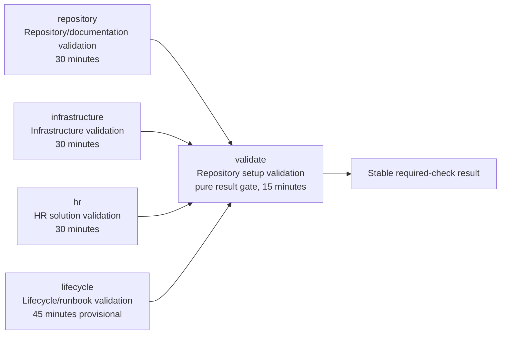

# Parallel Repository Validation Design

| Field | Value |
|---|---|
| **Version** | 1.2 |
| **Date** | 2026-10-22 |
| **Author** | docs-agent (Voice of Knowledge) |
| **Status** | Approved |
| **Scope** | Repository CI validation topology |
| **References** | [Specification Catalogue](README.md), [Draft Implementation Plan](../plans/2026-10-22-parallel-repository-validation-implementation.md), [Documentation Policy](../README.md), [Workflow Guide](../../.github/workflows/README.md) |

## 1. Status and Authority

The user approved this amended written specification. It is authoritative for implementation planning within its stated repository CI validation scope.

Approval makes no claim that the implementation exists, that any workflow or test change is live, that provider, deployment, or runtime behavior changed, or that an implementation branch is reviewed, merged, or current on `main`. This specification changes no production source, test, workflow, branch-protection setting, tenant, provider, deployment, or runtime state. The current workflow remains authoritative until a separately reviewed implementation is merged and then-current `main` is green.

## 2. Problem and Intended Outcome

The current `Repository setup validation` job installs all dependencies, runs all maintained Pester suites, and performs repository-wide checks sequentially. Evidence shows that the lifecycle suite determines most of the elapsed time while unrelated repository, infrastructure, and HR validation waits. The current isolated lifecycle dispatch smoke also repeats a test that the complete suite later executes.

The design keeps one validation workflow and one stable required check while running four exclusively owned validation domains in parallel. Repository safety, Bicep compilation, and whitespace validation move into their owning domains. The final aggregator becomes a pure result gate and does no validation work of its own.

The intended outcomes are:

- independent, visible domain failures without sibling fail-fast cancellation;
- complete recursive Pester inventory coverage with exact, exclusive ownership;
- early execution of high-risk lifecycle compatibility tests without executing any test twice;
- fail-closed setup and Pester behavior;
- raw NUnit evidence without broad write permissions or a third-party publisher;
- removal of about ten minutes of non-lifecycle waiting from the lifecycle critical path, subject to measured confirmation;
- no branch-protection reconfiguration; and
- no increase in provider, deployment, or tenant authority.

## 3. Comparative Challenge

The approved challenge reviewed the active GitHub workflows in [`urruegg/ernaehrungundsportapp`](https://github.com/urruegg/ernaehrungundsportapp/tree/main/.github/workflows). It treats an observed pattern as evidence, not as code to copy. The target repository retains its own Windows, Pester, documentation, security, and branch-protection contracts.

### 3.1 Active evidence and disposition

| Active evidence | Lesson | Disposition in this design |
|---|---|---|
| [`ci-test.yml`](https://github.com/urruegg/ernaehrungundsportapp/blob/main/.github/workflows/ci-test.yml) has an `if: always()` Test Summary job that only evaluates explicit upstream results. | A stable final check can be a pure aggregator rather than another validation stage. | Adopted. Job `validate` only gates the four `needs` results. It has no checkout, setup, safety, build, whitespace, artifact, or provider step. |
| Active workflows use same-ref concurrency with `cancel-in-progress: true`. | Superseded validation can be cancelled without weakening the newest run. | Adopted with a more precise PR-number-or-branch-ref key. |
| Active CI uses explicit jobs and, where a matrix is useful, explicit matrix behavior including `fail-fast: false`. | Parallel ownership must remain visible and one failure must not suppress sibling evidence. | Adopted as four explicit jobs. No matrix is needed; independent jobs naturally continue after a sibling fails. |
| Active jobs use dependency caches where lockfiles and cache keys are mature. | Caching can reduce setup cost when correctness and invalidation are proven. | Not adopted now. No cache contract or measured key strategy is approved for this Windows/Pester split. |
| Active workflows retain raw test or build artifacts and use test-report artifacts for diagnosis. | Diagnostics should survive a failed test step. | Adopted as raw NUnit XML uploaded by the official artifact action. Rich check publishing is deliberately not adopted. |
| Active safety gates pin tool versions, reject zero discovered tests and failed Pester containers, and inspect workflow semantics rather than relying only on line text. | Setup, discovery, containers, and contracts must fail closed. | Adopted for Pester `5.7.1`, JSON Schema `4.26.0`, all Pester result guards, and semantic workflow contract tests. |
| Active CI and CD are separated. Deployment workflows use OIDC, GitHub Environments, and artifact promotion when live authority is required. | Validation should not inherit deployment authority merely because deployment patterns are proven elsewhere. | The separation is adopted. OIDC, environments, secrets, cross-run promotion, provider calls, and deployment permissions remain outside this workflow. |

### 3.2 Active patterns that are intentionally not copied

The challenge also found active patterns that are unsuitable for this stable required workflow. Implementation must not copy:

- action major tags such as `@v7`; every external action here uses a reviewed full commit SHA;
- fallback acquisition such as `npm ci || npm install`;
- component jobs that execute the same unit tests under a second label;
- path filters that can omit the stable required workflow;
- broad `checks: write` or test-publisher permissions;
- third-party test-result publishers;
- direct deployment or environment mutation from CI; or
- a matrix where four explicit domain jobs provide clearer ownership and setup.

### 3.3 Disabled or stale material

Disabled workflows, deprecated workflow copies, and documentation that names absent or superseded pipelines are historical context, not active design authority. They cannot establish current triggers, permissions, required checks, deployment flow, or ownership. In particular, stale deployment documentation does not grant this repository validation workflow OIDC, environment, artifact-promotion, or deployment authority.

## 4. Decision Summary and Topology

Refactor `.github/workflows/validate-repository.yml` into exactly five jobs in one workflow:

| Job ID | Exact display name | Role | Timeout |
|---|---|---|---:|
| `repository` | `Repository/documentation validation` | Repository Pester, repository safety, and merge-base whitespace | 30 minutes |
| `infrastructure` | `Infrastructure validation` | Non-lifecycle infrastructure Pester and recursive local Bicep build | 30 minutes |
| `hr` | `HR solution validation` | HR Pester | 30 minutes |
| `lifecycle` | `Lifecycle/runbook validation` | Exact lifecycle allowlist, split into smoke and remainder without overlap | 45 minutes, provisional |
| `validate` | `Repository setup validation` | Pure result gate over the four domain jobs | 15 minutes |

The workflow name remains exactly `Validate repository`. The four domain jobs start independently. The final `validate` job has all four as `needs`, uses `if: always()`, and contains only the result gate.



The workflow retains pull-request, `main` push, and manual triggers. It has no path filters and remains the only workflow YAML file in `.github/workflows/`.

## 5. Security, Runner, and Host Boundary

The refactor preserves these workflow-wide controls:

- global permissions are exactly `contents: read`;
- every job uses `windows-2025`;
- every domain checkout uses `actions/checkout` pinned to the reviewed full commit SHA recorded in `infra/src/config/github/action-pins.json`, currently `3d3c42e5aac5ba805825da76410c181273ba90b1`;
- each domain checkout uses `fetch-depth: 0`;
- the official `actions/upload-artifact` action is pinned to a reviewed full commit SHA and added to the action-pin manifest before use;
- no major-tag action reference is accepted;
- no secret, `checks: write`, `id-token: write`, provider credential, environment approval, or deployment permission is introduced;
- no Azure authentication, provider call, deployment, tenant mutation, or other live operation is performed; and
- Bicep validation remains recursive local compilation only.

Every workflow `run:` step declares `shell: powershell`. This deliberately preserves Windows PowerShell 5.1 as the workflow shell. A move to `pwsh` is a separate decision and is not implicit in this refactor.

Diagnostics log all resolved `git.exe` and `pwsh.exe` applications and the host and Pester versions. When a child process needs one executable, the implementation chooses one deterministic scalar from the resolved applications rather than allowing an array-to-string or path-order accident. The existing high-risk coverage for executable resolution and raw, encoding-independent child-process transport remains mandatory and is part of the lifecycle compatibility smoke partition.

## 6. Components and Interfaces

Implementation introduces three repository-owned scripts with non-overlapping responsibilities.

### 6.1 `.github/cli/Get-MaintainedTestGroups.ps1`

Interface:

```text
-Group Repository|Infrastructure|Hr|Lifecycle
```

Responsibilities:

- recursively discover the complete maintained Pester inventory;
- define and validate exclusive group ownership;
- reject inventory or casing defects; and
- return only the selected group's normalized repository-relative `/` paths in ordinal order.

It does not install dependencies, invoke Pester, write test results, or perform domain checks.

### 6.2 `.github/cli/Install-CiTestDependencies.ps1`

Interface:

```text
-Group Repository|Infrastructure|Hr|Lifecycle
-MaxAttempts 3
```

Responsibilities:

- install and import exact Pester `5.7.1`;
- for `Hr`, install `hr/tests/requirements.txt`;
- for `Lifecycle`, install `infra/tests/requirements.txt`;
- retry only `Install-Module` and pip acquisition, up to `MaxAttempts`;
- log attempt number, UTC start and finish, elapsed time, and bounded failure detail without exposing secrets;
- after acquisition, verify the loaded Pester version is exactly `5.7.1`; and
- after Python acquisition, verify every required Python import succeeds.

It does not discover tests, run tests, invoke repository safety, build Bicep, or check whitespace. Verification failures are final and are not retried. Tests are never retried.

### 6.3 `.github/cli/Invoke-MaintainedTestGroup.ps1`

Interface:

```text
-Path <repository-relative path array>
-OutputPath <NUnit XML path>
[-Tag CICompatibilitySmoke]
[-ExcludeTag CICompatibilitySmoke]
```

Responsibilities:

- accept caller-selected paths without redefining ownership;
- log normalized selected paths, Windows PowerShell host version, exact loaded Pester version, resolved `git.exe` and `pwsh.exe` applications, and UTC start and finish;
- run Pester from a `New-PesterConfiguration` object;
- create the parent directory for the requested result path; and
- fail closed on discovery, container, test, or final-result failure.

Its exact Pester configuration includes:

- `Run.Path` set to the supplied selected paths;
- `Run.Throw = $true`;
- `Run.Exit = $false`;
- `Run.PassThru = $true`;
- Detailed output;
- NUnit XML enabled at the supplied output path; and
- the supplied include or exclude tag filter, when present.

After `Invoke-Pester`, the script fails if:

- `TotalCount` is zero;
- `FailedCount` is greater than zero;
- `FailedContainersCount` is greater than zero; or
- final `Result` is not `Passed`.

The script records its UTC finish in a `finally` path. It does not install dependencies, enumerate the maintained inventory, run safety, build Bicep, or check whitespace.

## 7. Recursive and Ordinal Test Ownership

The selector recursively enumerates every `*.Tests.ps1` leaf below exactly these roots:

- `.github/cli/tests/`;
- `infra/tests/pester/`; and
- `hr/tests/pester/`.

All returned and compared paths are repository-relative, use `/`, and are compared and sorted with `StringComparer.Ordinal`. The selector uses the Git-tracked spelling as the canonical case and rejects case drift rather than relying on the Windows case-insensitive file system.

Ownership is:

| Group | Exact ownership rule |
|---|---|
| `Repository` | Every recursively discovered `.github/cli/tests/**/*.Tests.ps1` leaf. |
| `Infrastructure` | Every recursively discovered `infra/tests/pester/**/*.Tests.ps1` leaf except the exact lifecycle allowlist. |
| `Hr` | Every recursively discovered `hr/tests/pester/**/*.Tests.ps1` leaf. |
| `Lifecycle` | The exact five-file allowlist below. |

The lifecycle allowlist is exactly:

1. `infra/tests/pester/TenantLifecycleContracts.Tests.ps1`;
2. `infra/tests/pester/TenantLifecycleOrchestration.Tests.ps1`;
3. `infra/tests/pester/RunbookContracts.Tests.ps1`;
4. `infra/tests/pester/RunbookStaticSafety.Tests.ps1`; and
5. `infra/tests/pester/RunbookDocumentation.Tests.ps1`.

For groups `R`, `I`, `H`, and `L`, and the recursively discovered maintained inventory `M`, the selector must prove:

- each group is nonempty;
- every selected entry exists and is a leaf file, not a directory;
- every selected path has the exact Git-tracked case;
- each group is duplicate-free;
- every pair of groups is disjoint;
- the union of `R`, `I`, `H`, and `L` equals `M`;
- the lifecycle group equals the exact five-file allowlist;
- every nested test is owned; and
- there are no extras outside the three maintained roots.

Missing files, directories in place of files, case drift, duplicates, unowned nested tests, unexpected lifecycle files, or other extras fail before any path is returned. Contract tests exercise the same inventory under at least `en-US` and `tr-TR` cultures to prove that selection and order are ordinal rather than culture-dependent.

## 8. Dependency and Schema Contract

Add `infra/tests/requirements.txt` with exactly:

```text
jsonschema[format]==4.26.0
```

The Lifecycle job installs this file through `Install-CiTestDependencies.ps1`. The HR job independently installs `hr/tests/requirements.txt`; it does not consume the infrastructure requirements file. Repository and Infrastructure install only the shared exact Pester dependency unless a later reviewed design adds a domain requirement.

After installation, required Python imports are executed as setup verification. A missing `jsonschema` import, wrong requirements file, pip failure after three attempts, or exact-version verification failure fails setup. Schema tests must not skip because the package is missing.

Acquisition uses bounded retry rather than fallback installation:

- maximum attempts are exactly three;
- only `Install-Module` and pip acquisition may be retried;
- each failed attempt emits bounded diagnostic detail and its elapsed time;
- version and import verification run after acquisition and are not retried; and
- no Pester invocation or domain validation is retried.

## 9. Domain Job Contracts

Each domain job:

1. checks out complete history with the pinned checkout SHA and `fetch-depth: 0`;
2. runs `Install-CiTestDependencies.ps1 -Group <group> -MaxAttempts 3`;
3. obtains its exact paths from `Get-MaintainedTestGroups.ps1`;
4. invokes those caller-selected paths through `Invoke-MaintainedTestGroup.ps1`;
5. performs only its additional owned checks; and
6. uploads its raw NUnit result path with `if: always()`.

The exact responsibilities are:

| Job | Pester execution | Additional owned checks | NUnit path | Artifact name |
|---|---|---|---|---|
| `repository` | Repository group once | Repository safety against the real checkout; merge-base `git diff --check` | `test-results/repository/pester.xml` | `repository-validation-test-results` |
| `infrastructure` | Infrastructure group once | Recursively build every `infra/src/bicep/**/*.bicep` entry point locally | `test-results/infrastructure/pester.xml` | `infrastructure-validation-test-results` |
| `hr` | HR group once | None | `test-results/hr/pester.xml` | `hr-validation-test-results` |
| `lifecycle` | Lifecycle smoke, then lifecycle remainder | None | `test-results/lifecycle/smoke.xml` and `test-results/lifecycle/remainder.xml` | `lifecycle-validation-test-results` |

Repository whitespace validation resolves the branch merge base and runs `git diff --check` over the complete branch change. There is no `HEAD~n` fallback. Infrastructure recursively enumerates Bicep entry points, fails when none are found, and fails on any local build error.

Each upload:

- uses official `actions/upload-artifact` pinned to its reviewed full commit SHA;
- uses `if: always()`;
- has the unique domain artifact name above;
- uploads only that domain's raw NUnit XML directory;
- uses `retention-days: 14`; and
- does not publish checks or require `checks: write`.

If setup fails before an XML file can exist, the always-run upload step reports the absence without converting the setup failure into success. Successful Pester invocation must always produce the expected XML.

## 10. Zero-Duplicate Lifecycle Compatibility Smoke

The high-risk lifecycle tests for:

- executable resolution;
- raw, encoding-independent child-process transport; and
- exact lifecycle dispatch

are tagged `CICompatibilitySmoke`.

The single `lifecycle` job runs two sequential Pester partitions over the same exact five-file path allowlist:

1. include tag `CICompatibilitySmoke`; then
2. exclude tag `CICompatibilitySmoke`.

The tag partition is an ordering mechanism, not duplicate coverage. Contract tests discover the lifecycle test cases and prove:

- the smoke set is nonempty;
- the remainder set is nonempty;
- the two test-case sets are disjoint; and
- their union equals every test case discovered from the exact lifecycle allowlist.

Both invocations use the same fail-closed wrapper and distinct NUnit files. No test case is executed in both phases, no lifecycle file enters Infrastructure, and the two phases remain one job and one `Lifecycle/runbook validation` check.

## 11. Pure Final Aggregator

The final job contract is exact:

- job ID is `validate`;
- display name is `Repository setup validation`;
- `needs` contains `repository`, `infrastructure`, `hr`, and `lifecycle`;
- job-level condition is `if: always()`;
- runner is `windows-2025`;
- timeout is 15 minutes; and
- its only work is a PowerShell result gate that requires every dependency result to equal `success`.

The aggregator has:

- no checkout;
- no installation;
- no test selection or Pester invocation;
- no artifact upload or download;
- no repository safety;
- no Bicep build;
- no whitespace validation;
- no cache;
- no secret, environment, Azure, provider, or deployment operation; and
- no ability to mask a failed, cancelled, or skipped dependency.

A dependency result of `failure`, `cancelled`, or `skipped` fails `validate`. A whole superseded run can itself be cancelled by concurrency before aggregation; the replacement run supplies the current required-check result.

## 12. Execution Flow and Concurrency

The runtime sequence is:

1. GitHub creates the four independent domain jobs.
2. Each domain checks out full history, performs bounded setup, selects exact owned tests, and invokes its Pester partition.
3. Repository then runs safety and merge-base whitespace; Infrastructure then runs recursive local Bicep builds; HR has no cross-domain check; Lifecycle runs smoke before its disjoint remainder.
4. Each domain's raw result upload is attempted with `if: always()`.
5. GitHub schedules `validate` after all four dependency results are available.
6. `validate` emits failure unless all four results are exactly `success`.

Workflow concurrency is:

```yaml
concurrency:
  group: ${{ github.workflow }}-${{ github.event.pull_request.number || github.ref }}
  cancel-in-progress: true
```

The pull-request number groups repeated runs for one pull request. The branch ref groups non-pull-request runs for one branch. Different pull requests or branch refs remain independent. The explicit jobs have no matrix fail-fast behavior; one domain failure does not cancel the other domain jobs. User-selected superseded-run cancellation remains authoritative.

## 13. Failure Behavior

| Condition | Required behavior |
|---|---|
| Pester or pip acquisition has a transient failure | Retry only that acquisition, with bounded logs, up to three total attempts. |
| Pester version or required Python import verification fails | Fail setup immediately after acquisition; do not retry verification or skip schema tests. |
| A selected group is empty, overlapping, incomplete, duplicated, mis-cased, or contains a directory | Fail selection before Pester. |
| A nested maintained test is unowned or an extra test appears outside the owned union | Fail selection before Pester. |
| Pester discovers zero tests | Fail the invocation. |
| A test or Pester container fails, or final Pester result is not `Passed` | Fail the invocation even if another count appears successful. |
| The compatibility smoke or remainder partition is empty, overlapping, or incomplete | Fail its contract; no duplicate fallback execution is allowed. |
| Repository Pester, safety, or merge-base whitespace fails | Fail `repository`; sibling domains can finish; `validate` fails. |
| Infrastructure Pester or any recursive Bicep build fails | Fail `infrastructure`; sibling domains can finish; `validate` fails. |
| HR or lifecycle Pester fails | Fail its owning domain; sibling domains can finish; `validate` fails. |
| A domain is cancelled or skipped | `validate` treats the result as not successful and fails if it is scheduled. |
| A test step fails after creating NUnit XML | Its domain artifact upload still runs and retains raw evidence for 14 days. |
| A run is superseded for the same PR or branch | GitHub cancels the older run; the newer run becomes authoritative. |

No failure path invokes a provider, authenticates to Azure, deploys a resource, mutates application or runbook behavior, or converts a failed, cancelled, or skipped dependency into success.

## 14. Semantic Contracts and Documentation Changes

Implementation follows test-driven contract changes.

Add `.github/cli/tests/MaintainedTestGroups.Tests.ps1` to prove:

- recursive discovery under all three roots;
- exact lifecycle allowlist;
- nonempty groups;
- leaf existence and exact Git-tracked case;
- duplicate rejection;
- pairwise disjointness and full union;
- rejection of nested unowned tests and out-of-root extras;
- repeated deterministic `StringComparer.Ordinal` order; and
- identical selection behavior under at least `en-US` and `tr-TR`.

Add focused contracts for `Install-CiTestDependencies.ps1` and `Invoke-MaintainedTestGroup.ps1` to prove:

- only acquisition is retried and the third failed attempt is final;
- tests are never retried;
- Pester is exactly `5.7.1`;
- HR and Lifecycle use only their respective requirements files;
- required Python imports fail closed;
- Pester configuration uses Throw, non-exiting PassThru, Detailed output, and NUnit XML;
- zero tests, failed tests, failed containers, and non-Passed final results all fail;
- selected paths, application resolution, versions, and UTC boundaries are logged; and
- include-tag and exclude-tag lifecycle sets are disjoint and complete.

Update `.github/cli/tests/WorkflowContract.Tests.ps1` to parse workflow structure semantically and require:

- workflow name `Validate repository`;
- exactly one workflow YAML and exactly five jobs;
- four explicit domain jobs and exact display names;
- exact `validate` ID and `Repository setup validation` display name;
- all `windows-2025` runners and exact timeouts;
- every `run:` step's explicit `shell: powershell`;
- least-privilege permissions;
- pinned full-SHA checkout and artifact actions;
- `fetch-depth: 0` in every domain;
- exact selector, installer, and invocation boundaries;
- HR and Lifecycle requirements separation;
- smoke/remainder partition without duplicate execution;
- repository ownership of safety and merge-base whitespace;
- infrastructure ownership of recursive Bicep build;
- four unique always-run, 14-day raw artifacts;
- `validate` with four `needs`, `if: always()`, and only a result gate;
- absence of path filters, caches, publishers, provider operations, and deployment authority; and
- the approved concurrency expression and cancellation.

`DocumentationNavigation.Tests.ps1` remains structural. It asserts the workflow inventory and allows only `validate-repository.yml` to be the changed workflow YAML. Its brittle exact changed-line allowlist is removed. All workflow semantic assertions belong to `WorkflowContract.Tests.ps1`.

Update `.github/workflows/README.md` during implementation to explain the delivered five-job topology, recursive exclusive ownership, setup requirements, zero-duplicate lifecycle partition, raw artifacts, pure stable aggregator, cancellation, and absence of deployment authority. Those implementation-stage changes are not part of this documentation-only amendment.

## 15. Branch-Protection Evidence

No branch-protection setting is changed.

Before implementation merge, evidence must:

1. record the currently configured required status context without inferring or rewriting it;
2. show workflow name exactly `Validate repository`;
3. show final job ID exactly `validate`;
4. show final display name exactly `Repository setup validation`;
5. prove on the pull request that the reported final check identity matches the recorded required context; and
6. prove the final check result exactly reflects the four dependency outcomes.

If the observed required context does not match the proposed stable final check, implementation stops for review. It does not reconfigure branch protection as a workaround.

## 16. Performance Evidence and Measurement

[Workflow run `39746996780`](https://github.com/urruegg/caldova-hr-frontier/actions/runs/39746996780) provides the planning evidence:

- complete maintained Pester step: approximately 42 minutes 37 seconds;
- exact five lifecycle files: approximately 32.5 minutes; and
- Pester setup: approximately 2 minutes 19 seconds.

This evidence supports an expectation that parallel ownership removes about ten minutes of non-lifecycle test waiting from ahead of the lifecycle result. It does not support the former 25-30 minute end-to-end target. Queue time, four-runner availability, repeated setup, two lifecycle invocations, artifact handling, and final-job scheduling remain material.

The Lifecycle timeout is provisionally 45 minutes. Repository, Infrastructure, and HR each retain 30 minutes. The pure aggregator retains a 15-minute guardrail even though its normal result gate should be brief.

No end-to-end duration target or measured speed-improvement claim is approved until at least three non-cancelled green runs record:

- queue time;
- setup time per domain;
- domain execution time per domain;
- aggregator scheduling and execution time;
- total workflow elapsed time; and
- the observed critical path.

After those three runs, review the provisional Lifecycle timeout and decide whether a measured target is supportable. A performance miss does not justify weaker coverage, broader permissions, skipped setup verification, path filters, or deployment coupling.

## 17. Alternatives and Tradeoffs

| Alternative | Decision | Reason |
|---|---|---|
| Run safety, Bicep, and whitespace in the final job | Rejected | It makes the aggregator impure and obscures domain ownership. |
| Make all four domain jobs separate required checks | Rejected | It changes branch-protection administration and creates avoidable required-check churn. |
| Use a matrix plus an aggregator | Rejected | HR/Lifecycle setup and lifecycle partitioning are clearer in explicit jobs; no matrix benefit offsets the expression complexity. |
| Keep one sequential job | Rejected | It preserves non-lifecycle waiting ahead of the lifecycle result. |
| Run compatibility smoke and then all lifecycle tests | Rejected | It executes tagged tests twice. Include-tag plus exclude-tag retains early evidence with an exact disjoint union. |
| Remove the compatibility smoke entirely | Rejected | It loses early evidence for the highest-risk Windows compatibility and dispatch contracts. |
| Move the workflow shell to `pwsh` | Rejected for this scope | It changes the host contract. Windows PowerShell 5.1 remains explicit; migration requires separate evidence. |
| Publish rich test checks with a third-party action | Rejected | Raw NUnit artifacts provide diagnosis without `checks: write` or publisher trust. |
| Copy the challenged repository's workflows wholesale | Rejected | Major tags, fallback installs, duplicate tests, path filters, and CI/CD authority do not satisfy this repository's contracts. |
| Add dependency caching now | Deferred | No reviewed cache key and invalidation contract exists for this split. Measure first. |
| Add another workflow or actionlint now | Deferred | Semantic contracts cover this topology without broadening workflow inventory or tooling scope. |
| Reconfigure branch protection | Rejected | The design preserves and proves the existing required context. |

The selected design accepts four runner allocations, repeated bounded setup, two non-overlapping lifecycle invocations, four small raw artifacts, and an additional aggregator scheduling transition. In exchange it provides explicit ownership, sibling failure visibility, early high-risk evidence, stable branch protection, and a result-only final gate.

## 18. Acceptance Criteria

Implementation is accepted only when:

1. selector, setup, invocation, workflow, smoke-partition, and documentation contracts are added or updated first and observed failing for the missing behavior;
2. `infra/tests/requirements.txt` exists with exact content `jsonschema[format]==4.26.0`;
3. HR installs `hr/tests/requirements.txt`, Lifecycle installs `infra/tests/requirements.txt`, and missing imports cannot skip schema tests;
4. dependency acquisition has at most three attempts, verifies exact Pester `5.7.1` and required imports, and never retries tests;
5. recursive ordinal selection rejects missing paths, directories, case drift, duplicates, extras, and unowned nested tests;
6. the exact lifecycle allowlist, pairwise disjoint groups, and complete maintained union pass under at least two cultures;
7. every Pester invocation uses the fail-closed configuration and guards;
8. `CICompatibilitySmoke` and lifecycle remainder are nonempty, disjoint, complete, and execute in one `lifecycle` job;
9. Repository owns repository Pester, repository safety, and merge-base whitespace; Infrastructure owns non-lifecycle Pester and recursive Bicep; HR owns HR Pester; Lifecycle owns only the five allowlisted files;
10. all four domain jobs use `windows-2025`, pinned checkout, full history, explicit `shell: powershell`, and the exact 30/30/30/45 timeouts;
11. four unique always-run raw NUnit artifacts use the official full-SHA-pinned upload action and 14-day retention without `checks: write`;
12. job `validate` has exact display name `Repository setup validation`, four `needs`, `if: always()`, a 15-minute timeout, and no work beyond its pure result gate;
13. repository safety, every recursive Bicep entry point, and merge-base whitespace pass in their owning domains;
14. failed, cancelled, and skipped dependency-result behavior is verified;
15. DocumentationMetadata, DocumentationLinks, and DocumentationNavigation tests pass;
16. WorkflowContract semantically validates the workflow while DocumentationNavigation remains structural;
17. branch-protection evidence records the current required context and proves the pull request reports the exact stable final identity and result without configuration change;
18. permissions remain exactly `contents: read`, with no secret, publisher, identity-token, provider, environment, or live-operation authority;
19. the first three non-cancelled green runs record queue, setup, domain, aggregator, total, and critical-path timing before an end-to-end target is proposed; and
20. `.github/workflows/README.md` accurately describes the delivered topology.

## 19. Non-goals

This design does not:

- implement or modify workflow, script, test, requirements, or source files as part of this documentation change;
- change application, infrastructure, lifecycle, or runbook behavior;
- change branch-protection configuration or make domain jobs separate required checks;
- add path filters;
- add dependency caching in this change;
- shard tests within a domain;
- add another workflow or actionlint in this change;
- add a third-party test publisher or `checks: write`;
- adopt major-tag actions or fallback package installation;
- move the workflow host from Windows PowerShell 5.1 to `pwsh`;
- perform deployment, Azure authentication, artifact promotion, provider operations, or tenant mutation;
- treat disabled workflows or stale documentation as current authority; or
- claim a 25-30 minute target or any measured duration improvement before the required three-run evidence exists.
