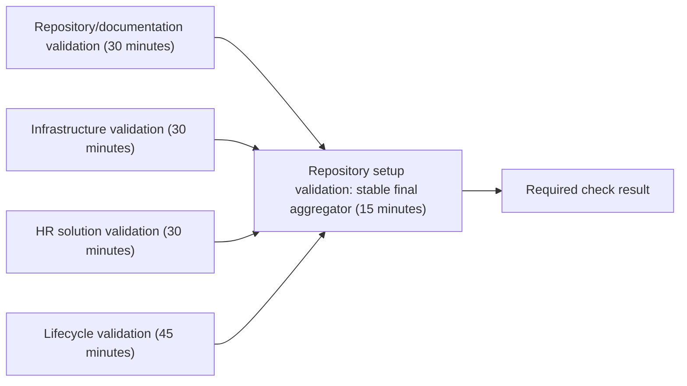

# Parallel Repository Validation Design

| Field | Value |
|---|---|
| **Version** | 1.0 |
| **Date** | 2026-10-22 |
| **Author** | docs-agent (Voice of Knowledge) |
| **Status** | Proposed Baseline (pending written-file review) |
| **Scope** | Repository CI validation topology |
| **References** | [Specification Catalogue](README.md), [Documentation Policy](../README.md), [Workflow Guide](../../.github/workflows/README.md) |

## 1. Status and Authority

The parallel validation design was approved for recording. This written artifact remains a Proposed Baseline pending review of the file itself. It defines the intended repository CI validation topology but does not authorize an implementation until that review is complete and an implementation plan is reviewed.

This specification changes no production source, test, workflow, branch-protection setting, tenant, provider, or deployment state. The current workflow remains authoritative until the proposed implementation is merged.

## 2. Problem and Intended Outcome

The single `Repository setup validation` job currently runs all maintained Pester suites and final repository-wide checks in sequence. The lifecycle suite determines much of the elapsed time while unrelated repository, infrastructure, and HR tests wait. A lifecycle smoke step also duplicates coverage that the complete suite later executes.

The design keeps one validation workflow and one stable required check while running four exclusively owned test domains in parallel. A final aggregator preserves the existing branch-protection check name and runs repository-wide safety, local build, and whitespace checks only after every domain succeeds.

The intended outcomes are:

- independent, visible domain failures;
- complete Pester inventory coverage without duplicate execution;
- a shorter critical path without weakening validation;
- no branch-protection reconfiguration; and
- no increase in workflow permissions or operational authority.

## 3. Decision Summary

Refactor `.github/workflows/validate-repository.yml` from one job into exactly five Windows 2025 jobs:

1. `Repository/documentation validation`;
2. `Infrastructure validation`;
3. `HR solution validation`;
4. `Lifecycle validation`; and
5. `Repository setup validation`, the stable final aggregator.

The four domain jobs start independently and in parallel. The final aggregator has all four as `needs` dependencies and uses `if: always()` so it can inspect every dependency result. It first rejects any result other than `success`; only then does it check out the repository and run the final repository-wide checks.

The topology is:



The workflow remains named `Validate repository`, retains its pull-request, `main` push, and manual triggers, and remains the only workflow YAML file in `.github/workflows/`.

## 4. Workflow Security and Execution Boundary

The refactor preserves these workflow-wide controls:

- global permissions are exactly `contents: read`;
- the checkout action remains pinned to the reviewed full commit SHA, currently `actions/checkout@3d3c42e5aac5ba805825da76410c181273ba90b1`;
- complete Git history is fetched where merge-base or repository contracts require it;
- Pester is installed at the exact version `5.7.1`;
- no secret, write permission, identity token, provider credential, or environment approval is introduced;
- no Azure authentication, provider call, deployment, tenant mutation, or other live operation is performed; and
- Bicep validation remains local compilation only.

Every job uses `windows-2025`. Domain jobs have no dependency on one another, and no domain job receives deployment authority.

## 5. Authoritative Test Ownership

Add `.github/cli/Get-MaintainedTestGroups.ps1` with one parameter:

```text
-Group Repository|Infrastructure|Hr|Lifecycle
```

The script has one purpose: define authoritative ownership of every maintained Pester test. On every invocation it enumerates all four groups, validates the complete ownership contract, and only then returns the selected group as repository-relative paths sorted with ordinal comparison.

The maintained inventory is every direct `*.Tests.ps1` file in:

- `.github/cli/tests/`;
- `infra/tests/pester/`; and
- `hr/tests/pester/`.

Ownership is:

| Group | Exact ownership rule |
|---|---|
| `Repository` | Every `.github/cli/tests/*.Tests.ps1` file. |
| `Infrastructure` | Every `infra/tests/pester/*.Tests.ps1` file except the exact five lifecycle files below. |
| `Hr` | Every `hr/tests/pester/*.Tests.ps1` file. |
| `Lifecycle` | The exact five-file allowlist below. |

The lifecycle allowlist is exactly:

1. `infra/tests/pester/TenantLifecycleContracts.Tests.ps1`;
2. `infra/tests/pester/TenantLifecycleOrchestration.Tests.ps1`;
3. `infra/tests/pester/RunbookContracts.Tests.ps1`;
4. `infra/tests/pester/RunbookStaticSafety.Tests.ps1`; and
5. `infra/tests/pester/RunbookDocumentation.Tests.ps1`.

For groups `R`, `I`, `H`, and `L`, and complete maintained inventory `M`, the selector must prove:

- each group is nonempty;
- every returned path exists and is a file;
- every pair of groups is disjoint;
- the union of `R`, `I`, `H`, and `L` equals `M`; and
- each selected result is deterministic, duplicate-free, and ordinally sorted.

Any violation fails before paths are returned. Infrastructure ownership is therefore the infrastructure inventory minus the exact lifecycle allowlist. The lifecycle files are not run in Infrastructure, and no lifecycle smoke test or other duplicate lifecycle execution remains.

## 6. Domain Job Contracts

Each domain job:

1. checks out the repository with `fetch-depth: 0`;
2. installs Pester `5.7.1`;
3. calls `.github/cli/Get-MaintainedTestGroups.ps1` for its one selected group;
4. invokes `Invoke-Pester -CI -PassThru` for exactly those paths; and
5. fails when `FailedCount` is greater than zero.

The exact job responsibilities and timeouts are:

| Display name | Selector group | Additional setup | Timeout |
|---|---|---|---:|
| `Repository/documentation validation` | `Repository` | None | 30 minutes |
| `Infrastructure validation` | `Infrastructure` | None | 30 minutes |
| `HR solution validation` | `Hr` | Install `hr/tests/requirements.txt` | 30 minutes |
| `Lifecycle validation` | `Lifecycle` | None | 45 minutes |

The HR job is the only job that installs Python requirements. No other domain job installs `hr/tests/requirements.txt` or an equivalent package set.

The current isolated lifecycle dispatch smoke step is removed. The full Lifecycle job starts immediately, has a visible check and log, and owns the complete lifecycle allowlist, so the smoke step would add duplicate execution without reducing the critical path.

## 7. Stable Final Aggregator

The final job display name is exactly `Repository setup validation`. This exact name preserves the existing branch-protection check identity. Branch protection is not reconfigured, and the four domain checks are not made separate required checks.

The aggregator contract is:

- it has `needs` dependencies on all four domain jobs;
- it uses job-level `if: always()`;
- its timeout is 15 minutes;
- its first step explicitly checks all four dependency results;
- any dependency result other than `success`, including `failure`, `cancelled`, or `skipped`, fails that first step;
- checkout and later checks do not run after that gate fails;
- after a successful gate, checkout uses the pinned action and `fetch-depth: 0`;
- repository safety runs against the real checkout;
- every maintained `infra/src/bicep/**/*.bicep` entry point builds locally;
- merge-base whitespace validation runs as `git diff --check` across the complete branch change; and
- no `HEAD~n` fallback is accepted.

This ordering prevents safety and build results from obscuring a failed test domain. Independent domain failures remain visible in their own jobs. When GitHub schedules the aggregator, failed, cancelled, or skipped dependencies produce a failed aggregator rather than an apparent success. A whole superseded run may itself be cancelled by the concurrency policy before aggregation; the replacement run supplies the current required-check result.

## 8. Concurrency and Superseded Runs

Workflow concurrency is:

```yaml
concurrency:
  group: ${{ github.workflow }}-${{ github.event.pull_request.number || github.ref }}
  cancel-in-progress: true
```

The pull-request number groups repeated runs for the same pull request. The branch ref groups non-pull-request runs for the same branch. A newer run cancels an in-progress superseded run in that group. Runs for different pull requests or branch refs remain independent.

Cancellation is an efficiency choice, not a relaxation of validation: only the newest non-cancelled run can provide the successful stable aggregator result.

## 9. Contract and Documentation Changes Required During Implementation

Implementation follows test-driven contract changes.

Add `.github/cli/tests/MaintainedTestGroups.Tests.ps1` to prove:

- the lifecycle allowlist is exact;
- every group is nonempty;
- all paths exist;
- groups are pairwise disjoint;
- their union equals the complete maintained Pester inventory; and
- repeated selections return deterministic ordinally sorted paths.

Update `.github/cli/tests/WorkflowContract.Tests.ps1` to require:

- exactly one workflow and exactly five jobs;
- four domain jobs plus the exact stable aggregator name;
- `windows-2025`, the approved timeouts, and least-privilege permissions;
- the pinned checkout action and full history where required;
- selector use by every domain job;
- Python requirements installation only in the HR job;
- no lifecycle smoke step or duplicate lifecycle execution;
- the aggregator's four `needs`, `if: always()`, dependency-result gate, and ordering;
- repository safety, all local Bicep builds, and merge-base whitespace checks in the aggregator; and
- the concurrency group and `cancel-in-progress: true`.

Update the workflow-change guard in `.github/cli/tests/DocumentationNavigation.Tests.ps1` so changes below `.github/workflows/` may affect only `validate-repository.yml`. Remove its brittle changed-line allowlist. Detailed workflow behavior belongs to `WorkflowContract.Tests.ps1`.

Update `.github/workflows/README.md` to explain the five-job topology, exclusive ownership, stable required check, superseded-run cancellation, and absence of deployment authority. These are implementation-stage documentation changes, not changes made by this design record.

## 10. Failure Behavior

| Condition | Required behavior |
|---|---|
| One domain fails | Its failure is visible; other independent domain jobs can finish; the aggregator fails its dependency gate. |
| Multiple domains fail | Every completed domain failure remains independently visible; the aggregator fails. |
| A domain is cancelled or skipped | The aggregator treats the result as not successful and fails if it is scheduled. |
| Test ownership is empty, overlapping, missing, or incomplete | The selector fails before invoking Pester. |
| Domain tests pass but repository safety, Bicep, or whitespace fails | The aggregator fails on the responsible final check. |
| A run is superseded for the same pull request or branch | GitHub cancels the older run; the newer run becomes authoritative. |

No failure path invokes a provider, authenticates to Azure, deploys a resource, mutates application or runbook behavior, or converts a cancelled/skipped dependency into success.

## 11. Performance Evidence

The planning estimate is a lifecycle-plus-aggregator critical path of roughly 25-30 minutes, compared with roughly 40-45 minutes for the sequential workflow. These figures are hypotheses, not measured improvement claims.

The first pull-request run after implementation must record:

- elapsed time for each of the four domain jobs;
- elapsed time for the final aggregator;
- total workflow elapsed time; and
- the resulting critical path.

No speed-improvement claim is accepted until that actual evidence is recorded and reviewed. A performance miss does not justify weakening coverage, permissions, or failure handling.

## 12. Alternatives and Tradeoffs

| Alternative | Decision | Reason |
|---|---|---|
| Make all four domain jobs required checks without an aggregator | Rejected | It changes the branch-protection contract and creates avoidable required-check churn. |
| Use a matrix plus an aggregator | Rejected | Conditional per-domain setup, especially HR-only Python dependencies, increases expression complexity and produces less explicit logs and ownership. |
| Keep one job with four sequential steps | Rejected | It preserves the long critical path and delivers no parallel speed improvement. |
| Retain a lifecycle smoke test in addition to the lifecycle job | Rejected | It duplicates lifecycle ownership and consumes time without advancing the full-suite result. |
| Put lifecycle files in both Infrastructure and Lifecycle | Rejected | It violates exclusive ownership and makes execution counts and failures ambiguous. |

The selected design accepts four runner allocations and an additional aggregator transition in exchange for clear ownership, parallel execution, stable branch protection, and isolated failure logs.

## 13. Acceptance Criteria

Implementation is accepted only when:

1. selector and workflow contracts are added or updated first and observed failing for the missing design behavior;
2. `Get-MaintainedTestGroups.ps1` proves nonempty, existing, pairwise-disjoint, deterministic ownership whose union equals the complete maintained Pester inventory;
3. all maintained Pester tests pass through their selected groups with no duplicate lifecycle execution;
4. repository safety and setup checks pass;
5. DocumentationMetadata, DocumentationLinks, and DocumentationNavigation tests pass;
6. every maintained Bicep entry point builds locally without deployment;
7. merge-base whitespace validation passes;
8. a pull request shows the four parallel domain jobs and the stable `Repository setup validation` aggregator;
9. failed, cancelled, and skipped dependency-result behavior is verified;
10. first-run per-job, total-duration, and critical-path evidence is recorded;
11. workflow permissions remain `contents: read`, with no secret, identity-token, provider, or live-operation authority;
12. workflow and branch permissions, branch-protection configuration, and the required-check name remain unchanged; and
13. `.github/workflows/README.md` accurately describes the delivered topology.

## 14. Non-goals

This design does not:

- shard tests within a domain;
- introduce package or dependency caching;
- add third-party test publishers;
- add path filters or skip validation based on changed files;
- add another workflow;
- perform deployment, Azure authentication, provider operations, or tenant mutation;
- change application, infrastructure, lifecycle, or runbook behavior;
- modify tests or workflow code as part of this documentation change;
- change branch-protection configuration or make the four domain jobs separate required checks; or
- claim measured duration improvement before first-run evidence exists.
