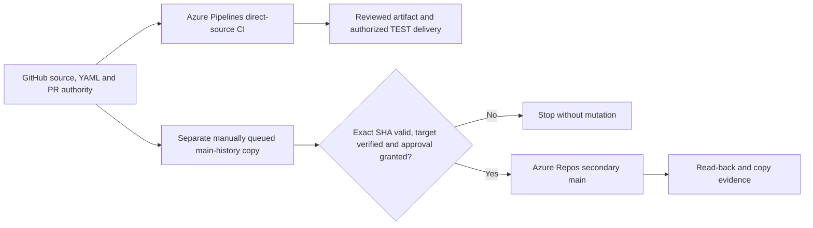
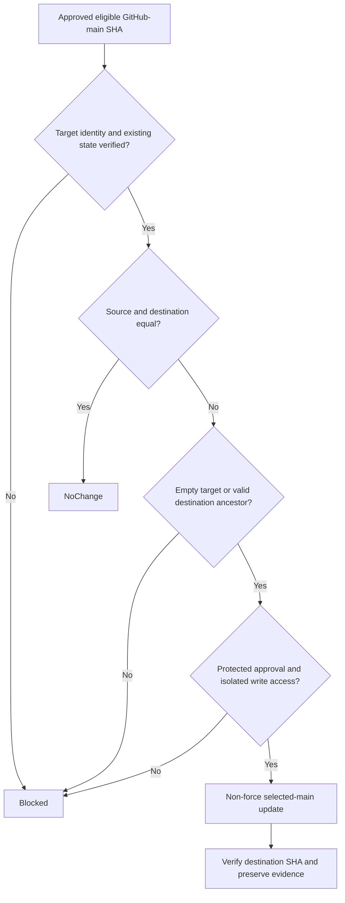

# Caldova GitHub Authority and Azure Repos Secondary Copy - Draft Specification

| Field | Value |
|---|---|
| **Version** | 0.7 |
| **Date** | 2026-10-30 |
| **Author** | Copilot |
| **Status** | Draft |
| **Scope** | Caldova Tenant 1 project/demo: GitHub-authoritative source and manually approved main-history secondary copy |
| **References** | [Idea](../ideas/caldova-azure-devops-repository-idea.md), [Sprint](../plans/2026-10-28-caldova-azure-devops-repository-sprint.md), [CI/CD specification](2026-10-28-caldova-azure-devops-solution-cicd-design.md), [Proposed ADR-0015](../adr/0015-caldova-github-authority-and-azure-repos-secondary.md), [Source boundary](../README.md#caldova-project-and-gf-source-boundary), [Historical GF record](../adr/0013-gf-azure-repos-source-authority.md) |

## 1. Authority, source context and current state

GitHub remains Caldova's sole authoritative source and pull-request plane. Azure Pipelines will consume GitHub directly for CI/CD. The intended Caldova Azure Repo is a **secondary copy**, not an independent development repository, second PR authority, private-configuration repository or release source.

The user selected this design, approved GitHub `main` plus reachable history, and a separate manually queued replication pipeline with validation/approval gates. [ADR-0015](../adr/0015-caldova-github-authority-and-azure-repos-secondary.md) is Proposed Baseline: it does not silently replace the Approved no-mirror decisions or prove live setup.

The user-supplied target is retained as session/private configuration, not
embedded here as tenant configuration or a credential-bearing URL. The
[sprint execution assessment](../plans/2026-10-28-caldova-azure-devops-repository-sprint.md)
records read-only target/source observations on 2026-10-29: a private enabled
target with no returned refs/policies/pipelines, and a failed required check on
published GitHub main. Accountable ownership, effective permissions, disclosure
approval and operational acceptance remain open. Neither a URL nor these
partial observations authorize initial replication.

Subsequent local repairs resolve the Python-wrapper, encoded-link and integer
parser defects. The user explicitly approved the scoped source-classification
amendment on 2026-10-30; the sprint records the implementation and subsequent
validation evidence. A local pass does not replace a passing published-SHA check
or operational authorization.

The former GF independent Azure Repos cutover is preserved at fixed handover snapshot `a4e4fbc` and in ADR-0013's GF scope. This Caldova design does not apply that customer cutover to Tenant 1. Stable `IDEA-GF-REPOSITORY` and `GF-REP-*` identifiers remain legacy traceability keys, not a transfer of customer authority.

## 2. Four connections with different responsibilities

| Connection | Purpose | Does not establish |
|---|---|---|
| Optional local `azdo` Git remote | Names the verified secondary endpoint in local `.git/config` | Copying, source authority, authentication approval or a dual-push `origin` |
| Azure Boards GitHub App | Work-item/commit/PR linkage under the existing single backlog | An Azure Repos source copy or CI connection |
| Azure Pipelines GitHub access | Reads GitHub YAML/source and reports GitHub checks | Azure Repo write permission or environment deployment approval |
| Dedicated replication path | Approved main-history non-force update to the verified secondary | Reverse sync, all-ref mirror, branch deletion or an independent backup/DR guarantee |

Keep GitHub `origin`, its branch upstream and push destination unchanged. Never add Azure as a second push URL to `origin`, and never overwrite an existing `azdo` definition whose target differs without an explicit decision.

## 3. Replication contract

| ID | Caldova draft requirement |
|---|---|
| GF-REP-01 | Resolve an exact eligible GitHub-main source SHA and verified intended Azure target; record source/target identities and approval scope. |
| GF-REP-02 | Review content and all history reachable from that source SHA, including source/brand/privacy/licensing boundaries and LFS/submodule needs. Current-tree review alone is insufficient. |
| GF-REP-03 | Copy only the approved `main` reference and its reachable history. Preserve Git commit IDs; no other branch/tag references or clean-snapshot substitution. |
| GF-REP-04 | GitHub remains sole source/PR authority; Azure is secondary. No Azure-only development, reverse merge, bidirectional sync or alternate release baseline. |
| GF-REP-05 | Permit only NoChange, explicitly approved initial creation or non-force fast-forward. Divergent/unrelated/uncertain state blocks without overwrite, merge, deletion or force. |
| GF-REP-06 | Verify exact source/destination refs after copying and record immutable source validation, approval, preflight and push/read-back results. |
| GF-REP-07 | Run replication separately through a manually queued, trusted GitHub-YAML pipeline with exact-revision validation and protected human approval. Copy lag/failure is not a CI/CD source dependency. |
| GF-REP-08 | Restrict replication identity to the intended secondary repository/ref operation and isolate credentials from PR CI and deployment. Missing enforceable isolation/approval blocks execution. |

These are revised Caldova contracts under versioned legacy identifiers. The original GF meanings remain in the historical snapshot; imported GF evidence/requirements elsewhere are not globally rewritten.

## 4. Eligible source and target preflight

An eligible source is an authorized commit on approved GitHub `main` history with the required successful validation and content/history review for that exact revision. A selected older SHA must still meet those rules and the destination ancestry condition.

Unpushed local confidential commits are **not** eligible merely because they exist locally. Never publish them to public GitHub to make synchronization possible. If no approved/disclosure-safe source is available, replication remains blocked.

Before any target write, inspect:

- exact organization/project/repository identity, privacy, owner and effective write/force/delete permissions;
- current default branch, main SHA and relevant existing branches/tags/content;
- whether the target is empty, already equal, a valid ancestor or divergent/unrelated;
- source/target access and any LFS payloads or submodules not copied by a normal branch update;
- applicable target policies and whether the authorized non-force update can satisfy them without bypass.

Do not infer emptiness from the historical repository size or an absent main branch. Existing non-main content or an initialized README needs explicit disposition; never delete it or merge unrelated history to make a push succeed.

## 5. Manually queued copy and failure behavior

Pipeline YAML remains in GitHub and is selected from a trusted reviewed branch. The operation has no PR-triggered mutation path. Select the approved source SHA, validate eligibility, preflight the destination, obtain protected approval and revalidate the source/target state immediately before the non-force main update.

| Source/destination condition | Required result |
|---|---|
| Equal approved source/destination | NoChange, with read-back evidence; no redundant push |
| Verified empty target and initial copy approved | Create only the selected main ref/history, then read back |
| Destination main is an ancestor of eligible source | Approved non-force fast-forward and exact read-back |
| Source is behind, divergent/unrelated history, wrong target or concurrent incompatible update | Stop; no force, deletion, reverse merge or automatic repair |
| Missing/stale/failed exact-SHA validation, denied approval or permission/policy failure | Explicit blocked/failed result; no fallback credential or broader operation |
| Ambiguous remote result | Re-read the destination before retry; never report success or blindly force another push |

`--mirror`, force push and ref deletion are explicitly excluded. Git's normal non-fast-forward rejection remains a protection, not an error to bypass.

Approval must protect the credential/resource outside author-editable YAML and be restricted to the replication pipeline. Do not grant the shared project build identity general secondary-repo contribution rights that untrusted PR CI can inherit. Authentication mode, identity, scope and effective resource checks are implementation proof gates, not assumed capabilities.

## 6. Source ownership and interactions

The source flow keeps normal CI/CD independent of secondary replication.

The decision diagram defines safe update outcomes, not an active configured pipeline.

## 7. Acceptance, governance and exclusions

Acceptance requires exact-SHA validation/approval, effective least privilege, explicit disclosure review, safe existing-target handling and matching destination read-back. Record NoChange, success, failure and unknown outcomes separately.

Keep the current GitHub validation until the [CI/CD migration gates](2026-10-28-caldova-azure-devops-solution-cicd-design.md) are met. Known branding failures prevent claiming green mandatory CI; focused tests are not full validation.

Private tenant configuration remains ignored/outside Git with its established recovery boundary. The secondary copy is not a second configuration role, not the GF customer destination and not a production deployment.

This refinement configures no local/remote Git setting, source copy, connection,
permission or pipeline. Initial read-only inventory is recorded in the sprint;
write-authorizing permission/ownership checks and operational authorization remain
open. Source validation is currently a blocking failure, not a waived gate.

## 8. First-party grounding

- [Azure Pipelines with GitHub source and Checks](https://learn.microsoft.com/azure/devops/pipelines/repos/github?view=azure-devops).
- [Azure Repos Git import and mirror warnings](https://learn.microsoft.com/azure/devops/repos/git/import-git-repository?view=azure-devops).

The import service is not assumed to be the recurring-copy mechanism or safe for an occupied target. The manually reviewed branch-specific design is deliberately narrower than an all-ref import/mirror.
