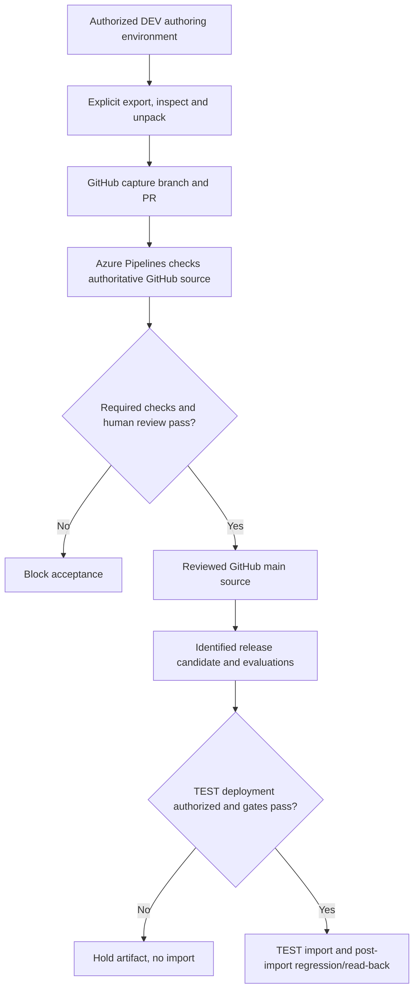
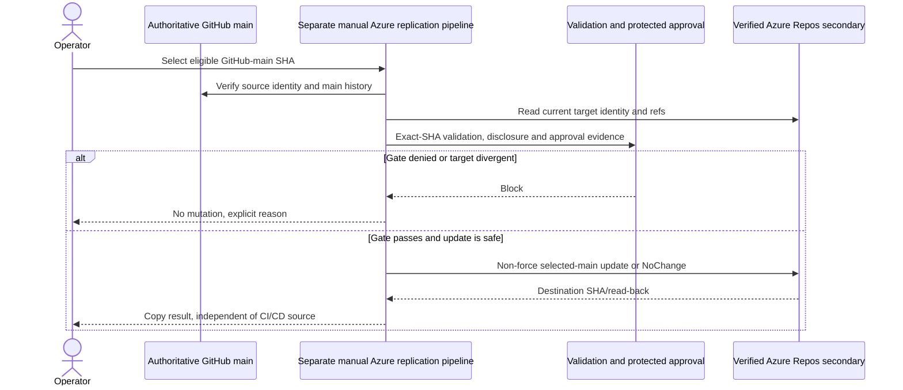

# Caldova GitHub-Source Azure Pipelines CI/CD and DEV Capture - Draft Specification

| Field | Value |
|---|---|
| **Version** | 0.4 |
| **Date** | 2026-10-29 |
| **Author** | Copilot |
| **Status** | Draft |
| **Scope** | Caldova project/demo: direct GitHub-source Azure CI, controlled DEV capture, TEST CD and independent secondary replication |
| **References** | [Idea](../ideas/caldova-azure-devops-solution-cicd-idea.md), [Sprint](../plans/2026-10-28-caldova-azure-devops-solution-cicd-sprint.md), [Repository specification](2026-10-28-caldova-azure-devops-repository-design.md), [Proposed ADR-0015](../adr/0015-caldova-github-authority-and-azure-repos-secondary.md), [Source boundary](../README.md#caldova-project-and-gf-source-boundary), [Delivery governance](2026-10-02-hr-frontier-copilot-agent-portfolio-governance-design.md), [Grounded GF scenario identities](../brand/gf-agent-identity/README.md) |

## 1. Authority and scope

GitHub owns Caldova source, pipeline YAML and PR review. **Azure Pipelines checks out GitHub directly** for validation and delivery; the Azure Repos secondary is not a build/release source or prerequisite.

The selected lifecycle includes reusable explicitly triggered DEV export/unpack into a GitHub branch/PR, reviewed-source artifact creation and TEST-only deployment. Production is later scope. A separate manually queued main-history replication pipeline follows the repository specification.

This is the Caldova project/demo using explicitly identified GF source/customer context. GF requirements, brand assets and reported approvals do not become Caldova corporate facts. Stable `IDEA-GF-SOLUTION-CICD` and `GF-CICD-*` keys remain legacy traceability identifiers.

The original GF Azure-Repos-authoritative design is retained in fixed snapshot `a4e4fbc`; it is not the current Caldova model. ADR-0015 remains Proposed Baseline and authorizes no live mutation or retirement of existing validation.

## 2. Distinct pipeline paths

| Path | Source/trigger | Output and boundary |
|---|---|---|
| PR/main CI | Reviewed pipeline configuration in GitHub; validate GitHub PRs/main directly | Required GitHub result, logs and exact source evidence; no deployment/replication credentials for untrusted PRs |
| DEV capture | Explicitly authorized selected solution/environment | Inspected source on a GitHub branch/PR; no direct main write or environment-to-release shortcut |
| TEST CD | Exact accepted source/artifact identity and deployment authorization | Identified artifact, private environment configuration, import and component/access read-back |
| Secondary copy | Separate manual queue, exact-SHA validation and protected approval | Main-history non-force replication/read-back; no deployment or alternate source authority |

Copy lag/failure is recorded independently. It cannot change which commit CI/CD builds, make an unreviewed Azure commit eligible, or become a shortcut around GitHub review.

## 3. Lifecycle and interactions

The release lifecycle returns maker changes to GitHub and promotes only a traced candidate.

The separate copy path consumes approved main history, not the release artifact or DEV state.

## 4. Draft requirements

| ID | Caldova contract |
|---|---|
| GF-CICD-01 | Capture only selected approved DEV solutions after explicit authorization, recording environment/solution/version and result. |
| GF-CICD-02 | Inspect/unpack into a GitHub branch/PR; surface partial/failed exports rather than successful empty captures. |
| GF-CICD-03 | Reconcile source baseline/concurrency; NoChange is explicit and unreviewed capture cannot overwrite protected main. |
| GF-CICD-04 | Azure Pipelines validates GitHub PR/main source and reports required GitHub checks. Azure Repos branch policies do not protect GitHub PRs. |
| GF-CICD-05 | Bind artifact identity/version to the exact accepted source and build/evaluation run. A changed SHA requires affected validation and a new accepted candidate. |
| GF-CICD-06 | Import the identified artifact only to the approved TEST environment with explicit private configuration, dependencies and component/access verification. |
| GF-CICD-07 | Isolate capture, validation, deployment and replication privileges. No secrets, private settings or real personal data in source/logs/artifacts. |
| GF-CICD-08 | Report denied/failed/uncertain outcomes and reconcile before retry; no blind import/copy force operation or success-shaped fallback. |
| GF-CICD-09 | Prove complete chosen-harness agent/skill/workflow/knowledge/config source round-trip before claiming deployability. No silent ESS/standard-harness substitution. |
| GF-CICD-10 | Version signed-off mandatory golden/refusal cases and actual results; safety/permission failures cannot be overridden by aggregate quality scores. |
| GF-CICD-11 | Record admitted identity/skill/config assets and hashes, release-state support and packaging/read-back evidence; source inclusion is not admission. |

The identifiers are retained from the versioned source package, but their current meaning is the Caldova contract here. Original GF meanings remain in the historical snapshot.

## 5. GitHub connection, PR safety and required-check migration

Recommend the Azure Pipelines GitHub App scoped to the intended repository. Microsoft documents direct GitHub YAML/source access and GitHub Checks; exact installation/service access and effective permissions still require read-back.

GitHub branch protections/rulesets must require the **actual observed Azure check identity**. A pipeline created in Azure DevOps or a successful manual run alone does not establish a blocking PR gate. Azure Repos policies govern its own refs only.

Untrusted/fork PR validation receives no deployment, private-configuration, remote-copy or environment credentials. A shared project build identity must not grant replication write access to CI jobs. Guard resource/connection access and approvals outside author-editable YAML; missing enforcement blocks the affected action.

Retain the existing GitHub `Repository setup validation` workflow/check until all are demonstrated:

1. equivalent validation and reporting for both PR and main paths;
2. equivalent required-check blocking, including failure and stale-candidate cases;
3. retained logs and unambiguous commit/artifact/build/evaluation/environment identity;
4. tested rollback/operational ownership and protected credentials;
5. explicit approval to switch required checks and retire the old path.

Known legacy branding failures are not solved by moving runners. A passing focused subset or selective exclusions do not prove full mandatory validation equivalence.

## 6. Source, artifact and deployment identity

A synthetic PR merge SHA and the final main commit can differ. Do not reuse the former artifact as if it were the latter. Establish the exact source identity of the accepted release candidate; changed content/SHA requires affected validation and candidate acceptance.

Build the accepted artifact once for its declared source and configuration contract. Promote that identified artifact without an untracked rebuild. Where identity stamping changes TEST/PROD package bytes, resolve a reviewed paired-artifact or supported external-configuration model; never call distinct packages identical. Production remains outside current scope.

Current GF-scenario runtime identities remain grounded in the supplied kit, not invented Caldova corporate assets. Imported stamper/generator/pipelines are inactive reference text. Prove supported GitHub-harness fields, exact matches, fail-closed atomic adaptation and actual host read-back before integration.

## 7. Capability and execution gates

| Gate | Required proof |
|---|---|
| Source/control | GitHub source/YAML authority, exact service access, PR/main check identity and branch blocking |
| Solution/environment | Approved DEV/TEST inventory, component coverage, package type, dependencies and target identities |
| Authentication | Separately scoped capture/deployment/replication identities and effective protected-resource policies |
| Harness/ALM | Actual source format, supported export/unpack/build/import, included skills/configuration and channel activation behavior |
| Runtime scope | Recruiting's open write/publication decision and HR Operations blocked-write gate remain disabled; ESS permissions are separately reviewed |
| TEST operation | Private environment-variable/connection-reference mapping, import status, smoke/access tests and safe recovery |
| Secondary copy | Repository-spec preflight, exact-SHA validation/history authorization, approval and main-only safe update |

No actual target URL, service connection, app identity, task version or permission is invented by this draft. The user-supplied Azure Repo endpoint remains private/session input. Source history review includes LFS/submodules if present; branch copying is not payload verification by itself.

## 8. Acceptance and exclusions

Test explicit capture, empty/no-difference capture, concurrent work, denied export, invalid source, missing components and unauthorized deploy. Prove failing Azure results block GitHub PR acceptance, untrusted PRs cannot obtain credentials, and TEST reads the intended artifact/configuration.

Replication tests separately cover equal refs, approved initial copy/fast-forward, divergence, missing approval, stale/failed validation, insufficient rights and uncertain remote outcomes. Never force or reverse-merge to repair them.

Run mandatory evaluations before promotion and configuration/access regression after TEST import. A pre-import pass does not prove TEST permissions or published behavior. Retain source/customer provenance; no numeric business gain or live acceptance is claimed.

Exclude production, automatic copy on ordinary CI, all-ref mirrors, direct main capture writes, source cutover, check retirement without proof and changes to HR decision authority. This documentation task creates no YAML pipeline, connection, Git remote, ref update or environment operation.

## 9. First-party grounding

- [Azure Pipelines GitHub source, App, Checks and PR security](https://learn.microsoft.com/azure/devops/pipelines/repos/github?view=azure-devops).
- [Power Platform Build Tools tasks](https://learn.microsoft.com/power-platform/alm/devops-build-tool-tasks#solution-tasks).
- [Git repository import and mirror hazards](https://learn.microsoft.com/azure/devops/repos/git/import-git-repository?view=azure-devops).

General Build Tools capability is not proof of chosen-harness completeness or Caldova tenant readiness; those remain the execution gates above.
