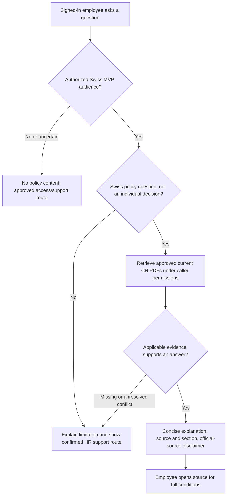
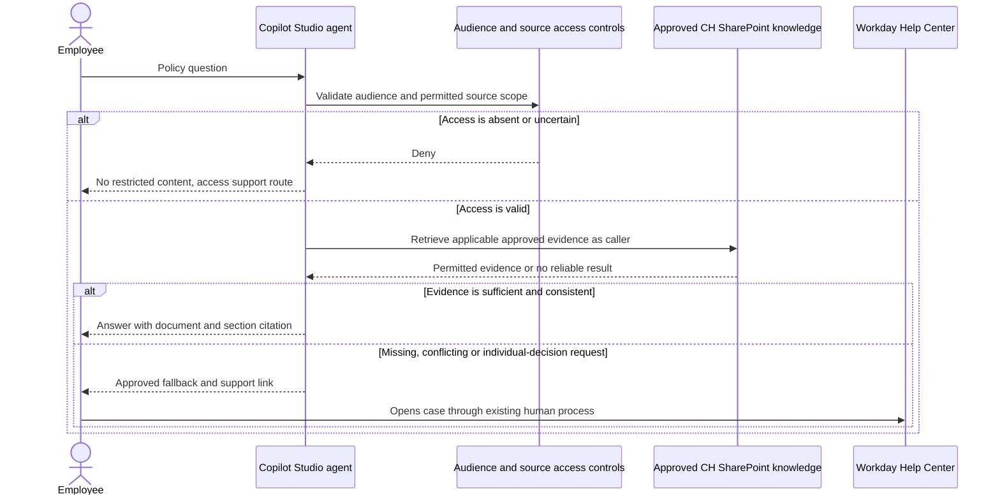

# Caldova SSE HR Policy Assistant - Draft Specification

| Field | Value |
|---|---|
| **Version** | 0.4 |
| **Date** | 2026-10-29 |
| **Author** | Copilot |
| **Status** | Draft |
| **Scope** | Caldova project/demo; GF source/customer context: functional package: employee-facing, read-only policy guidance |
| **References** | [Idea](../ideas/caldova-sse-hr-policy-assistant-idea.md), [Sprint](../plans/2026-10-28-caldova-sse-hr-policy-assistant-sprint.md), [Platform requirements](../prd.md), [Workflow-first architecture](../adr/0011-workflow-first-process-architecture.md) |

## Caldova project and GF source boundary

This is a Caldova project/demo document using the explicitly identified GF source/customer scenario. GF facts, approvals, requirements and trademarks remain GF-scoped; project renaming does not establish Caldova corporate policy or runtime acceptance. See the [source and authority boundary](../README.md#caldova-project-and-gf-source-boundary). Existing stable IDs are retained for traceability, not reassigned.

## Grounded agent identity

Use the [GF identity kit and adopted bindings](../brand/gf-agent-identity/README.md#3-adopted-identities):
**D3-A01, HR Policy Assistant**. Select exact DEV/TEST/PROD names and icon files
from its per-agent JSON. This mapping does not select native ESS, change the
GitHub-harness decision, approve technical names or prove a deployed identity.
Publisher/solution and target-format decisions remain gated by the
[identity adoption specification](2026-10-29-caldova-agent-identity-kit-design.md).

## 1. Authority and confirmed scope

The supplied build brief v1.0 section 3 describes D3-A01, a read-only Swiss policy assistant. References such as E41 and E42 below are the brief's citations; the underlying SOP, FAQ and policy PDFs have not been independently reviewed. See the [source/publication boundary](../README.md#caldova-project-and-gf-source-boundary).

The user now confirms a **Switzerland-only MVP with future regional onboarding**, and Copilot Studio's **GitHub Copilot runtime harness** for all MVP agents. ESS and an automatic standard-harness fallback are out of scope. Platform selection is not evidence that tenant access, indexing or TEST delivery works.

## 2. Process and interactions

The proposed question flow enforces the Swiss audience and permitted source boundary before answering. A support handoff is a link for the employee, not an automatic case write.

The interaction view distinguishes runtime reasoning, source authorization and human support. These are intended responsibilities, not configured components.

The model must not grant audience access or resolve an unapproved policy conflict. Topic/outcome telemetry, if approved, is minimized and aggregated separately from the answer.

## 3. Draft behavior contract

| ID | Draft requirement and source basis |
|---|---|
| GF-POL-01 | Use only approved, applicable Swiss policy PDFs the caller can access; no web/general-knowledge answers (brief 3.1/3.5; E41). |
| GF-POL-02 | Cite document and supporting section/article, with a usable permitted source link; do not invent revisions or applicability (E41/E42). |
| GF-POL-03 | Missing, obsolete, conflicting or insufficient evidence produces a limitation/support route, not a guessed policy. CEA/GF conflicts still listed as open must go to the policy owner (brief 3.12 OD-08). |
| GF-POL-04 | No Workday data access, HR transactions, case creation, legal advice or decisions about a person. Identify the agent as such. |
| GF-POL-05 | Verify effective source permissions outside instructions; prevent disclosure through answers, citations and error messages. |
| GF-POL-06 | Keep FAQ/evaluation files and archived or incoming policy versions outside answer knowledge. |
| GF-POL-07 | Future regions require their own approved source set, permissions, policy hierarchy/applicability, languages, owners, escalation and tests before activation. Country metadata never grants access. |
| GF-POL-08 | Use GitHub-harness instructions/skills and supported workflows, not an assumed standard topic-YAML/prompt-node implementation. Validate source and deployment representation in the CI/CD package. |

## 4. SharePoint bill of materials and content lifecycle

| Brief item | Role and boundary | Required verification |
|---|---|---|
| K1.01-K1.13 | CEA, expenses, general conditions, working hours, training, company regulations, handbook, on-call, shift, service-technician, scope, social-insurance changes and site schedule PDFs | Actual current files, policy-owner approval, regional/site applicability and permitted audience; titles alone do not prove currency |
| K1.14 | Further policies, explicitly missing | HR-approved scope and owner |
| W1.01/W1.03 | Version tracker and incoming versions in a work/staging area | Owner, version, effective/review date, change process and access |
| W1.02 / E42 | FAQ workbook with 66 reported questions | Golden evaluation material only; originals and expected answers still pending here |
| A1.01 | Superseded copies in archive | Excluded from retrieval; retention and access agreed |
| C1.01 | Help Center/support configuration | Confirm URL, route and audience before testing fallback end to end |

The brief proposes DEV/TEST project copies and production knowledge at its authoritative origin. Exact locations are not supplied. Policy publication, approved copy/index update, archive removal and regression evaluation are separate steps. Connection success is not proof of indexing or effective permissions.

## 5. Seven declarations and open gates

| Declaration | Current draft |
|---|---|
| Write envelope | Read-only business behavior; no Workday/SharePoint/email writes or automatic case creation. Any operational logging is separately governed. |
| Refusal set | Other-country MVP questions, employment/eligibility decisions, transactions, access bypass, legal advice and unsupported conclusions. |
| Escalation path | Help Center route; policy conflicts to Swiss policy owner; access to IT; incidents to Security/Privacy. Exact URLs, named accountable owners and incident route remain open. |
| Grounding | Approved Swiss PDFs; source hierarchy is reported by the brief, with disputed cases pending policy-owner interpretation. |
| Classification | Brief describes internal policy content; actual document classification/access review remains open. Transcripts may contain personal data and need DPO-approved access/retention. |
| Employment-decision surface | Explain policy only; people decide individual cases. |
| Measurement | Source support, citation usability, access isolation, safe fallback and approved FAQ/refusal coverage. Brief proposes 100% signed-off golden cases before promotion; no results exist here. |

Open decisions include exact audience group, licensed test users, language set, source/owner register, fallback wording and URL, CEA conflict handling, retention and minimum aggregation groups. The brief's prior ticket-reduction target has no verified baseline.

For future regional onboarding, select shared versus separate deployments explicitly. Require default-deny routing, separately approved regional sources and no cross-region comparison/retrieval in the Swiss MVP. A later region must pass its own access, language and policy tests.

## 6. Reuse assessment and acceptance

The [CAT assessment](../README.md#cat-reuse-assessment) recommends Knowledge Readiness for **maker preparation** and Agent Evaluation Designer for **evaluation design**. Neither proves live permissions or supplies a production runtime. Knowledge Source Router is a conditional future-region pattern: its named tools are not verified tenant capabilities, and its cross-country comparison behavior must not widen the Swiss MVP.

Evaluate the complete 66-question FAQ after it is actually obtained and approved; add denied-access, other-country, unresolved-conflict, individual-decision, prompt-injection, missing/index-stale source and inaccessible-citation cases. Compare meaning for free-form explanations; verify the approved fallback string separately against the actual SOP. Require 100% of the signed-off mandatory golden/refusal cases and no access-boundary violations before promotion.

Do not fabricate policy answers from this brief's sample values. All tests are proposed, not executed. Gate pilot release on classification, source/currentness, identity/permissions, owner approval, privacy and verified harness-compatible deployment.
