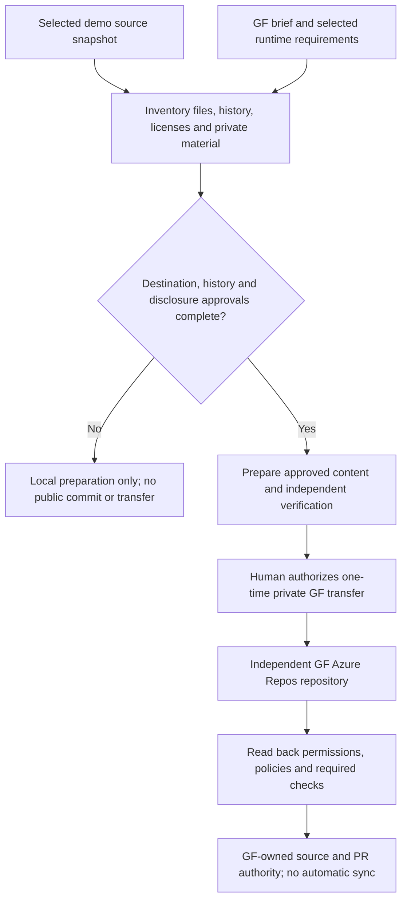
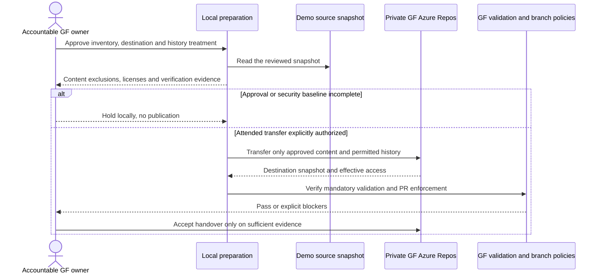

# GF Azure DevOps Repository Establishment - Draft Specification

| Field | Value |
|---|---|
| **Version** | 0.3 |
| **Date** | 2026-10-29 |
| **Author** | Copilot |
| **Status** | Draft |
| **Scope** | GF technical package: reviewed transfer and Azure Repos source authority |
| **References** | [Idea](../ideas/gf-azure-devops-repository-idea.md), [Sprint](../plans/2026-10-28-gf-azure-devops-repository-sprint.md), [GF source-authority ADR refinement](../adr/0013-gf-azure-repos-source-authority.md), [CI/CD specification](2026-10-28-gf-azure-devops-solution-cicd-design.md), [Existing handover design](2026-10-02-tenant-replica-and-customer-handover-runbook-design.md) |

## Grounded identity source for handover

The [curated GF identity kit](../brand/gf-agent-identity/README.md) is a
versioned handover input, with original hashes/notices and explicit runtime
bindings. It does not rename repository agents or activate its source scripts,
pipeline templates or broad instructions. Preserve the
[identity adoption gates](2026-10-29-gf-agent-identity-kit-design.md), including
technical-name decisions, trademark/disclosure review and the legacy branding
guard conflict, before claiming a merge/publication-ready transfer.

## 1. Authority and confirmed target

GF's target is an independent Azure DevOps/Azure Repos repository seeded from this repository through a one-time reviewed clone/transfer. After transfer, Azure Repos owns GF source and pull requests. The existing GitHub demo/reference repository remains separate, with no automatic synchronization.

This target was confirmed by the user on 2026-10-28. The specification remains Draft and authorizes no repository creation, credential use, publication or migration. ADR-0013 (Proposed Baseline) records the GF-scoped refinement of ADR-0001, ADR-0002 and ADR-0012 without rewriting their approved demo decisions.

The supplied build brief v1.0 sections 1-2 add proposed source layout and SharePoint boundaries. Only that brief, not its underlying evidence/export, was reviewed. Copilot Studio's GitHub Copilot runtime harness is the selected MVP platform; ESS is excluded. The runtime name does not require GF source to be hosted in GitHub.

Local confidential preparation is authorized, **not public publication**. Keep the original brief outside Git; do not commit/push detailed confidential refinements to this public demo origin. Review the destination's privacy/access before controlled handover.

## 2. Draft transfer contract

| ID | Draft requirement |
|---|---|
| GF-REP-01 | Identify an explicit source snapshot and reviewed destination organization, project and repository. Record accountable GF ownership and access approval. |
| GF-REP-02 | Agree an inclusion/exclusion inventory before transfer. Review demo/tenant-specific configuration, evidence, identities, endpoints, generated artifacts and licensing obligations. |
| GF-REP-03 | Decide whether to retain Git history or use a clean seed. If history is retained, inspect included history as well as current files; current-tree sanitization alone is insufficient. |
| GF-REP-04 | Establish Azure Repos as GF's sole source/PR authority after verified cutover. No automatic mirror, dual-write authority or synchronization is introduced. |
| GF-REP-05 | Configure GF access, protected-branch controls and required validation explicitly. Do not inherit the demo's solo-owner approval exceptions as GF policy. |
| GF-REP-06 | Verify the transferred inventory and independent checkout; retain sanitized transfer evidence without secrets or real personal data. |
| GF-REP-07 | Establish one canonical representation per agent/solution component. Map the brief's sample agent/skill/topic folders to supported GitHub-harness source rather than duplicate generated solution files or assume classic topic YAML works. |
| GF-REP-08 | Admit reusable skills only after exact source/version/checksum, license/asset notices, dependencies, data flow, permissions, support and harness compatibility are reviewed. An instruction bundle cannot grant a connector or bypass a write gate. |

The user approved a one-time reviewed transfer, not unfiltered mirroring of all refs/history. The existing customer-handover design is reference material; its history-free export profile does not resolve GF's transfer-history choice.

## 3. Operating boundary

The intended sequence is source/destination inventory, scoped ADR review, transfer and history decision, sanitization and independent verification, attended destination import, then destination read-back and control verification. No live step may begin while security, ownership or destination authorization is missing.

Preserve useful source, tests, instructions and documentation only through the agreed inventory. GitHub-hosted CI, branch protections and integrations do not become Azure DevOps controls merely because their files were copied. Identify required checks and their Azure DevOps equivalents, with any capability gaps explicit.

Azure Repos PR validation must be established through destination branch policies and linked validation pipelines. GF branch names, required reviewers, bypass permissions, backlog process and identities are not yet selected.

## 4. Open entry gates

| Gate | Evidence still required |
|---|---|
| Target and accountability | GF organization/project/repository, visibility, owner and authorized operators |
| Transfer contents | Source snapshot, history treatment, inclusion/exclusion inventory and licensing review |
| Information protection | Current-tree and applicable history checks; approved handling of private configuration and evidence |
| Engineering controls | GF permission baseline, review requirements, validation mapping and bypass restrictions |
| Cutover acceptance | Independent checkout and build/validation evidence; documented source authority and handover acceptance |

Missing security baseline or accountable ownership blocks execution. None of these live prerequisites has been verified by this draft.

## 5. Acceptance evidence to establish

Demonstrate that the approved content arrived at the intended GF destination; excluded material is absent from both current files and any transferred history; an independent checkout resolves required artifacts; protected-branch changes follow GF's approved PR controls; failed mandatory checks block completion; and there is no configured automatic synchronization.

Record source and destination snapshot identifiers and the reviewed inventory so that content differences are explained rather than hidden by an assumed identical hash after sanitization.

## 6. Dependencies and exclusions

The separate CI/CD package owns reusable DEV solution capture, application builds and TEST deployment. Coordinate required validation pipelines with that package; repository acceptance must not claim controls are operational before their linked validation exists.

Exclude live migration from this drafting task, production deployment, automatic backporting and changes to demo tenant ownership. Manual cross-repository reuse, if later needed, requires explicit review rather than silent propagation.

## 7. First-party grounding

[Azure Repos pipeline PR triggers](https://learn.microsoft.com/azure/devops/pipelines/repos/azure-repos-git?view=azure-devops#pr-triggers) and [branch-policy build validation](https://learn.microsoft.com/azure/devops/repos/git/branch-policies?view=azure-devops#set-build-validation) describe destination-side PR validation. They support the control mechanism, not a claim that GF controls are already configured.

## 8. Transfer process and interactions

The transfer flow includes confidentiality, history and destination approval before any import. Existing documentation placement remains unchanged.

The interaction view distinguishes source preparation, attended transfer and post-transfer control verification. It does not queue a migration.

## 9. Source layout and reusable-component boundary

| Content | Intended ownership |
|---|---|
| Five idea/spec/sprint sets | Existing canonical documentation locations; cross-linked, not duplicated into a new canvas root |
| Agent instructions, skills, workflows and solution assets | One supported source representation selected after harness round-trip proof; brief layout is a proposal, not delivered directories |
| Policy PDFs, employee intake, runtime rule workbook and primary confidential sources | Controlled SharePoint/private evidence; not Git knowledge copies |
| Environment variables and connection references | Names/purpose/schema in source; actual environment values and credentials outside Git |
| Evaluations and rule/field schemas | Versioned approved expectations and synthetic fixtures only |
| Third-party skills | Approved pinned source/assets/notices and explicit admission evidence, only if later selected |

The [CAT assessment](../README.md#cat-reuse-assessment) inspected catalogue metadata/instructions at a pinned revision, not downloaded executable bundles. No candidate transfers repositories or configures Azure DevOps. Use normal reviewed Git/Azure DevOps controls for this package.

Knowledge Readiness and Agent Evaluation Designer are potential engineering helpers, not GF end-user permissions. Conditional runtime reuse of routing/template skills needs separate admission. Do not copy a Cowork plugin into Copilot Studio, or assume a Copilot Studio tag means compatibility with the chosen harness.
