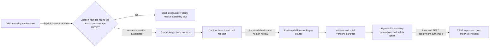
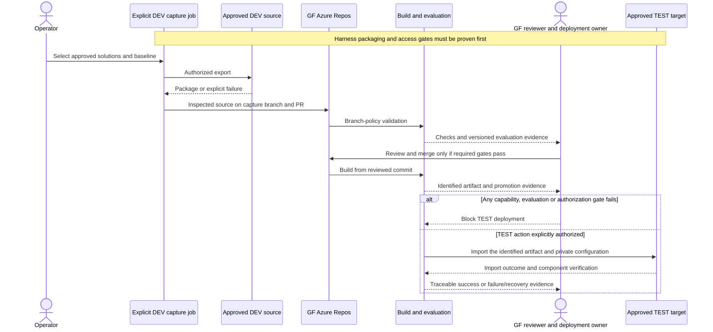

# GF Azure DevOps Solution CI/CD and DEV Capture - Draft Specification

| Field | Value |
|---|---|
| **Version** | 0.3 |
| **Date** | 2026-10-29 |
| **Author** | Copilot |
| **Status** | Draft |
| **Scope** | GF technical package: reusable Power Platform DEV capture, CI and TEST CD |
| **References** | [Idea](../ideas/gf-azure-devops-solution-cicd-idea.md), [Sprint](../plans/2026-10-28-gf-azure-devops-solution-cicd-sprint.md), [Repository specification](2026-10-28-gf-azure-devops-repository-design.md), [GF source-authority ADR refinement](../adr/0013-gf-azure-repos-source-authority.md) |

## Grounded runtime identity and release evidence

Use the [GF kit and stable runtime bindings](../brand/gf-agent-identity/README.md)
for names/icons, but do not execute the imported reference stamper or install
its pipelines. The [identity adoption specification](2026-10-29-gf-agent-identity-kit-design.md)
requires proven GitHub-harness source/manifest fields, exact matches,
fail-closed atomic writes and actual post-import read-back.

TEST/PROD identity bytes differ when names/icons differ. Resolve that explicitly
against the artifact-promotion contract; never claim an identical tested
artifact after untracked environment-specific stamping. Production remains out
of current sprint scope.

## 1. Authority and confirmed boundary

The user confirmed reusable, explicitly triggered export/unpack of existing DEV solutions into a branch and pull request, followed by build and deployment from reviewed repository source. Initial deployment is TEST only. Production is later scope.

This Draft does not authorize a DEV export, pipeline queue, permission grant, import or environment change. Existing solution inventory, GF environments, packaging support and service access have not been verified.

The supplied build brief v1.0 reports solution/environment inputs and evaluation-first delivery (sections 1, 3.7, 4.7 and 5.7); those reports are not independent inventory evidence. The user selects Copilot Studio's **GitHub Copilot runtime harness** for all MVP agents and excludes ESS. The brief's standard-harness topics/prompts/cards cannot be carried forward as an assumed source/deployment contract.

## 2. Draft lifecycle

The following flow separates maker capture from accepted source and deployment. An export is a proposed change, not a release.

No capture job writes directly to the protected main branch. No production destination is part of this flow.

The interaction view follows the same gate: capture proposes a change; reviewed source and an identified artifact, not DEV state, authorize the release candidate.

## 3. Draft behavior contract

| ID | Draft requirement |
|---|---|
| GF-CICD-01 | Capture only explicitly selected solutions from the approved DEV environment after an authorized trigger. Record environment, solution identity/version and capture result. |
| GF-CICD-02 | Inspect and unpack captured packages into agreed solution-source paths on a dedicated branch and PR. Surface errors; do not hide failed or partial exports as successful captures. |
| GF-CICD-03 | Reconcile the capture against the selected repository baseline. Do not overwrite concurrent work or bypass review. A verified no-difference capture reports NoChange rather than creating a misleading release. |
| GF-CICD-04 | Validate PR changes through Azure Repos branch-policy build validation. Unreviewed capture branches cannot trigger an authorized TEST release. |
| GF-CICD-05 | Build the agreed deployable artifact from reviewed source using a verified solution packaging route. Bind artifact identity/version to the source commit and build run. |
| GF-CICD-06 | Deploy the identified artifact only to the approved TEST environment with explicit connection/environment configuration, dependency checks and post-import verification. |
| GF-CICD-07 | Use least-privilege, separately scoped capture and deployment access. Keep credentials, connection secrets, private settings and real personal data out of source, artifacts and logs. |
| GF-CICD-08 | Record failures and uncertain import outcomes explicitly. Reconcile destination state before retrying; retain diagnostic and recovery evidence under the agreed access/retention policy. |
| GF-CICD-09 | Prove selected-harness agent/workflow/skill/knowledge/configuration export, source representation and import coverage before claiming a deployable pipeline. Missing support blocks the route; do not silently substitute ESS or the standard harness. |
| GF-CICD-10 | Version the signed-off mandatory golden/refusal set and run evidence. Require the brief's proposed 100% pass target and zero unsafe actions for promotion; quality scores never override permission/privacy/safety blockers. |
| GF-CICD-11 | For admitted skills, track exact source, dependencies/notices and asset inclusion; verify sanitized logs, bundling and regression behavior after capture, build and TEST import. |

DEV is the authoring environment; reviewed Azure Repos source is the release baseline. A reusable capture pipeline is not an environment-to-release shortcut.

## 4. Packaging and configuration gates

Inventory solution unique names, publishers, versions, dependencies, component support, existing source layout and DEV exportability. Agree unpack format, source paths and deterministic comparison rules before implementing capture.

Confirm the supported unmanaged-source and deployment-artifact types and demonstrate their round trip with the selected toolchain. Do not assume an unmanaged export becomes a managed release merely by renaming it or setting a packing flag. Managed TEST delivery is a proposed ALM choice requiring inventory/tooling validation, not a user-confirmed requirement.

Define how environment variables, connection references, required configuration and prerequisites resolve in TEST without committing private values. Confirm whether runtime agents or other solution components need additional supported publishing steps; solution import alone is not assumed to make every component usable.

## 5. Open execution gates

| Gate | Evidence still required |
|---|---|
| GF repository | Attended transfer/cutover acceptance and destination permissions from the separate repository package |
| Solution/environment inventory | Approved DEV source and TEST target, solution list/types, dependencies and component support |
| Identity and controls | Named owners, approved authentication mechanism, least-privilege service connections, PR rules and TEST authorization |
| Build contract | Selected tooling/versions, validated export/unpack/build route, source paths, checks and artifact identity |
| TEST operation | Configuration mapping, import verification, smoke tests, failure/retry/recovery procedure and evidence retention |

These are not satisfied by the existence of demo scripts or pipeline designs. No identifiers, service connections, tool versions or permissions are invented here.

Golden tests are written before agent implementation, run in DEV and rerun against the deployed TEST configuration before acceptance. A pre-import pass does not prove TEST source permissions, connection settings or published behavior. The policy FAQ's 66 cases are a brief-reported input, not a local test fixture; original expectations require owner review.

The user keeps Recruiting's creation/publication boundary open and HR Operations propose-only until decisions and safety proof. CI must preserve these disabled capabilities rather than using a general evaluation pass as authorization to enable writes.

## 6. Acceptance evidence to establish

| Scenario | Required evidence |
|---|---|
| Explicit DEV capture | Selected solutions produce inspected, unpacked source and a traceable PR, without a direct protected-branch write. |
| Repeat and concurrent capture | No-difference capture is explicit; concurrent changes do not get silently overwritten. |
| Invalid source or denied export | Capture/build fails visibly without PR completion or deployment. |
| Review and build | Mandatory checks run through destination policy; the built artifact identifies the reviewed commit and run. |
| TEST deployment | Intended artifact imports into the intended target and passes agreed configuration/component smoke checks. |
| Failed or uncertain import | Failure is recorded, target state is reconciled, and recovery is controlled rather than blindly retried. |
| Boundary enforcement | No production target/permission is used; secrets and real personal data are absent from retained deliverables. |

No acceptance scenario has been executed. Quality thresholds and component-specific tests follow inventory review.

## 7. Exclusions and first-party grounding

Exclude production delivery, PROD permissions, automatic capture on every maker edit, direct-to-main DEV synchronization, application-feature development and automatic GitHub synchronization.

[Power Platform Build Tools solution tasks](https://learn.microsoft.com/power-platform/alm/devops-build-tool-tasks#solution-tasks) describe export, unpack, pack and import capabilities. [Azure Repos PR triggers](https://learn.microsoft.com/azure/devops/pipelines/repos/azure-repos-git?view=azure-devops#pr-triggers) describe branch-policy validation. These are capability references, not proof of GF tenant readiness or a selected implementation.

## 8. Selected-harness evidence and reuse

[Harnesses in Copilot Studio](https://learn.microsoft.com/microsoft-copilot-studio/harnesses-overview) distinguishes runtime from the GitHub Copilot service. [The harness FAQ](https://learn.microsoft.com/microsoft-copilot-studio/agents-experience/faqs-copilot-harness) explains skills/workflows instead of migrated classic topics or a separate prompts feature. [Workflow FAQ](https://learn.microsoft.com/microsoft-copilot-studio/workflows-experience/faq-workflows) supports agent/workflow invocation but does not establish automatic conversion of classic flows.

The generic [solution export/import article](https://learn.microsoft.com/microsoft-copilot-studio/authoring-solutions-import-export) explicitly scopes itself to the standard harness. It is not proof of complete GitHub-harness solution portability. Validate the actual GF component inventory, source format and supported release path with current platform/tenant evidence; this capability gate remains open.

The [CAT assessment](../README.md#cat-reuse-assessment) recommends Agent Evaluation Designer as evaluation **methodology**, not an executable CI runner. Native evaluation/export/automation support and capacity must be proven. Knowledge Readiness helps prepare source quality; it cannot attest live access. The Test Planner Cowork plugin, standard-harness card packages and unrelated HR/legal skills are not pipeline dependencies.

No CAT packages are installed or vendored by this documentation change. Scripts/ZIP contents, outbound calls, sandbox execution and asset licenses remain unassessed until admission. No real employee data, confidential source attachments or private configuration may be uploaded to a public catalogue or included in build logs.
