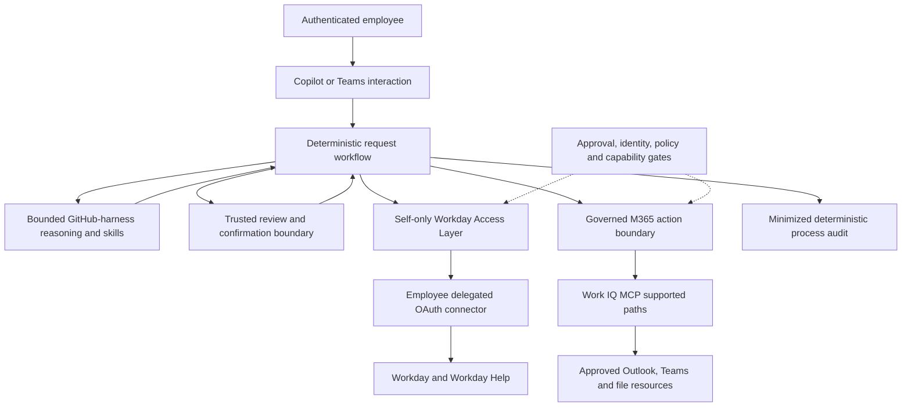
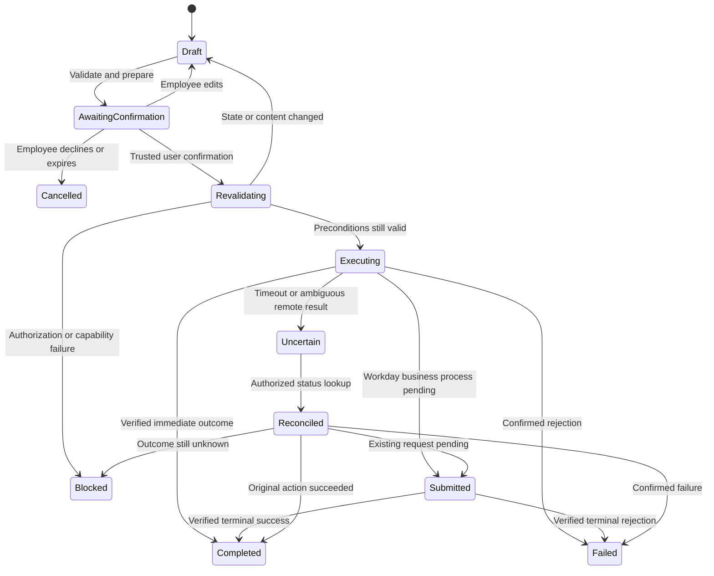
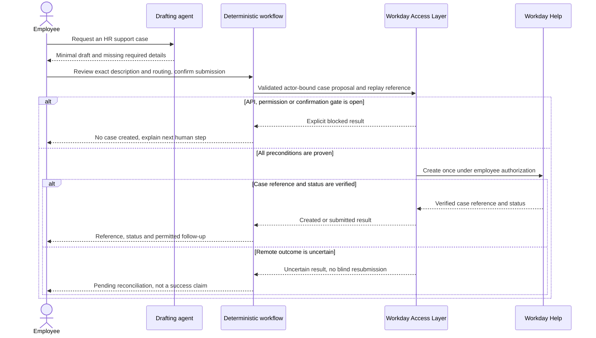

# GF ESS-Equivalent Rebuild with GitHub Harness and Work IQ - Draft Specification

| Field | Value |
|---|---|
| **Version** | 0.3 |
| **Date** | 2026-10-29 |
| **Author** | Copilot |
| **Status** | Draft |
| **Scope** | GF employee self-service: new Copilot Studio agent, governed M365 actions and self-only Workday transactions |
| **References** | [Idea](../ideas/gf-ess-github-harness-workiq-idea.md), [Sprint](../plans/2026-10-28-gf-ess-github-harness-workiq-sprint.md), [Draft implementation plan](../plans/2026-10-28-gf-ess-github-harness-workiq-implementation.md), [Proposed scoped decision](../adr/0014-gf-ess-workiq-and-self-service-write-envelope.md), [Workday access boundary](../adr/0009-workday-access-via-connector-behind-governed-layer.md), [Write-envelope governance](../adr/0008-human-in-the-loop-and-write-envelope.md), [GF delivery design](2026-10-28-gf-azure-devops-solution-cicd-design.md), [GF package map](../README.md#gf-draft-packages) |

## Grounded agent identity

The user adopted **D3-A02, HR Ops Self-Service** from the
[GF identity kit](../brand/gf-agent-identity/README.md#3-adopted-identities).
Use its exact DEV/TEST/PROD names and assets. Reuse of that identity does not
inherit the source's native-ESS kind, older later-wave status or description:
this specification still owns the new GitHub-harness six-operation scope.
Review published descriptions and technical names under the
[identity adoption gates](2026-10-29-gf-agent-identity-kit-design.md).

## 1. Outcome, status and source baseline

Build a new employee-self-service experience on **Copilot Studio's GitHub Copilot runtime harness**, using Microsoft's ESS Custom Engine Agent as a capability reference rather than a deployed source baseline. The user confirmed that no existing ESS source/export is available to refactor. This is a new implementation, not an in-place migration, an installed Microsoft ESS product, or a claim of full ESS feature parity.

This specification, the linked idea and the existing sprint form the sixth GF primary handover set. The implementation plan and proposed ADR remain supporting artifacts; this packaging does not change the functional scope or activation gates.

The approved drafting direction includes policy guidance and six self-service transactions: personal phone, personal email, home address, emergency contact, time-off submission, and Workday Help case creation. All Workday access uses the signed-in employee's own delegated OAuth authorization behind a governed Access Layer. Work IQ supplies M365 capabilities per use case, not an assumed Workday connector gateway.

Switzerland is the initial GF scope, with later regional onboarding designed separately. Build in DEV, validate in TEST, and keep production deployment outside this sprint. Existing policy-only, Recruiting and HR Operations packages retain their own boundaries. This specification neither enables their writes nor silently supersedes their requirements.

Privacy/Security approval is **user-reported**. Its formal reference, permitted resources/actions, identities, environments and retention conditions were not supplied. The general intention to use Work IQ is not evidence that every operation is approved. [ADR-0014](../adr/0014-gf-ess-workiq-and-self-service-write-envelope.md) proposes the scoped governance change; it is not ratification or live execution authority.

## 2. First-party capability analysis

The references in section 12 were inspected on 2026-10-28. Documentation establishes product/reference capabilities, not configuration or successful execution in GF.

| Capability | Microsoft reference evidence | Rebuild disposition and gap |
|---|---|---|
| HR policy answers | ESS HR starter supports policy knowledge, organizational resources and escalation [S01] | Rebuild with approved regional sources, citations and source/access tests. Do not mix FAQ evaluation material with answer knowledge. |
| Employee profile reads | Workday extension has company/cost-center, employment and contact-related read topics [S02] | Read only the fields needed for the employee's selected task. Do not inherit the entire employee/manager catalogue. |
| Phone/personal email updates | Documented employee write topics and template mappings [S02] | Candidate reference mappings, not portable GitHub-harness components. Prove permitted personal fields, primary/secondary semantics and status verification. |
| Time-off balance/request | Explicit extensibility examples and samples [S04] | Extension work, not assumed baseline functionality. Workday owns entitlement validation and approval; submission is not approval. |
| Home-address update | Contact reads and address reference data appear in guidance [S03/S04] | These do not prove a supported write contract. HRIS must identify the exact update operation, required fields, effective-date rules and permissions. |
| Emergency-contact update | Emergency-contact read topic exists [S02] | Create/update semantics, contact selection and delegated permissions remain unproven. Do not replace every related person or infer contact details from mail. |
| Workday Help case creation | ESS overview distinguishes Workday profile operations from ServiceNow ticketing [S01] | New explicit Workday Help extension. No ready-made create-case action or endpoint was established by this research. Prove create/status/routing support before enabling. |
| Outlook/Teams/calendar | Work IQ exposes generic tools over supported M365 resource paths [S06/S07] | Separate necessary reads, draft-only outputs and confirmed side effects per use case. Underlying user permissions and effective tenant policies still apply. |
| Word output | GitHub harness natively creates/edits Office files; Work IQ can access file content [S05/S07] | Document generation is not the same capability as file retrieval/storage. Prove generation, template fidelity and permitted storage separately. |
| Workday via Work IQ | Business Apps preview documents Dynamics and model-driven app participation [S10] | No documented direct route to the required OAuth Workday connector was established. Keep unified access as optional research, not a dependency or invented MCP path. |
| Workflow tools | Published agent-call workflows require real-time response within 100 seconds [S08] | Separate prepare, confirmed execution and status checks. Never hold a user decision or Workday approval inside one synchronous tool call. |
| Native ESS experience | ESS includes landing-page, handoff and mobile behaviors [S01] | Not automatically inherited by a custom rebuild. Confirm required Teams/Copilot UX; rich ESS landing page, agent handoff and mobile parity are not sprint promises. |
| Deployment and governance | Harness, Work IQ and connector documentation have distinct runtime/auth/control surfaces [S03/S05/S06] | Prove complete chosen-harness export/import, identities, action restrictions and policy behavior. Successful maker setup is not employee runtime proof. |

National IDs/passports/visas, compensation, payroll/bank changes, manager/other-employee actions, transfers, recruiting decisions and identity-document processing are not in scope merely because examples or connectors expose them.

### OAuth: two different authentication boundaries

Work IQ authenticates through Microsoft Entra and acts within the signed-in user's M365 access. Workday uses a **separate connector connection and OAuth audience**. A Work IQ token must not be forwarded to Workday or treated as Workday authorization.

The generic Workday connector documents an OAuth 2.0 connection with Workday authorization/token endpoints and a non-shareable, per-user connection [S09]. Microsoft's simplified ESS integration specifically requires Entra ID Integrated SSO with OAuth; its REST user-context lookup and SOAP employee operations run as the signed-in user [S03]. Those product-specific prerequisites do not prove that the custom runtime supports the same identity propagation.

Choose and prove the exact connector authentication mode against GF's existing identity setup. Do not switch to a maker/shared HR account, ISU or Basic authentication when delegated execution fails. All environment endpoints, secrets and connection values remain outside Git.

## 3. Functional contracts and write envelope

Every transaction is a separately enabled capability. Selection into the requested scope does not mean its API, approvals or safety tests are complete.

| ID | Use case and necessary reads | Permitted candidate mutation | Required boundary and evidence |
|---|---|---|---|
| ESS-UC-01 | Approved Swiss policy search | None | Cite applicable source/section, refuse employment decisions, expose no unauthorized regional content. |
| ESS-UC-02 | Own current personal phone and approved reference values | Update the selected personal-phone record/fields only | Confirm normalized proposed value and any primary designation; preserve unrelated phones and work contacts; verify Workday result. |
| ESS-UC-03 | Own current personal email | Update the selected personal-email record/fields only | No work-email/account/identity change; validate selection and explicit confirmation; preserve unrelated addresses. |
| ESS-UC-04 | Own home address and permitted address reference data | Update the selected home-address record using the proven HRIS contract | Country/format/required fields/effective date remain owner-defined. No inferred address, whole-profile replacement or unrelated contact deletion. |
| ESS-UC-05 | Own existing emergency-contact entries and permitted relationship values | Apply an explicitly confirmed change to the selected emergency contact | Exact create/update choice and fields require HRIS approval. Related-person privacy and minimal retention are gates; no bulk replacement. |
| ESS-UC-06 | Own permitted leave types, balances and request status as needed | Submit the confirmed time-off request into the existing Workday business process | Review dates, type, units and required fields. Do not decide entitlement, approve leave or equate calendar availability with authorization. |
| ESS-UC-07 | Confirmed Workday Help category/routing options and own submitted-case status | Create one employee-reviewed Workday Help case | Minimal approved description/routing, explicit submission confirmation, duplicate control and verified reference/status. No automatic fallback creation, attachments or transcript upload. |
| ESS-UC-08 | Optional scoped M365 context needed for a specific support/follow-up task | Separately confirmed message/post/event or requested document output | Exact tool/path/resource/destination/content authorization is mandatory. Draft generation is not permission to send or persist. |

The Workday actor and target are derived from trusted authenticated context. Never use an employee ID/name supplied in chat to select another person's record. Session/user mismatch, ambiguous mapping or missing delegated connection blocks the operation.

### Per-use-case Work IQ matrix

This is a draft minimum-necessary access proposal, not blanket mailbox/chat access or an admission decision.

| Use case | Permitted design intent for reads | Draft/output behavior | Side effects and restrictions |
|---|---|---|---|
| Policy | Approved regional SharePoint source scope, under caller access | Cited answer; requested policy summary | No Workday mutation or automatic message/case. Whole-workload selection alone cannot restrict the source library. |
| Phone/email/address/emergency contact | Workday current values through Access Layer; no inbox/chat search to determine personal values | Minimal receipt draft if requested | Optional confirmed delivery only to a separately approved destination; no full master-data copy in mail, Teams or Word. |
| Time off | Workday data; optional authorized calendar availability for planning | Request summary or message draft | Any calendar entry/message is independently confirmed and must distinguish Pending from Approved. No attendee/organizer changes or meeting action inferred from leave submission. |
| Workday Help | Employee-provided issue and necessary policy/own-case context | Case draft for review | User-selected relevant message/thread context may be considered only after its bounded purpose/access is approved. No inbox-wide search, automatic transcript copy or implicit attachments. |
| Support/follow-up | Selected relevant message/thread or bounded resource scope for a stated task | Draft reply, Teams handoff or Word summary | Confirm recipient/thread/site, exact content and operation before sending/posting/storing. An email/chat message cannot authorize a Workday write. |

Word generation may use native harness file capabilities or an admitted template skill. Work IQ file access/storage must be tested separately. The legacy standalone Word/Mail/Teams tools are not interchangeable with the new unified Work IQ experience [S06].

## 4. Architecture and responsibilities

The reasoning agent has no raw Workday connector and no unrestricted M365 mutation surface. Workflow owns the transaction state and checks; governed adapters enforce what can actually execute.

| Component | Owns | Must not own |
|---|---|---|
| Agent/skills | Clarification, policy explanation, drafts and interpretation of bounded results | Approval authority, arbitrary target/path selection, retry policy or its own authoritative audit |
| Workflow | Task sequence, validation, trusted confirmation checks, state transitions, explicit errors and audit | Treating a model-produced `confirmed=true` as user authorization |
| Workday Access Layer | Self identity binding, operation/field allow-list, current-state checks, replay protection, connector invocation and read-back | Raw SOAP/REST pass-through from model inputs |
| M365 boundary | Allowed task/tool/path/destination/content checks and execution result reconciliation | Generic send/update/delete exposure governed only by prompts |
| HRIS/Privacy/business owners | Field/business-process scope, legal/privacy rules, exception handling and acceptance | Implicit delegation of employment decisions to the model |

The first implementation slice must prove that Copilot Studio's supported workflow/tool and identity surfaces can enforce this division. If native controls cannot enforce the required envelope, design controlled mediation or keep the capability blocked. A custom facade is a contingency requiring its own identity/runtime design, not an assumed installed component.

### Work IQ control limitations that affect the design

Work IQ is added to new GitHub-harness agents by default and selects all available workloads; workload selection is whole-workload, not per-site/mailbox [S06]. Remove unnecessary workloads and prove effective restrictions before testing with real data.

The Copilot Studio article describes writes as on by default, while the MCP reference/governance describes tenant mutation blocking by default [S06/S07/S11]. These are distinct configuration layers, not a safe default to assume. Read back and negative-test the effective tenant/agent/client/resource behavior.

The documented initial policy management surface is tenant-level, not a per-agent/per-scenario policy template [S11]. Do not design around an unavailable granular admin switch. An instruction saying "only send after confirmation" is insufficient when the agent retains a generic write-capable tool.

## 5. Confirmation, execution and recovery

The following logical operation names are proposed custom contracts, **not Microsoft product APIs**: resolve authenticated self, read allowed self data, prepare a reviewed operation, execute a confirmed operation, and get an authorized operation status. No arbitrary service name, SOAP body, HTTP path or employee target is accepted from the reasoning node.

Each proposal binds authenticated actor, operation, permitted target/fields, normalized content, relevant current version, destination and validity window. Trusted confirmation is captured by the user-facing platform/workflow and validated server-side; an agent assertion is not evidence. Editing content, changing actor/destination or stale current state invalidates confirmation.

No mutation is blindly retried after a timeout. Persist a protected operation/idempotency reference before execution, reconcile the original result, and require a separately safe retry decision. The connector's preview REST action provides no idempotency key [S09]; Workday/backend duplicate behavior must be tested for every action.

Before a contact update, re-read relevant current state and preserve unselected values. A read followed by a write is not an atomic concurrency guarantee: prove backend expected-version enforcement or an HRIS-approved concurrency mechanism, otherwise block the affected update. Before leave/case creation, validate allowed request fields, routing and duplicate controls. Workday may return a pending business process rather than an immediately updated record: report Submitted/Pending, never "updated" or "approved" without evidence.

Workflow-as-tool calls must complete within the documented 100-second action limit [S08]. Return proposal or operation/status references and resume through separately authenticated calls; do not hold human confirmation or a long Workday approval in one invocation.

### Workday Help case interaction

A fallback link/manual path remains available when safe automation is blocked, but it is labelled as a handoff, not successful case creation. Attachments, automatic transcripts, sensitive-field replication and arbitrary email-to-case shortcuts are excluded.

## 6. Reuse and rebuild assessment

| Resource | Reviewed revision/scope | Reuse decision |
|---|---|---|
| ESS Custom Engine reference | Learn overview, Workday integration and extensibility [S01-S04] | Reuse scenario taxonomy, request/response semantics and test ideas. Rebuild runtime responsibilities; do not inherit all topics, field access or native ESS UI. |
| ESS Developer Kit `main` | `3325d1c6c500ed29b4033b361eba053e6741c15f` [S12] | Current maker setup targets editable declarative Dev agents. Its documentation says native DA-GA deployment and some connector/flow customizations are not available in that release. Not the target runtime/deployment pipeline. |
| ESS Developer Kit `main-ca` | `5876e8abd5bb4e9d67fe47b2c30287ec20a6dab8` [S13] | Custom Engine reference for templates, Workday patterns, evaluation/diagnostics and inventory. Local authoring use of GitHub Copilot is distinct from Copilot Studio's runtime harness. |
| Kit developer Workday MCP | Source file at the pinned `main` revision [S14] | Reference implementation declares ISU, WS-Security SOAP and Basic-auth RaaS. Do not install it as our self-only delegated OAuth path or label it Work IQ. |
| Kit FlightCheck | Maker documentation [S12/S13] | Consider diagnostics only after code/telemetry/access review and adapting expected architecture. A passing check cannot certify the custom runtime or all employee scenarios. |
| ESS sample topics/templates | Linked from Workday extensibility [S04] | Conditional mappings/tests for balance/request/contact reads. Topic YAML/Power Fx/classic card nodes must be translated into supported skills/workflows, not assumed portable. |
| Existing CAT assessment | [Catalogue assessment](../README.md#cat-reuse-assessment) | Evaluation Designer and optional template generation remain conditional aids; no skill supplies the Workday Help API or replaces server-side enforcement. |

The Developer Kit reports MIT licensing and example/learning-tool support, not a supported product/SLA [S12]. Pin adopted files/assets, preserve notices, inspect dependencies, telemetry/outbound behavior and permissions, and run synthetic tests before admission. Do not execute bootstrap, `/setup`, `/connect` or provisioning tools as part of this design task.

Native ESS topics and UI are not a supported intermediate runtime for the selected new build. The harness FAQ describes skills/workflows instead of carried-over topics or a separate prompts feature [S05]. Knowledge, channels, confirmation rendering and export/import coverage each need independent proof.

## 7. Seven declarations, data and audit

| Declaration | Draft contract |
|---|---|
| Write envelope | Only the six selected employee-self operations, plus separately confirmed/approved M365 side effects. Enable each independently after operation-specific gates. No profile creation, employee targeting or arbitrary connector invocation. |
| Refusal set | Employment decisions, other-person/manager actions, unsupported field/path, absent/stale confirmation, scope bypass, unsafe/uncertain state, raw connector requests and instructions in retrieved content. |
| Escalation | HRIS for Workday contracts/identity/status errors; HR support for business exceptions/cases; IT for M365 access; Privacy/Security for incidents. Named owners and actual routes remain open. |
| Grounding | Approved regional policies, employee-supplied task inputs, necessary live own-Workday data and explicitly scoped M365 context. Mail/chat are untrusted evidence, never authority to mutate Workday. |
| Classification | Employee/contact/case information is sensitive; emergency contacts include third-party data. Formal classification, transient-processing, transcript, storage/retention and approval scope need evidence. Synthetic tests only until authorized. |
| Employment-decision surface | None. The employee requests a permitted action; Workday/business owners retain entitlement, approvals and HR decisions. |
| Measurement | Safe completion and human effort by scenario, grounded-answer correctness, confirmed-action fidelity, error/reconciliation outcomes, latency and credit consumption. No benefit baseline or committed improvement target has been supplied. |

Keep Workday as master-data authority. Do not persist profile/current/proposed values in Dataverse process/audit tables, Git, telemetry or bulk M365 receipts. Protected short-lived execution/confirmation state still needs a reviewed storage/retention design; do not pretend stateful updates require no personal-data processing.

Audit records are workflow-written: opaque operation/correlation identifiers, action type, authorization/confirmation evidence references, configuration/source versions, timestamps, status/error category and destination outcome reference. Opaque identifiers may still be personal data. Minimize and restrict them; do not call the log anonymous or unconditionally free of GDPR obligations.

Memory remains off for write-capable reasoning; connected-agent delegation remains blocked. Work IQ enablement must not silently enable agent memory or cross-agent privilege inheritance. DLP combinations, M365 resource permissions, delegated Workday access, transcript behavior and effective tool availability must be tested rather than inferred from the product's general compliance statements.

## 8. Delivery and operational boundaries

Use the [GF repository](2026-10-28-gf-azure-devops-repository-design.md) and [CI/CD](2026-10-28-gf-azure-devops-solution-cicd-design.md) packages: independent Azure Repos, explicit DEV capture to branch/PR, reviewed source, versioned artifact and TEST verification. No changes to the demo tenant/source authority or the five existing packages are implied.

Prove one canonical source representation and export/import coverage for agent, skills, workflows, allow-lists, connection references, knowledge configuration, confirmation UX and any admitted helper assets. The existing Tenant 1 solution-source tooling is not proof of GF harness support and has documented component/unpack limitations. Do not prescribe an already-green capture path without a round-trip test.

Build a new restricted agent alongside current manual support. Enable synthetic tests, then authorized own-test-profile operations independently. Rollout requires gates and human acceptance per capability; blocked capabilities are not counted as delivered. Disable mutation tools/workflows as the immediate stop action if identity, permissions, audit or reconciliation becomes unsafe.

Version rollback stops new unsafe requests; it does not undo committed Workday changes, leave requests, cases or sent messages. Reconcile in-flight actions first. Any correction/cancellation is a separate authorized operation under existing Workday/M365 processes, not a blind inverse write.

## 9. Acceptance and value evidence

Mandatory safety cases must all pass; proposed bar: **100% of the signed-off mandatory cases and zero unauthorized/cross-user writes or duplicate submissions**. This is a design acceptance target, not a measured result.

| Test group | Required evidence |
|---|---|
| Self identity | Two users cannot read/update each other through target substitution, shared connection, stale session or replay. Maker permissions do not leak into runtime. |
| Exact action | Changed fields/content/destination, expired confirmation, stale current version and unselected contact data are rejected/preserved as appropriate. Model-produced confirmation is rejected. |
| Each selected mutation | Phone/email/address/contact action maps to the proven Workday contract; time off follows existing approval; Help returns a real case reference/status. Unsupported actions stay disabled. |
| Permission/capability denial | Missing OAuth scope, denied Work IQ policy, unsupported path, broken connection or missing declaration fails visibly with no tool fallback that broadens scope. |
| Reliability | Read/write throttles, timeout before/after remote commit, concurrent updates, duplicate clicks/events and uncertain status are reconciled without blind mutation retries. |
| M365 and documents | Selected resource scope is enforced outside instructions; draft does not send; no disclosure in receipts/Word/logs; wrong destination or unapproved data cannot execute. |
| Retrieval and injection | Appropriate policy citation, missing/conflicting sources, wrong region, malicious email/chat/document instructions and unsafe case content produce bounded behavior. |
| Lifecycle | Unpublished tool, missing asset, TEST permission/config mismatch, kill switch and version rollback preserve transaction/audit integrity. |

Business evaluation records baseline and pilot observations per scenario: manual steps/active time, correct end-to-end completion, error/support rate, time to verified submission, employee feedback, and cost per safe completed request. Separate model-answer quality from actual backend completion; a well-worded reply is not a successful transaction.

Measure read/draft versus live side-effect outcomes separately, retain sanitized reproducible run references and configuration versions, and agree benefit thresholds with accountable business owners. No business-value gain is claimed from document completion.

## 10. Decision and readiness register

| Gate | State and evidence required |
|---|---|
| ESS-D01 scoped governance | User reports approval; formal reference/scope, HRIS write authorization and ADR ratification remain unverified. |
| ESS-D02 identity/authentication | Self-only delegated OAuth chosen; actual connection mode, trusted employee mapping and workflow/runtime propagation not tested. |
| ESS-D03 operation support | Phone/email references exist; address/emergency-contact updates and Help create/status/routing need exact HRIS API/permission proof; time off needs tenant validation. |
| ESS-D04 M365 envelope | Use-case-specific approach selected; allowed tools/resources, read versus draft versus execute, tenant policy and enforceable mediation remain to be demonstrated. |
| ESS-D05 confirmation/state | Actor/content/version-bound confirmation UX, protected short-lived state, validity, concurrency and replay storage need design/proof. No synchronous wait for human/Workday approval. |
| ESS-D06 privacy and accountability | Named owners, regional source approval, transcript/retention, emergency-contact/case data and receipts/Word storage need confirmation. |
| ESS-D07 platform/ALM | Harness tools/channels, credit/capacity, DLP, package source/export/import and TEST configuration require read-back and round-trip evidence. |
| ESS-D08 value/release | Baselines, time box/capacity, priority among six operations, owner acceptance and operational stop/support route remain open. |

Open gates do not prevent synthetic design work, but block affected live capabilities. Do not silently drop requested operations and call the whole sprint complete. Report each as demonstrated, blocked, or deliberately deferred with an accountable disposition.

## 11. Next review and implementation planning

The user reviewed this written specification on 2026-10-28 as the basis for the [Draft implementation plan](../plans/2026-10-28-gf-ess-github-harness-workiq-implementation.md). That planning approval does not ratify operational permissions or remove the Draft status. The plan separates source/capability discovery from executable slices and names the intended contract/test surfaces. No deployed ESS source, OAuth connection or native Work IQ-to-Workday route is assumed.

No installation, live configuration, personal-data processing, commit or push is authorized by this Draft.

## 12. Sources and limits of evidence

| ID | Public source inspected on 2026-10-28 |
|---|---|
| S01 | [ESS Custom Engine overview](https://learn.microsoft.com/microsoft-365/copilot/employee-self-service/overview) |
| S02 | [Legacy ESS Workday integration and topics](https://learn.microsoft.com/microsoft-365/copilot/employee-self-service/workday) |
| S03 | [Simplified ESS Workday setup](https://learn.microsoft.com/microsoft-365/copilot/employee-self-service/workday-simplified-setup) |
| S04 | [Workday extensibility and samples](https://learn.microsoft.com/microsoft-365/copilot/employee-self-service/workday-extensibility) |
| S05 | [Harness overview](https://learn.microsoft.com/microsoft-copilot-studio/harnesses-overview) and [GitHub-harness FAQ](https://learn.microsoft.com/microsoft-copilot-studio/agents-experience/faqs-copilot-harness) |
| S06 | [Work IQ in Copilot Studio](https://learn.microsoft.com/microsoft-copilot-studio/agents-experience/add-work-iq) |
| S07 | [Work IQ MCP overview](https://learn.microsoft.com/microsoft-365/copilot/extensibility/work-iq/mcp/overview) and [tool reference](https://learn.microsoft.com/microsoft-365/copilot/extensibility/work-iq/mcp/tool-reference) |
| S08 | [Workflow as agent tool and synchronous limits](https://learn.microsoft.com/microsoft-copilot-studio/workflows-experience/flow-agent) |
| S09 | [Workday connector, OAuth, actions and throttle](https://learn.microsoft.com/connectors/workdaysoap/) |
| S10 | [Business Applications in Work IQ preview](https://learn.microsoft.com/power-apps/maker/data-platform/business-applications-work-iq) |
| S11 | [Work IQ MCP policy governance](https://learn.microsoft.com/microsoft-365/copilot/extensibility/work-iq/mcp/policy-governance-mcp) and [permissions](https://learn.microsoft.com/microsoft-365/copilot/extensibility/work-iq/permissions) |
| S12 | [Developer Kit pinned main](https://github.com/microsoft/Employee-Self-Service-Agent-Developer-Kit/tree/3325d1c6c500ed29b4033b361eba053e6741c15f), including maker README, license and support notice |
| S13 | [Developer Kit pinned Custom Engine branch](https://github.com/microsoft/Employee-Self-Service-Agent-Developer-Kit/tree/5876e8abd5bb4e9d67fe47b2c30287ec20a6dab8), including maker README |
| S14 | [Kit developer Workday MCP source](https://github.com/microsoft/Employee-Self-Service-Agent-Developer-Kit/blob/3325d1c6c500ed29b4033b361eba053e6741c15f/solutions/ess-maker-skills/src/mcp/workday/server.py) |

No source above proves a GF tenant setting, grants a Workday API permission, supplies the missing Help case endpoint, or constitutes the reported Privacy/Security decision. Product documentation may evolve; recheck contracts and release states before implementation.
