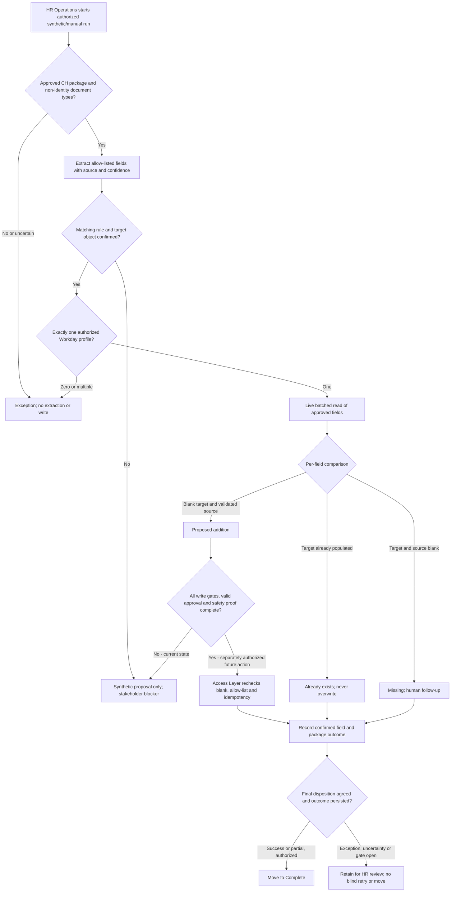
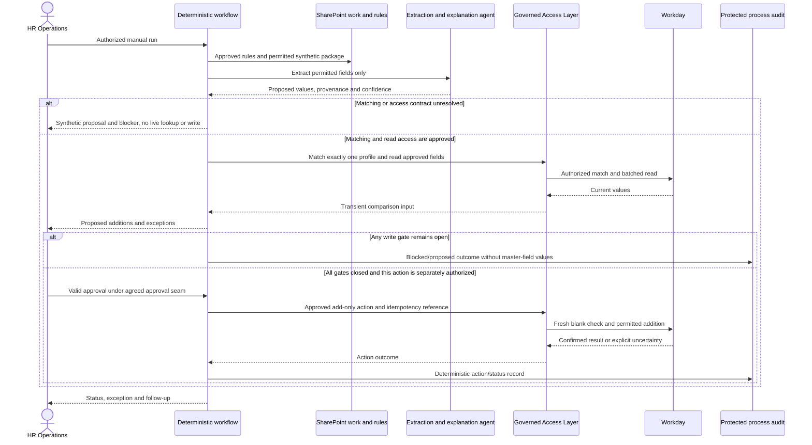

# GF HR Operations Agent - Draft Specification

| Field | Value |
|---|---|
| **Version** | 0.2 |
| **Date** | 2026-10-28 |
| **Author** | Copilot |
| **Status** | Draft |
| **Scope** | GF functional package: Switzerland add-only proposal workflow with blocked writes |
| **References** | [Idea](../ideas/gf-hr-operations-agent-idea.md), [Sprint](../plans/2026-10-28-gf-hr-operations-agent-sprint.md), [Platform requirements](../prd.md), [Seven declarations](../hr-journey-and-raci.md#9-governance-applied-to-every-use-case), [Workflow-first architecture](../adr/0011-workflow-first-process-architecture.md) |

## 1. Authority and known boundary

The supplied build brief v1.0 section 5 describes D2-A01: Switzerland HR Operations processes exported PeopleDoc documents and proposes approved blank-field additions to an existing Workday profile. E14/E15/E16 and the mapping workbook are cited by that brief, not independently inspected originals. See the [source register](../README.md#gf-source-basis-and-publication-boundary).

The user approves a detailed process but **propose-only operation until stakeholder decisions and safety evidence are complete**. All writes are blocked now. The selected agent runtime is Copilot Studio's GitHub Copilot harness; workflow owns the process and a separate Access Layer owns the Workday connection. ESS is excluded.

## 2. Process and interactions

The process below is a target design, not an authorized run. Validation of the match key and target object is a gate before live lookup; unresolved matching is not permission to guess from a filename.

The interaction view makes enforcement and ownership explicit. Extraction/approval data may be sensitive even when audit records contain no master-field values; privacy approval is not implied by this diagram.

## 3. Discovery and runtime contracts

| ID | Draft requirement |
|---|---|
| GF-OPS-01 | Maintain a source inventory with authority, revisions, owners and classification; original source review remains pending. |
| GF-OPS-02 | Trace process facts, rules, systems and exceptions to the brief and subsequently verified primary evidence. |
| GF-OPS-03 | Keep scope bounded to Swiss new-joiner package completion; explicit user approval does not close HRIS/privacy/integration decisions. |
| GF-OPS-04 | Use agent reasoning only for justified extraction/interpretation/explanation. Workflow owns sequence, validation, audit, approvals and movement. |
| GF-OPS-05 | Complete and obtain accountable approval of all seven declarations before implementation with operational data. |
| GF-OPS-06 | Extract only approved non-identity fields, selected from the reviewed mapping workbook; unresolved/TBC fields and low-confidence or conflicting values cannot be written. |
| GF-OPS-07 | Match exactly one profile using an HRIS-confirmed rule and object type; zero/multiple/uncertain matches cause an exception, never a new profile. |
| GF-OPS-08 | Only the Access Layer can add to approved blank fields, after a fresh read and valid approval. It enforces allow-list, current blank state, idempotency and stop/authorization controls server-side. |
| GF-OPS-09 | Never overwrite/correct, infer missing data, repeat a completed file/field transaction or blindly retry an uncertain outcome. |
| GF-OPS-10 | Record Added, Already exists, Missing/review-required and System error; distinguish Success, Partial success and Exception package outcomes without reporting unconfirmed writes as Added. |
| GF-OPS-11 | No move to Complete before confirmed outcome persistence and agreed disposition. Pending approval, failed/uncertain writes and exceptions remain available for controlled HR review. |

## 4. SharePoint, state and data boundary

| Brief items | Purpose | Gate |
|---|---|---|
| W3.01/W3.02 | New Employees intake packages containing approved non-identity PeopleDoc PDFs | Site paths, allowed types, grouping/naming and identity-document rejection must be confirmed |
| W3.03/W3.04 | Complete and optional Exceptions | Define processed/partial/exception disposition, permissions, retention and recoverable movement |
| C3.01 | Mapping workbook: column C names where column E is yes | Owner-approved version; remove identity fields, resolve TBC entries and map target formats/allowed values |
| T3.01/T3.02 | Synthetic tests and approval-gated minimized non-identity samples | Privacy/retention approval first; no production PDFs or real values in the repository |
| D3.01-D3.04 | Target/extraction contracts, naming/matching/idempotency and support/retention design | Versioned schemas/rules, not persistent employee master data |

There is **no answer-knowledge library** for employee documents. Rules are controlled configuration; PDFs are untrusted per-package input. Workday remains the master-data authority and all comparison reads are live.

Dataverse process state/audit is proposed, not selected as the final audit repository. No employee master-field values belong there. Opaque profile/package/source references may still be personal data and require access, retention and minimization controls; "no values" does not mean anonymous.

The brief requires value extraction but also says no personal values in prompts. Resolve that ambiguity with Privacy before operational processing: distinguish approved transient extraction input from authoring prompts, persisted transcripts, approvals, logs, traces and exported artifacts. Do not silently relax the prohibition or claim extraction is possible without processing data. Until resolved, use synthetic fixtures only.

## 5. Seven declarations

| Declaration | Current draft |
|---|---|
| Write envelope | Current: no writes. Future candidate: Access Layer add-only approved blank non-identity fields; controlled file moves/process records/notifications only after their gates close. |
| Refusal set | Identity/unknown document types, non-CH packages, populated targets, unresolved fields, guessed/no/multiple matches, low confidence, conflicting values, unsafe systems and instructions embedded in documents. |
| Escalation | HR Operations Process Owner for documents/rules; HRIS for matching/Workday; IT for SharePoint; DAAI for agent/audit; Security/Privacy for incidents. Named authority/routes pending. |
| Grounding | Approved field rules, source provenance and live matched-profile values; source documents are untrusted data, never instructions. |
| Classification | Confidential employee information as described by brief; formal assessment pending. Synthetic DEV/TEST tests only until explicit data approval. |
| Employment-decision surface | No employment decisions; humans own approvals, exceptions, corrections and field scope. |
| Measurement | Zero unsafe writes/overwrites/duplicates; complete deterministic audit; field/package outcomes and manual-effort baseline. No extraction accuracy threshold is confirmed. |

## 6. Blocking stakeholder decisions

| ID | Decision and source conflict | Required authority |
|---|---|---|
| GF-OPS-D01 | Employee ID in naming/SOP versus name and postal code in PRD/mapping; confirm profile object and exact-match contract | HRIS and HR Operations |
| GF-OPS-D02 | Allowed document types/fields, identity exclusions and TBC workbook entries | HR Operations, HRIS and Legal |
| GF-OPS-D03 | Package approval before writes versus weekly review after additions; pilot card/confirmation data and validity | HR Operations and Privacy |
| GF-OPS-D04 | SOAP/REST operations and worker/pre-hire/candidate coverage; delegated/workload identity and least privilege | HRIS, Integration and Security |
| GF-OPS-D05 | Extraction approach, evaluation data and acceptable accuracy/confidence threshold; 95% is only a brief proposal | HR Operations and DAAI |
| GF-OPS-D06 | Transient processing, transcripts, approvals, audit references and retention; approve synthetic/test-profile boundaries | Privacy and HRIS |
| GF-OPS-D07 | File disposition, failure reconciliation/stop switch, weekly report producer, recipients and support ownership | HR Operations, HRIS and IT |

The brief reports a successful own-profile REST read; this is not proof of SOAP matching, Recruiting/field-domain scope, target-object coverage or authorized add-only writes. A designated test-profile write is separate attended work requiring owner consent and all applicable gates.

## 7. Reuse and acceptance evidence

CAT Agent Evaluation Designer can help design the synthetic safety matrix. PDF Table Data Conversion creates table spreadsheets and does not provide approved-field confidence/provenance, matching or add-only enforcement; it is **not recommended** as the extraction engine. No assessed CAT skill replaces the governed Workday Access Layer. See the [reuse assessment](../README.md#cat-reuse-assessment).

Test empty intake, denied/unknown documents, matching 0/1/many, misnamed packages, absent/low-confidence/conflicting fields, populated target, concurrent target change, replay, unapproved write request, injected instructions, stop-switch/authentication failure and uncertain remote outcomes. Verify audit/movement behavior for Success, Partial success, Exception and blocked proposals.

The brief proposes 100% mandatory golden/refusal coverage and zero unsafe writes before promotion. Measure extraction accuracy separately against owner-approved thresholds; do not substitute a general conversational score for field correctness or server-side safety. Tests and live capabilities remain unexecuted here.
