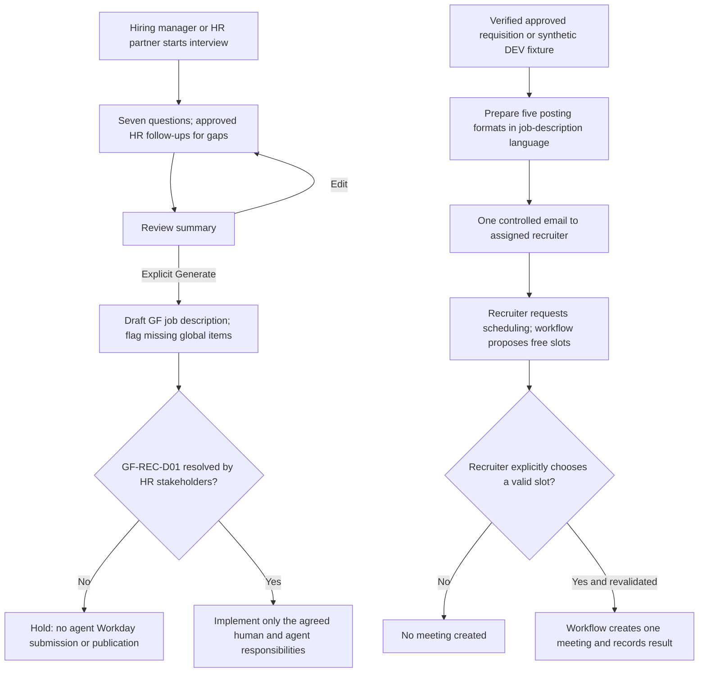
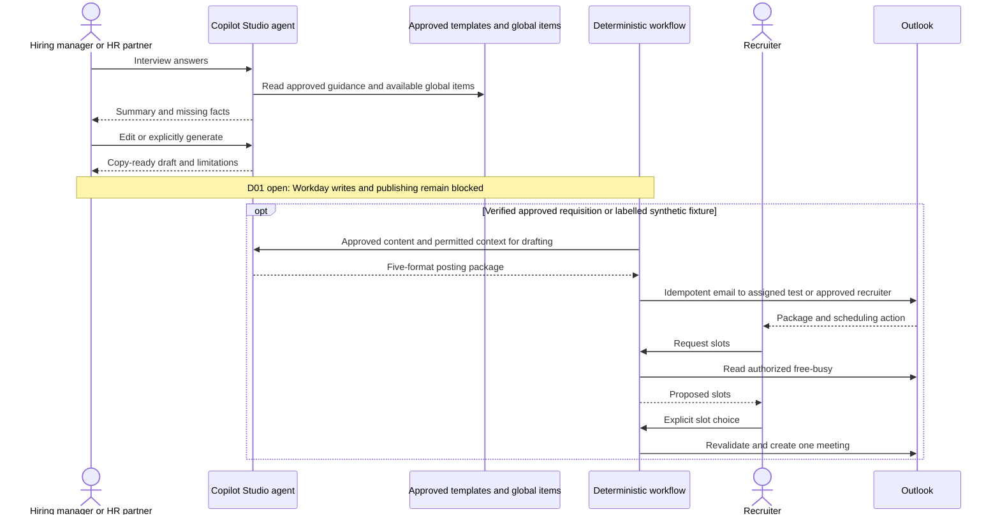

# GF Recruiting: Job Requisition and Job Posting Agent - Draft Specification

| Field | Value |
|---|---|
| **Version** | 0.2 |
| **Date** | 2026-10-28 |
| **Author** | Copilot |
| **Status** | Draft |
| **Scope** | GF functional package: recruiting preparation with stakeholder-gated action scope |
| **References** | [Idea](../ideas/gf-recruiting-requisition-posting-agent-idea.md), [Sprint](../plans/2026-10-28-gf-recruiting-requisition-posting-agent-sprint.md), [Platform requirements](../prd.md), [Write envelope](../adr/0008-human-in-the-loop-and-write-envelope.md), [Governed Workday access](../adr/0009-workday-access-via-connector-behind-governed-layer.md), [Workflow-first architecture](../adr/0011-workflow-first-process-architecture.md) |

## 1. Authority and confirmed scope

Section 4 of the supplied build brief v1.0 describes D1-A01 and cites E20/E21/E22/E43. The original PRD, BOM, SOP and templates remain unreviewed here. The selected platform is Copilot Studio's GitHub Copilot runtime harness, not the brief's standard-harness build proposal; ESS is excluded. See the [source register](../README.md#gf-source-basis-and-publication-boundary).

**GF-REC-D01 is unresolved by explicit user instruction.** Earlier discussion requested approved agent creation of requisitions and publication. The brief requires human Workday entry/submission and manual recruiter publication. HR stakeholders must decide the action boundary. This draft enables neither Workday writes nor publication automation and does not silently choose the manual route as the final agreement.

## 2. Process and interactions

The common preparation flow is specified now; disputed actions end at a decision gate. The downstream handoff is a separate, conditional design requiring a verified approval event or an explicitly synthetic DEV fixture.

The interaction view keeps content reasoning separate from side-effect enforcement. It does not prescribe native Adaptive Cards in the selected harness.

## 3. Draft behavior contract

| ID | Draft requirement and source basis |
|---|---|
| GF-REC-01 | Draft from the approved SOP/templates and user facts; clarify missing information and flag non-inclusive requirements rather than inventing facts (brief 4.1/4.5). |
| GF-REC-02 | Keep requisition creation/submission and publication disabled until GF-REC-D01, approval responsibilities and any write envelope are confirmed. Human approval alone does not establish a connector/action capability. |
| GF-REC-03 | Bind each allowed generation/action confirmation to its content and operation. Changed content must be re-reviewed under the eventual agreed rules. |
| GF-REC-04 | Workflow owns deterministic sequencing, approval/event validation, allowed destinations, audit and failure handling; model output is not authorization. |
| GF-REC-05 | Reconcile email/meeting outcomes before retrying; prevent repeated handoff from replayed approval events and repeated slot selections. |
| GF-REC-06 | Refuse CV screening/intake, candidate assessment/ranking, hiring decisions and protected/proxy-characteristic requirements. |
| GF-REC-07 | Review/edit precedes explicit generation; no generation before the user's Generate action. Validate a supported confirmation UX for the selected harness. |
| GF-REC-08 | Proposed Template A flow uses seven questions in three sections. Global items come only from the approved library; the brief's five-global/up-to-three-local structure needs template-owner validation. |
| GF-REC-09 | Conditional handoff comprises external advert, internal posting, LinkedIn version, recruiter summary and tags in the job-description language, not automatic publication. |
| GF-REC-10 | The brief proposes a 30-minute Teams meeting only after recruiter selection; confirm sender/organizer, permissions, current availability and duplicate handling before enabling it. |

## 4. SharePoint and input/output bill of materials

| Brief items | Role | Current gate |
|---|---|---|
| K2.01-K2.05 | Templates A-C, clean Job Description layout and HR follow-up questions | Originals and approvals pending; final merged question set is open |
| K2.06 | Global responsibilities, competencies and skills per profile | Missing; do not invent; a placeholder is draft-only, not a completed approved description |
| K2.07/K2.08 | Approved samples and inclusive-language guidance | Missing/proposed; avoid importing unrelated legal or screening rules |
| L2.01-L2.04 | Official Employer Branding, Job Scoping, Requisition/Approval and Hiring Journey guidance | Keep as controlled links; URLs/ownership need confirmation |
| T2.01 | Synthetic approved-requisition fixtures in a work/test area | Manual prototype trigger only; cannot prove the live event/read integration |
| W2.01 | Optional generated Word descriptions | Storage, requester/recruiter access, retention and OneDrive/SharePoint choice unresolved |

Templates are guidance/output structure; approved requisition data is a live authorized input, not a SharePoint knowledge substitute. Candidate-screening documents are excluded.

## 5. Seven declarations and stakeholder decisions

| Declaration | Current draft |
|---|---|
| Write envelope | Workday writes/publication blocked by D01. Email, selected-slot meeting and optional document creation are proposed, separately permission/identity/storage-gated side effects. |
| Refusal set | Screening, assessment, employment decisions, bypassing Generate/action confirmations, arbitrary publication, invented global facts or unauthorized reads/writes. |
| Escalation | People Attraction/Recruiting for scope/templates; Workday owner for approved-event/read integration; DAAI for agent behavior; M365 support for scheduling. Named owners/routes pending. |
| Grounding | Approved user inputs, templates, global items, samples and authorized approved requisition; official guidance linked. |
| Classification | Role/requisition content and mail/calendar context may contain personal data; formal classification, consent/access and retention are unresolved. No candidate records. |
| Decisions about people | Humans retain hiring and content/business authority; no candidate judgments. |
| Measurement | Template conformity, complete handoff, safe confirmations, no duplicate side effects and signed-off golden/refusal pass rate. Earlier drafting-time target has no verified baseline. |

Other open decisions are final user roles/countries, global-library scope, approved-requisition trigger and Recruiting read permission, entry channel, language logic, mailbox/organizer, optional output storage and publishing owner. Do not treat the reported existing Workday connection as proof of Recruiting scope.

## 6. Reuse, harness translation and acceptance

CAT [Template-Based Document Generation](../README.md#cat-reuse-assessment) v3.8.0 is a **conditional Word-output candidate**, not the core interview, Workday integration or publication workflow. Its Python/filesystem bundle needs code/dependency/license review, sandbox execution support, template tests and private output/log handling; current reports may contain input values. The skill's permission to derive literals must be restricted by GF's no-invention contract.

Agent Evaluation Designer can shape the test matrix. The CAT Adaptive Card Builder targets standard-harness card/topic nodes; the Cowork Test Planner plugin is not a Copilot Studio runtime plugin. Use a harness-supported confirmation interaction or an independently approved workflow/channel UX; do not promise native cards by pasting JSON.

Test review/edit/generate sequencing, missing global items, template/language conformity, discriminatory input, CV/hiring refusals, prompt injection, denied reads, replayed approval events, one-email behavior, changed/expired slot selection and uncertain Outlook outcomes. D01 remains a blocking test condition: no Workday-write or publishing tool may be enabled while unresolved. The brief proposes 100% signed-off mandatory golden/refusal cases before promotion; actual fixtures, approvals and results remain pending.
