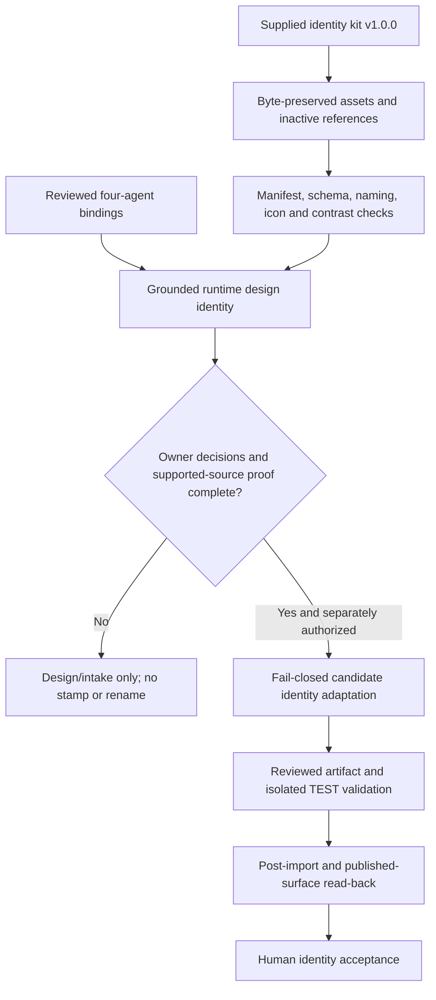
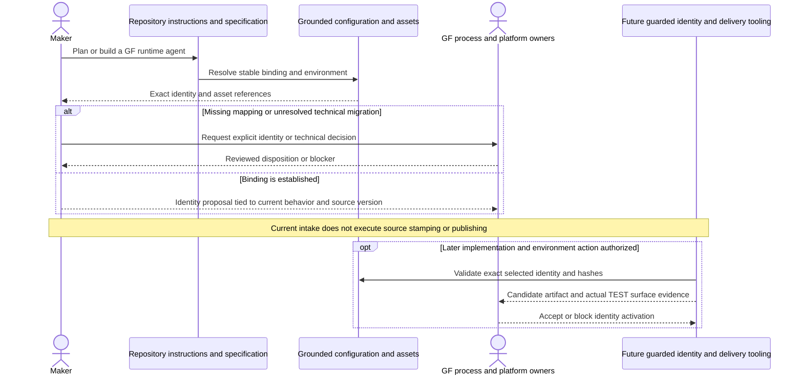

# Caldova Grounded Agent Identity Kit Adoption - Draft Specification

| Field | Value |
|---|---|
| **Version** | 0.4 |
| **Date** | 2026-10-30 |
| **Author** | Copilot |
| **Status** | Draft |
| **Scope** | Caldova project/demo; GF source/customer context: Copilot Studio identities: curated source intake, explicit bindings, design guidance and gated deployment integration |
| **References** | [Idea](../ideas/caldova-agent-identity-kit-idea.md), [Sprint](../plans/2026-10-29-caldova-agent-identity-kit-sprint.md), [Provisional implementation plan](../plans/2026-10-29-caldova-agent-identity-kit-implementation.md), [Kit guide](../brand/gf-agent-identity/README.md), [Bindings](../brand/gf-agent-identity/agent-bindings.json), [Caldova delivery design](2026-10-28-caldova-azure-devops-solution-cicd-design.md), [Blueprint overview design](2026-10-29-caldova-blueprint-progress-overview-design.md), [Existing theme](../brand/README.md) |

## Caldova project and GF source boundary

This is a Caldova project/demo document using the explicitly identified GF source/customer scenario. GF facts, approvals, requirements and trademarks remain GF-scoped; project renaming does not establish Caldova corporate policy or runtime acceptance. See the [source and authority boundary](../README.md#caldova-project-and-gf-source-boundary). Existing stable IDs are retained for traceability, not reassigned.

## 1. Outcome and authority

Make the supplied GF identity package the grounded source for naming and branding every planned/built GF Copilot Studio runtime agent. Preserve the existing Caldova application/theme behavior and distinguish identity adoption from runtime implementation or deployment acceptance.

The user reports GF written approval to **adapt the kit for agents**, and explicitly approved four identity mappings. No formal approval artifact/reference was supplied. The supplied package remains v1.0.0 dated 2026-10-28, labelled proposal for GF approval with unresolved N-1 through N-6/G5 decisions. Do not rewrite that historical source or infer that adaptation resolves technical prefixes, installed names, brand-portal verification or all catalogue hypotheses.

This is the eighth handover package. It does not expand the three workshop MVP commitments or automatically install 37 agents.

## 2. Source and repository ownership

| Surface | Owned content | Treatment |
|---|---|---|
| `docs/brand/` | Existing Caldova CSS/Fluent theme/mockup | Unchanged; demo identity/provenance and semantic/accessibility behavior preserved |
| [GF kit root](../brand/gf-agent-identity/README.md) | Maintained adoption guide, bindings and manifest | Canonical GF identity navigation |
| `config/`, `agents/`, `brand/`, `visuals/` inside kit | 442 supplied configuration/asset files | Source bytes unchanged; generated assets are not hand-edited |
| `reference/` inside kit | 24 original Markdown/code/pipeline/instruction/fixture files | Exact content with `.txt` suffix; inactive evidence/reference, no executable integration |
| [Scoped instructions](../../.github/instructions/gf-agent-identity.instructions.md) | Repository guidance for GF runtime designs/source | Links to canonical kit; does not copy broad upstream `applyTo: "**"` or automatic stamp instructions |
| Current GF specifications | Their behavior, scope, owners and activation gates | Link to identity binding; do not inherit stale source descriptions/platform states |

The manifest records all 466 source files with source path, curated path, size, SHA256 and role. A matching hash proves byte identity, not legal approval, safety or tenant readiness. Original code is not executed during intake.

Kit-local Git attributes set imported subtrees to `-text`, preserving exact bytes
across Windows/Unix checkout without changing repository-wide newline policy.

Retain the Fluent glyph MIT notice and GF trademark statement verbatim. Source logos/cards/visuals are supplied references for authorized GF adaptation; no new logo variant or unrestricted-public-use license is claimed. No Caldova logo is added.

## 3. Adopted identities and coverage

| Package | Source ID / asset folder | Display base | Identity status here |
|---|---|---|---|
| Policy | D3-A01 / `hr-policy-assistant` | HR Policy Assistant | Adopted binding; not deployed |
| Recruiting | D1-A01 / `recruiting-job-posting` | Recruiting Job Posting | Adopted binding; not deployed |
| HR Operations | D2-A01 / `hr-ops-master-data-ch` | HR Ops Master Data CH | Adopted binding; not deployed |
| ESS-equivalent | D3-A02 / `hr-ops-self-service` | HR Ops Self-Service | Adopted identity; current six-operation specification remains behavioral authority |

For DEV/TEST read exact `displayName.<ENV>` and corresponding icon files from the per-agent JSON. PROD uses the clean base icon/name. Use stable IDs and asset paths, not inferred matches from similar display titles.

The full source catalogue contains 29 environment-scoped runtime identities and 8 repository identities. Preserve hypotheses/deferred/out-of-scope labels and keep those records out of the committed delivery inventory unless separately selected.

All future GF runtime agents need an explicitly approved binding or extension with generated identities/assets and tests. An unmapped agent blocks identity readiness; no invented fallback colour/glyph/name. Technical packages and the repository-working Blueprint Maintainer have no runtime identity mapping.

## 4. Identity contract

| ID | Requirement |
|---|---|
| IDN-01 | Resolve each GF runtime design/source to a stable identity binding and versioned source; preserve technical/public identity distinction. |
| IDN-02 | Use exact source display names, descriptions only after content review, journey colours and environment-specific icon paths. Never hand-edit imported generated values. |
| IDN-03 | Apply DEV/TEST display/description markers and icon bands; PROD has no postfix/band. Source size limits are 30 display characters, 25 base characters, 80 short description and 4000 full description. Verify current host constraints before publication. |
| IDN-04 | Keep schema/solution/variable/reference/workflow/folder identifiers environment-neutral; do not migrate existing names or choose `gf`/`gfhr` without owner decisions. |
| IDN-05 | Preserve source palette and contrast: each glyph/background and marker label pair meets at least 4.5:1. Keep journey/environment colours separate from application semantic status tokens. |
| IDN-06 | Use square 192/32 colour PNGs and 32 transparent outline with retained vector source, source-recommended safe area and maximum icon payload of 100 KiB. Readability/rendering need visual host tests too. |
| IDN-07 | No source `ess`/later-wave/factory metadata overrides current GitHub-harness choice, functional scope, repository portfolio or deployment status. |
| IDN-08 | Keep imported scripts/pipelines inactive until fail-closed target-format, identity-match, atomic-write and release-artifact contracts are proven. |
| IDN-09 | Include exact identity/config/icon hashes and post-import observation in later release evidence; static intake tests do not attest a deployed identity. |
| IDN-10 | Preserve notices, customer disclosure boundaries, demo-theme bytes and unrelated supplied blueprint content. |

The source's PO interpretation, vocabulary, publisher prefix, selected display names, combined ESS naming and site/infrastructure patterns remain owner decisions where not specifically resolved by the adopted bindings. Source `gf` examples do not override prior `gfhr` proposals or mutate existing schemas.

## 5. Process and interaction

The current intake stops at validated assets, mappings and design guidance. Later source stamping/publishing has separate gates.

The interaction view assigns identity choices to reviewed source and owner decisions, not generative guesses.

## 6. Automation admission gaps

The supplied stamper recognizes `bots/*/bot.xml` and can use broad prefix/suffix matching. It can warn or return success when no bot/name/icon is available, and can write earlier components before a later unmatched strict result. Those are not sufficient fail-closed guarantees.

Before adapting it, require:

1. Actual GitHub-harness export/manifest field proof; no assumption that classic `bot.xml` or observed Teams fields are portable.
2. Exact unique schema mapping from reviewed exports; no short-suffix guessing or ambiguous multi-match.
3. Missing/unknown component/name/icon/manifest must block a requested identity change.
4. Preflight every selected component before any write, preserve other content, detect concurrent changes and replace atomically.
5. Dry run is non-writing; repeated same-input application is a no-op; source/generator/tool versions are recorded.
6. Resolve distinct TEST/PROD identity bytes against the release model. Do not claim identical artifact promotion when names/icons differ, or rebuild production under an unchanged artifact identity.
7. Test actual Copilot Studio, Teams/M365 publication and cache/read-back behavior with authorized non-production identities.

The source's generator needs Node/Playwright and includes GF logo-based visuals. It is not installed merely by copying reference text. A future admitted generator must use a pinned dependency/runtime, preserve notices, produce deterministic output and be reviewed for filesystem/network effects.

## 7. Repository integration and legacy guard

Link the four Caldova runtime specifications, the Caldova GitHub-source
repository/delivery designs and the blueprint overview to the grounded GF kit.
Its guidance applies to the explicitly identified GF customer/source scenario.
Caldova document renaming is not a change to corporate branding, technical
runtime identities or the repository-agent portfolio.

Add a test wrapper to existing maintained Pester discovery; no new GitHub workflow is needed. Tests cover imported hashes/inventory, source JSON schema, exact mapped identity, names/environment behavior, icon payload dimensions/size, SVG external-code/reference exclusion and recomputed contrast. Pixel-level icon quality, channel rendering and host instruction loading are separate evidence.

The original pre-intake report recorded 87 findings and zero recognized
exceptions. The subsequent integer-parser repair restores recognition of seven
existing approved evidence records under PowerShell 7, without adding exceptions
or changing immutable evidence. Expanded strict units now pass 35 cases under
both PowerShell 5.1 and 7. The actual branding gate remains blocked by retained
customer/source names and paths, not by that parser defect.

### Approved scoped source-classification amendment

The user explicitly approved this scoped amendment on 2026-10-30. Its governing
authority and pinned exact registry are recorded in the
[Approved branding design](2026-10-01-caldova-branding-migration-design.md).
The prior unavailable-user state is superseded by that explicit approval, not
by inference. This identity-adoption specification itself remains Draft; runtime,
disclosure, source-copy and tenant approval gates are unchanged.

The amendment distinguishes intentional source provenance from prohibited active
project branding, subject to all of these conditions:

1. Classify supplied identity inputs, the original blueprint and historical
   manifests by exact path, source version/hash and provenance. Preserve all
   original bytes, notices and licence restrictions.
2. Separately review maintained customer-source citations and legacy technical
   identifiers. Bind admitted path/content classes and counts to the reviewed
   file hash and approval reference; do not allow every occurrence in a folder.
3. Keep the existing seven AI Builder exceptions unchanged. Do not reuse that
   exception authority to invent permission for retained customer paths.
4. Fail on unknown paths/classes, changed unapproved bytes/counts, invalid
   provenance or missing approval. Test both authorized-source cases and
   unexpected names in active code/configuration; no general customer-name ban
   removal or automatic rehash-and-approve operation.
5. Treat source classification as repository hygiene only. It grants no
   publication/disclosure licence, destination approval, runtime admission or
   authority to copy source, and does not change Caldova theme or HR safety gates.

The scanner implements exact per-file hashes and class/count sets with atomic
fail-closed validation. The approved policy pins the registry's normalized hash;
the registry cannot approve itself or absorb evidence-root records. The seven
existing evidence exceptions are unchanged. Strict unit/regression checks passed
60 cases on each host. Actual source admission reports zero findings, and the
complete maintained suite passed 1,667 tests with zero failures and three existing
evidence-dependent skips. The [handover](../reviews/2026-10-29-caldova-project-handover-review.md)
records those results separately from disclosure and operational approval.

## 8. Acceptance and next review

| Area | Current intake evidence / later gate |
|---|---|
| Source fidelity | All 466 source paths preserved byte-for-byte; imported data and reference roles recorded |
| Runtime coverage | Four explicit bindings; all future unmapped runtime agents require owner review |
| Authority | User-reported written adaptation approval distinguished from original proposal and remaining decisions |
| Static asset quality | Source schema, naming, environment, dimensions/size/SVG and contrast checks |
| Preservation | Caldova tokens/theme/mockup and supplied blueprint remain unchanged |
| Deployment | No source stamping, rename, icon upload or runtime status claim; later proof required |
| Publication | Approval/reference, notices, target inventory and legacy guard policy review before public transfer/merge |

Written-spec review was requested but the user was unavailable. The [implementation plan](../plans/2026-10-29-caldova-agent-identity-kit-implementation.md) is therefore a provisional Draft, not described as user-reviewed. It separates the completed curated intake from unimplemented automation/activation with test-first slices and technical/approval gates. No commit, push, customer transfer or tenant changes are implied.
