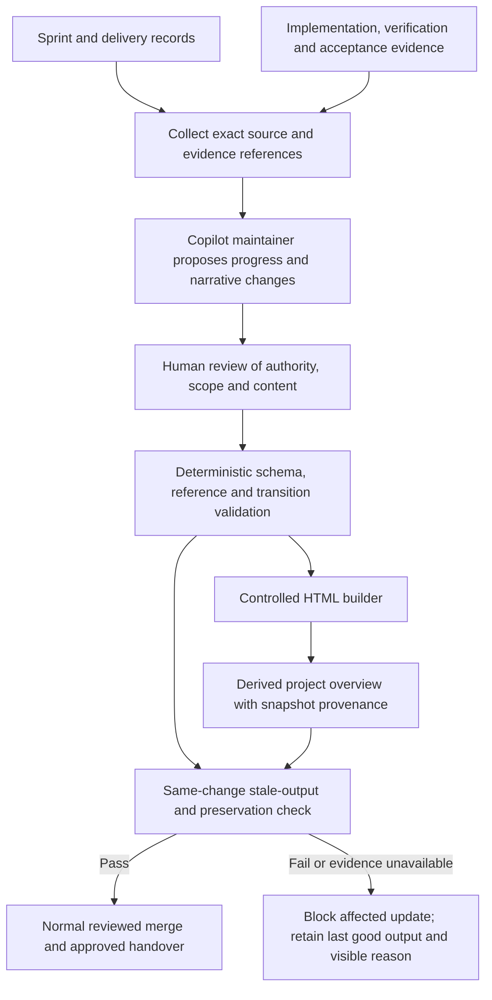
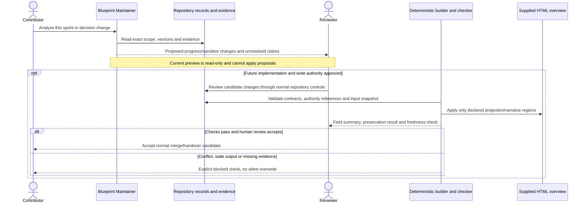
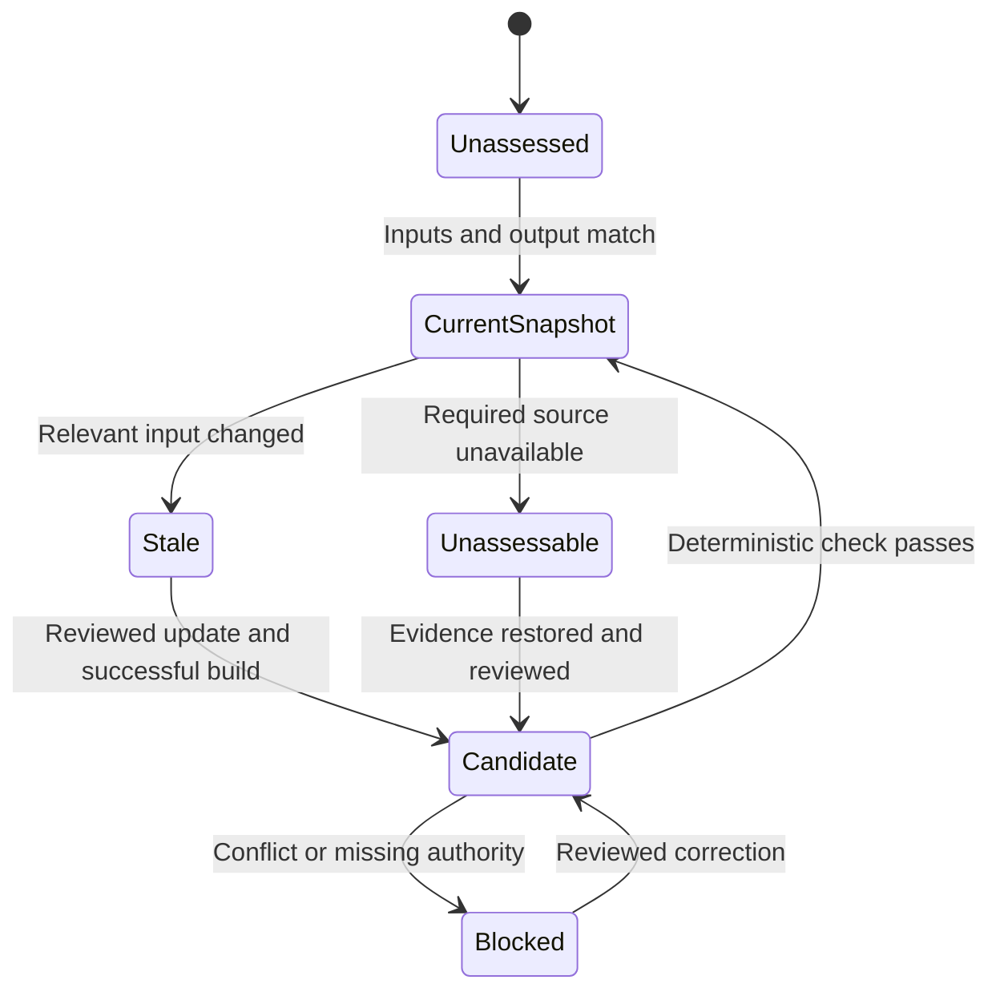

# Caldova Blueprint Progress Overview and Maintainer - Draft Specification

| Field | Value |
|---|---|
| **Version** | 0.2 |
| **Date** | 2026-10-29 |
| **Author** | Copilot |
| **Status** | Draft |
| **Scope** | Caldova project/demo; GF source/customer context: repository project overview: controlled HTML projection, reviewed narrative updates and gated Copilot maintainer |
| **References** | [Idea](../ideas/caldova-blueprint-progress-overview-idea.md), [Sprint](../plans/2026-10-29-caldova-blueprint-progress-overview-sprint.md), [Provisional implementation plan](../plans/2026-10-29-caldova-blueprint-progress-overview-implementation.md), [Documentation authority](../README.md#authority-and-conflict-order), [Approved repository-agent portfolio](2026-10-02-hr-frontier-copilot-agent-portfolio-governance-design.md), [Caldova repository target](2026-10-28-caldova-azure-devops-repository-design.md), [Caldova delivery design](2026-10-28-caldova-azure-devops-solution-cicd-design.md) |

## Caldova project and GF source boundary

This is a Caldova project/demo document using the explicitly identified GF source/customer scenario. GF facts, approvals, requirements and trademarks remain GF-scoped; project renaming does not establish Caldova corporate policy or runtime acceptance. See the [source and authority boundary](../README.md#caldova-project-and-gf-source-boundary). Existing stable IDs are retained for traceability, not reassigned.

## Grounded runtime identities

Future blueprint identity/narrative proposals must resolve the
[GF kit bindings](../brand/gf-agent-identity/README.md#3-adopted-identities)
and record their version/approval scope. The imported catalogue's 37 identities
are not 37 approved runtime agents, and its eight factory identities do not
rename the repository-working Blueprint Maintainer. The
[adoption specification](2026-10-29-caldova-agent-identity-kit-design.md) governs
technical/visual integration gates. This intake leaves the supplied HTML unchanged.

## 1. Outcome and current delivery boundary

Provide a traceable, current-at-its-recorded-snapshot project overview in the supplied [Georg Fischer blueprint](../Georg%20Fischer%20Frontier%20Company%20Blueprint.html). A repository-working GitHub Copilot maintainer analyzes sprint/evidence changes, while deterministic tooling validates and projects reviewed progress and narrative changes into declared HTML sections.

The user selected repository records/evidence first, Azure Boards later; updates in the same reviewed change; narrative changes only when supported by reviewed decisions; and a controlled layer in the existing HTML rather than a full generator migration.

This change prepares the four planning artifacts and the previously approved, manually invocable **read/search-only preview profile**. Written-specification review remains pending as recorded in section 11. It does not implement the renderer, enable writes/execution, modify the imported HTML, activate continuous synchronization, publish a website or transfer the repository.

The seventh package is delivery-enablement work, not a new approved HR runtime MVP.

## 2. Inspected baseline and preservation requirements

| Finding | Design consequence |
|---|---|
| The imported HTML is approximately 1.2 MB, with embedded `script#bp-data` JSON and a separate renderer | Parse bounded structured content without dumping/reasoning over encoded assets; no free-form whole-file agent edits |
| Schema is `frontier-blueprint/1.0`; metadata identifies hypothesis v0.5 dated 2026-10-28 | Record source/schema compatibility; retain its hypothesis meaning rather than treating it as delivery status |
| It contains three workshop PRDs and a wider portfolio | Map all eight Caldova project packages explicitly; technical/proposal work is not automatically an additional approved customer MVP |
| Renderer attribution identifies the Frontier Envisioning plugin and MIT-noticed renderer code | Preserve attribution and original assets; no original generator source has been found in this repository |
| It is self-contained, with no external asset references found during static inspection | Keep the local/offline overview self-contained; no runtime remote repository/tenant calls or embedded tokens |
| Workshop/discovery notes use browser localStorage keyed by blueprint ID/version | Notes are non-shared until exported/reviewed; version changes need explicit preservation/migration handling |
| File metadata and evidence labels indicate a customer audience | This is not a public-release or privacy determination; inspect the actual handover inventory before sharing |

Preserve the supplied file during planning. In implementation, require byte preservation outside declared managed HTML regions, semantic preservation of all unapproved blueprint fields, and unchanged embedded-asset values/attribution. Existing renderer code is not an unlimited edit surface.

## 3. Authority and progress model

The blueprint is a projection, never a competing backlog, approval record or source of implementation truth.

| Dimension | Meaning and evidence |
|---|---|
| Document lifecycle | The owning idea/spec/sprint/plan metadata, such as Draft or Approved; does not determine implementation |
| Delivery state | Explicit work record: Unreported, Not started, In progress, Blocked or Implemented; distinguish reported assertions from corroborated source changes |
| Verification | Result, scope, environment, source/artifact revision and test/read-back evidence; a documentation pass is not runtime verification |
| Acceptance | Explicit human disposition and scope; test pass or agent recommendation is not human acceptance |
| Freshness | Exact relevant-input match, mismatch/stale, or unassessable; a new generation timestamp alone proves nothing |
| Hypothesis/workshop validation | Existing blueprint/browser validation concepts; do not overload them with delivered/accepted status |

`Unreported` is the honest initial delivery state when there is no execution record. Do not mark a work package Not started, In progress or Blocked merely because its specification is Draft or has open activation gates. Surface readiness gaps separately from actual delivery blockers.

Implemented, verified and accepted claims require corresponding evidence of that scope. A capability may be implemented in source while still unverified in TEST. An operation demonstrated in DEV is not production-ready. Partial evidence never means an entire package is complete.

No inferred weighted completion percentage is permitted. Counts may describe actual recorded states, with unknown/unreported items visible and the denominator clear.

### Package and blueprint mappings

Use all eight existing central idea identifiers as legacy traceability keys:
`IDEA-GF-POLICY`, `IDEA-GF-RECRUITING`, `IDEA-GF-HR-OPERATIONS`,
`IDEA-GF-REPOSITORY`, `IDEA-GF-SOLUTION-CICD`, `IDEA-GF-ESS`,
`IDEA-GF-BLUEPRINT` and `IDEA-GF-AGENT-IDENTITY`. Current document ownership is
the Caldova project/demo. Keep GF source/customer scope and original three
workshop MVPs distinct; no ID is renumbered or interpreted as new acceptance.

Declare links to blueprint PRD/domain/agent/use-case IDs explicitly after inspecting their actual values. Never infer identity from similar titles. Preserve existing IDs; a package can map to multiple blueprint elements or have no runtime-agent counterpart. The ESS package remains a separately proposed build unless authoritative scope evidence changes that disposition.

## 4. Responsibilities and update flow

The intended flow separates interpretation from enforcement. The preview agent currently stops at a recommendation; write/render/check stages are future implementation.

| Participant | Owns | Does not own |
|---|---|---|
| Blueprint Maintainer preview | Repository reads/search, evidence analysis, proposed changes and explicit uncertainty | Source edits, shell/render commands, external systems, status approval or a freshness guarantee |
| Future write-enabled maintainer | Narrow proposed record/narrative changes inside reviewed allowed paths | Arbitrary HTML edits, evidence invention, direct publication/merge or altering unrelated architecture |
| Deterministic tooling | Schema/reference checks, declared patch application, reproducible projection, preservation and stale checks | Deciding whether evidence is truthful or granting approval from a Boolean field |
| Human owner/reviewer | Authoritative scope/narrative/acceptance decisions, review and handover authorization | Treating agent output as independent evidence |
| Existing validation pipeline | Reject stale/inconsistent/unsafe updates using the reviewed check command | Autonomous semantic approval or deployment to customer systems |

GitHub Copilot working on repository files is distinct from the HR agents running in Copilot Studio. The maintainer receives no Workday, Work IQ, SharePoint, mailbox, tenant or runtime-agent privilege.

## 5. Proposed repository inputs and evidence contract

The following paths are **planned**, not created by this specification:

| Intended path | Responsibility |
|---|---|
| `.github\blueprint\package-map.json` | Stable package IDs, exact source paths, blueprint mappings and package kinds |
| `.github\blueprint\progress.json` | Explicit reported progress, blockers/next actions and evidence references; not a new independent authority |
| `.github\blueprint\narrative-updates.json` | Declared field-targeted proposals, preconditions, source/authority references and human disposition |
| `.github\blueprint\schemas\` | Strict contracts, enums and allowed fields; no arbitrary script, URL, filesystem path or JSON patch execution |
| `.github\blueprint\delivery-panel.js` | Future managed display component; no duplicate copy of the imported renderer or branding |
| `.github\cli\Update-BlueprintOverview.ps1` | Future explicit Build/Check entry point with local paths, no publication |
| `.github\cli\blueprint\blueprint_overview.py` | Future bounded parser/projector and deterministic checks, using standard-library parsing rather than executing HTML |

Each evidence reference records its kind, exact source path or approved external pointer, relevant stable ID/section, source revision/hash, claim scope and verification/acceptance context. Runtime evidence includes the actual environment/artifact/run scope; document evidence stays document evidence. No invented Board item, pipeline run, owner, date or metric is accepted.

Existence and hashing verify identity, not truth. A local file with `approved: true` or `passed: true` is not sufficient proof by itself. Evaluate provenance, recorded authoritative disposition and human review; unavailable/conflicting evidence is visibly unverified and blocks promotion of the affected claim.

Keep personal data, tenant values, confidential attachments and raw execution evidence out of these projection records. Use minimized references with appropriate classification/access review. Customer-facing source labels do not make underlying employee documents safe to copy.

## 6. Reviewed narrative changes and controlled rendering

The selected approach changes declared blocks in the existing HTML, not the entire source-generation architecture.

### Narrative contract

A proposed narrative change identifies a stable target record/allowed field, expected old-value hash, proposed replacement, source references, authority and intended claim scope. Do not accept arbitrary JSON Pointer/code strings or array positions whose identity can drift.

Only reviewed decisions with sufficient authority may change customer scope or factual narrative. A Draft plan can support "proposed" text but not "GF approved", "implemented" or "deployed". Preserve open decisions and contradictory evidence for review rather than reconciling by inference.

The renderer's hypothesis/validation labels do not substitute for document authority. Narrative proposals cannot rewrite evidence records, approval history, stable IDs, branding, user-access settings or executable code by default.

### Managed HTML regions

Define explicit managed markers for delivery data and its display extension, plus a bounded update of `script#bp-data` when a reviewed narrative proposal applies. Require exactly one target data block and supported schema. Unknown structure, duplicate markers or incompatible renderer version causes an explicit stop.

Preserve bytes outside these declared regions. For blueprint JSON, compare unapproved fields and asset values before/after rather than assuming a serializer preserved them. Generate a field-level change summary so reviewers do not have to inspect a megabyte-long minified line.

Apply changes only if the expected source value matches, or the exact desired value is already present with matching decision provenance. An already-applied patch must be a deterministic no-op, not an error or repeated transformation. Conflicting/manual edits are preserved and reported for rebase/review.

The following interaction defines the intended agent/builder division, not an available tool sequence today.

Use JSON serialization safe for an HTML script-data context, including escaping `<` so source text cannot terminate a script block. Render untrusted titles/notes with text APIs. Validate links against allowed local paths/reviewed schemes; do not permit `javascript:` or arbitrary executable content. Preserve existing embedded images without adding new logo assets.

Writes use an independently built/validated candidate and a source-change check before atomic replacement. Failure must not partially rewrite the original or replace it with an empty/success-shaped fallback.

## 7. Freshness and same-change validation

Fingerprint the relevant mapped source/evidence content, normalized input records, approved narrative proposals, builder/template version and unmanaged blueprint baseline. Exclude generated projection blocks, their own output hash and volatile current-HEAD/working-tree metadata from the freshness comparison to avoid circular staleness. An unrelated commit or the generated output itself becoming dirty must not invalidate unchanged inputs.

Report source snapshot identity and dirty/uncommitted state explicitly. Do not invent a commit SHA for working-tree content. Separate original blueprint metadata, last evidence/verification time and projection snapshot identity; generation time is not a verification claim.

Given the same inputs and snapshot metadata, Build must be byte-reproducible and idempotent. Do not add a fresh wall-clock timestamp on every build. Check performs no write and fails on stale/missing/inconsistent output, unresolved required references or unauthorized changes.

States are:

"Always updated" means a same-change freshness gate and visible snapshot limitations, not a continuously running agent. Configure the check within the existing validation workflow; introduce no new GitHub-only autonomous publisher. Plan the equivalent step in GF's Azure DevOps validation path once that package establishes it.

A failed check retains the last good HTML, identifies the affected input/claim and blocks integration of that change. A human may decide a documented deferral only under repository policy; the system must not silently call stale output current.

## 8. Browser feedback and version handling

The existing localStorage key includes blueprint ID and version. Keep delivery snapshot identity separate from that namespace. Before any authorized change to blueprint ID/version, require an export/backup and a tested explicit migration path; never silently clear or abandon notes.

Imported feedback is untrusted data. Verify blueprint ID/version, allowed fields, schema, classification and duplication before making a review proposal. A browser "answered"/"validated" note does not close an implementation gate or approve a narrative change by itself.

Do not upload local browser storage or feedback automatically, and do not read user browser profiles from repository tooling. The reviewer supplies an explicitly selected export when feedback is to be incorporated.

## 9. Gated profile and proposed portfolio amendment

The approved repository-agent portfolio contains exactly twelve target roles; the existing Docs Agent is Markdown-only. This design does not silently rewrite that approval or make a thirteenth operational agent active.

The user specifically approved a **manually invoked read-only preview** during planning. The [workspace profile](../../.github/agents/blueprint-maintainer.agent.md) uses `tools: [read, search, todo]`, manual invocation enabled, model invocation disabled and no model override. It can analyze and recommend changes in chat; it cannot edit records/HTML, execute validation or access remote systems.

Its status is Proposed Baseline, labelled Gated preview. The current three operational profiles remain unchanged. The profile may not claim that a renderer, freshness gate or automatic update has run; if structured sources/tooling are absent or a large embedded payload cannot be safely assessed, it reports that limitation.

Full activation needs a reviewed companion portfolio amendment accepting this narrow role, confirmation of documentation-cleanup prerequisites, exact allowed paths/tools, deterministic scope/diff checks, successful implementation tests and human acceptance. A generic `edit` or `execute` tool grant is not path enforcement.

Future permissions must be confined to proposing the defined input/narrative records and invoking the approved builder/checker. No evidence creation, source-status promotion, tenant mutation, arbitrary command execution, publication, merge or external communication is admitted. Separate agent convenience from actual enforced controls.

## 10. Customer handover and acceptance

The handover set includes idea, sprint, specification and implementation plan; the preview profile and unchanged imported HTML are supporting resources. This is the seventh package, not a change to the original three workshop-MVP commitments.

Before customer transfer, review an explicit inventory covering the HTML, required linked documents, input schemas/mappings, admitted agent/tooling, attribution and build/freshness manifest. Exclude Git history unless separately reviewed, private configuration, raw evidence, browser notes and non-approved sources. A visibility label is not a release authorization.

Test from a clean receiving folder, without access to the original workstation, localStorage or tenant credentials. Verify local navigation/links, keyboard use, error/stale indicators, source provenance and the update/check instructions. Include hashes and an explicit as-of snapshot; no public hosting or network API is required.

| Acceptance area | Required proof in implementation |
|---|---|
| Status honesty | Draft/checkbox/browser validation cannot become implemented/verified/accepted; unknowns remain visible |
| Scope and narrative | Explicit package mapping; correct authority/provenance; three baseline MVPs not inflated by technical/proposal work |
| Preservation | Original unapproved data, assets, attribution and unmanaged HTML regions unchanged; unsupported schema/manual conflict stops safely |
| Determinism/freshness | Same-input no-op; source change causes read-only Check failure; rebuild restores consistency without circular/timestamp churn |
| Feedback/security | Notes preserved across approved version handling; malicious feedback/script text/links cannot execute or change authority |
| Agent boundary | Preview has no edit/execute/network/delegation/merge capability and reports not-run checks honestly |
| Handover | Clean-folder offline use, approved inventory, resolvable local links, manifest match and named recipient acceptance |

## 11. Open decisions and next step

Named update/review/acceptance owners, formal portfolio-amendment disposition, per-package evidence definitions, allowed narrative-field list, source schema markers and approved handover inventory remain to be established during implementation. No freshness-age target, timeline, percentage or external identifier is invented.

Written-specification review was requested but the user was unavailable. The [implementation plan](../plans/2026-10-29-caldova-blueprint-progress-overview-implementation.md) is therefore provisional, not described as user-reviewed. The previously explicitly approved read-only preview and its focused tests are the only implementation slice permitted in this change. The writer, progress registry, renderer, stale gate and full-role activation remain blocked pending review and their own controls.
